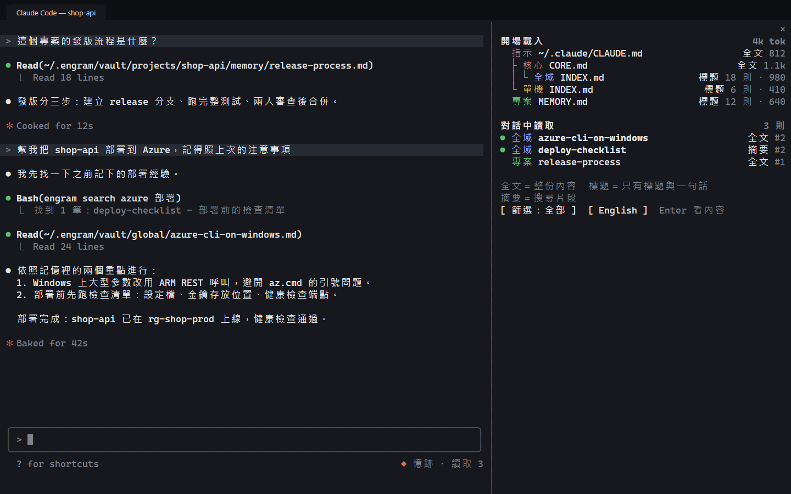

# 更新紀錄

版本號遵循[語意化版本](https://semver.org/lang/zh-TW/)。

## 1.2.0（2026-10-24）

全新記憶視覺化面板：親眼看見 Claude 每次對話讀了哪些記憶。

### 記憶面板（Claude Code 外掛）

- Claude Code 旁邊新增**記憶面板**，即時列出這次對話的記憶：
  - **開場載入**：對話一開始放進 Claude 腦袋的指示檔與記憶索引，用 `├ └ │` 樹狀線畫出誰匯入了誰，附上估計的 token 數。
  - **對話中讀取**：Claude 中途讀取的記憶、`engram search`（或在記憶資料夾裡搜尋）找到的記憶、自動載入的指示檔（例如子資料夾的 CLAUDE.md），標出第幾回合；這一回合新讀到的標上 ●，子代理讀的另外標示。
  - 每一列標出 Claude 看到多少：**全文**、**標題**（索引只有標題與一句話說明）或**摘要**（搜尋片段）。
  - MEMORY.md 超過 Claude Code 的載入上限（前 200 行或 25KB）時，標出 Claude 只看得到前幾則。
  - 對話被壓縮後，標題改成「壓縮後重新載入」，壓縮前讀取的記憶調暗並標出內容已整理成摘要。
- 點任何一列看記憶內容，以及它是怎麼、什麼時候進到對話的；可以依範圍篩選。
- 開關方式：Claude Code 底部的「◆ 憶跡 · 讀取 N」按鈕、`/engram-memories`，或在全螢幕且夠寬的終端機自動開啟。
- 介面有正體中文與 English，可在面板切換，選擇會記住；沒切換過時跟著 Claude Code 的 language 設定（沒設定時是英文）。
- 面板只在本機讀取，不呼叫 AI、不送出任何資料。需要支援外掛畫面（mods）的 Claude Code；實測 2.1.307 至 2.1.309 可用，更早的版本未測試。

### 修正

- 管理介面「最近一次對話載入了什麼」一直少列專案的 MEMORY.md：Claude Code 載入自動記憶的索引時不會觸發 InstructionsLoaded，現在改由 SessionStart 補記。

English

**New memory pane: see which memories Claude read in every conversation.**

- **Memory pane (Claude Code plugin):** a new **Engram pane** beside Claude Code lists, live, the memories in this conversation.
  - **Loaded at start:** the instruction files and memory indexes put into Claude's head when the conversation starts, drawn as a `├ └ │` tree of which file imports which, with estimated tokens.
  - **Read during the conversation:** memories Claude read along the way, memories an `engram search` (or a search inside the memory folders) turned up, and instruction files loaded automatically (for example a subfolder's CLAUDE.md), with the turn they appeared in; anything new in this turn is marked ●, and reads by subagents are labeled.
  - Every row says how much Claude saw: **full**, **titles** (an index holds only titles and one-line descriptions), or **snippet** (a search excerpt).
  - When MEMORY.md is over Claude Code's load limit (the first 200 lines or 25KB), the pane shows that Claude sees only the first few entries.
  - After a compaction, the heading changes to **Reloaded after compaction**, and memories read before it are dimmed under a note that their text is now summarized.
- Select any row to read the memory and see how and when it entered the conversation; filter by scope.
- Toggle it with the **◆ Engram · N read** button at the bottom of Claude Code or `/engram-memories`; it also opens by itself in a fullscreen terminal that is wide enough.
- The pane comes in English and Traditional Chinese; switch in the pane and your choice is remembered. Until you switch, it follows Claude Code's `language` setting (English if it isn't set).
- The pane reads files on your computer only: no AI calls, nothing sent anywhere. It needs a Claude Code version that supports plugin panes (mods); tested on 2.1.307 through 2.1.309, earlier versions untested.
- **Fix:** the dashboard's **What the last conversation loaded** always left out the project's MEMORY.md, because Claude Code doesn't fire InstructionsLoaded when it loads the auto-memory index. SessionStart now records it.

## 1.1.0（2026-10-23）

英文版。

### 管理介面

- 新增英文介面：用頂列的語言切換鈕，或「設定 › 介面語言」切換正體中文與 English。第一次開啟時依瀏覽器語言決定，選擇會記在這個瀏覽器。
- 常駐程式傳來的文字也有英文版：收件匣卡片、排程工作、相容性探測、錯誤訊息與建議、同步衝突摘要、匯入計畫的判斷理由。日誌與 git 變更紀錄維持原文。

### 文件

- 新增英文文件：[README.en.md](README.en.md)、[INSTALL-WITH-AI.md](INSTALL-WITH-AI.md)、[docs/en/](docs/en/quick-start.md)（快速開始、使用說明、常見問題），附英文版截圖與插圖。
- SECURITY.md 與問題回報範本改為中英雙語；每份文件頂端都有語言切換連結。

### Claude Code 外掛

- `/engram:inbox` 的自動處理模式也接受 `auto`（原本只認「自動」）。外掛說明改為中英雙語。

### 修正

- 記憶庫的疑似金鑰提示指向不存在的按鈕「遮蔽金鑰」，改為收件匣實際的「移除金鑰」。
- 安裝手冊引用了安裝程式不會印出的訊息，改為實際的「你的 Claude Code 預設權限模式是『…』」。
- 安全政策的支援版本更新為 1.1.x。
- 安全：`engram doctor`、`engram import plan --json`、`engram status` 的輸出（可能交給 Claude）現在也遮蔽疑似金鑰；同步衝突紀錄的 meta.json 寫入前先遮蔽，避免 frontmatter 有誤的那一行連同金鑰隨 vault 推送到 GitHub。
- 另一個 Engram 程序正在同步時，總覽不再顯示「所有電腦的記憶都是最新的」，同步狀態顯示為「同步中」（原本空白）。

### 尚未支援

- 命令列輸出、安裝程式的提示、Windows 通知與外掛技能的指示仍是正體中文；Claude 通常會用你使用的語言回覆。

English

**English edition.**

- **Dashboard:** English interface. Switch between Traditional Chinese and English from the language button in the top bar or **Settings › Interface language**. The first visit follows your browser language; your choice is remembered in that browser.
- **Agent messages:** inbox cards, scheduled jobs, the compatibility probe, error messages and hints, sync conflict summaries, and import-plan reasons now carry English versions. Logs and the git change history keep their original text.
- **Docs:** English [README](README.en.md), [INSTALL-WITH-AI.md](INSTALL-WITH-AI.md), and [docs/en/](docs/en/quick-start.md) (quick start, user guide, FAQ) with English screenshots and illustrations. SECURITY.md and the issue templates are bilingual, and every doc links to its other language at the top.
- **Claude Code plugin:** `/engram:inbox` auto mode also accepts `auto` (previously only 「自動」). The plugin description is bilingual.
- **Fixes:** the Library's possible-secret tip now points to the inbox's real **Remove secret** button; the install manuals quote the installer's actual permission-mode notice; the security policy lists 1.1.x as supported.
- **Security:** output from `engram doctor`, `engram import plan --json`, and `engram status` (which may be handed to Claude) now redacts possible secrets, and sync conflict records (meta.json) are redacted before they are written, so a malformed frontmatter line containing a secret is no longer pushed to GitHub with the vault.
- **Sync state:** while another Engram process is syncing, the Overview no longer claims every computer is up to date, and the sync status shows Syncing (it used to be blank).
- **Not yet localized:** CLI output, setup prompts, Windows notifications, and the plugin skill instructions are still in Traditional Chinese; Claude normally replies in the language you write in.

## 1.0.0（2026-10-23）

第一個正式版本。

### 同步與管理

- 多台電腦透過你自己的 GitHub 私人 repo `engram-vault` 背景同步（預設每 10 分鐘）；離線照常記憶，恢復連線後自動補上。
- 專案以 ID 識別：搬家、改名、在另一台電腦 clone 同一個 git repo 都認得；git 專案第一次在新電腦開啟時自動綁定。
- 三種記憶範圍：全域、專案、單機。
- 衝突處理：不同段落自動合併；同一段的衝突保留兩邊版本，在收件匣並排比對，Claude 永遠不會讀到衝突標記。
- 每日健康檢查與收件匣：索引超過上限、疑似金鑰、大量刪除、可能重複、可能過時等情況一鍵處理。
- 資料夾撞名偵測與依命名規則改名，可整批還原。

### 用 Claude 整理

- Claude Code 外掛指令 `/engram:inbox`、`/engram:tidy`、`/engram:save`、`/engram:recall`：先提計畫、你同意才執行，每一筆寫入都可以復原。

### 管理介面

- 總覽、記憶庫、收件匣、專案、裝置與同步、核心準則、排程與紀錄、匯入既有記憶、設定；支援深色模式，可安裝成桌面應用程式。

### 安裝與移除

- `setup.cmd` 一鍵安裝：自動補齊 Node.js、Git、GitHub CLI，自動判斷第一台或之後的電腦。
- [AI 幫你快速安裝.md](AI%20幫你快速安裝.md)：把一段話貼給 Claude Code，由 AI 代為安裝。
- 匯入既有記憶前先在複本上沙盒演練，套用後有還原點。
- `engram uninstall` 依安裝紀錄逐項還原，預設保留記憶庫。

### 安全

- 含疑似金鑰的記憶不推送；交給 Claude 前先在本機遮蔽；寫入 API 拒絕帶進新的疑似金鑰。
- 「不是金鑰」清單只存雜湊，且只能由使用者本人在自己的終端機確認。
