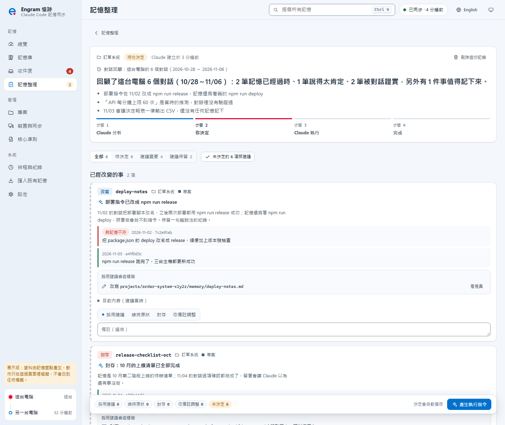
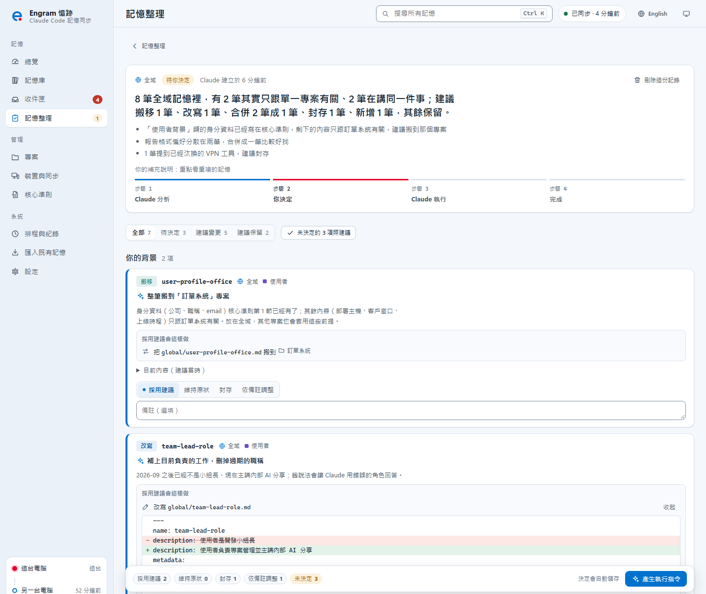
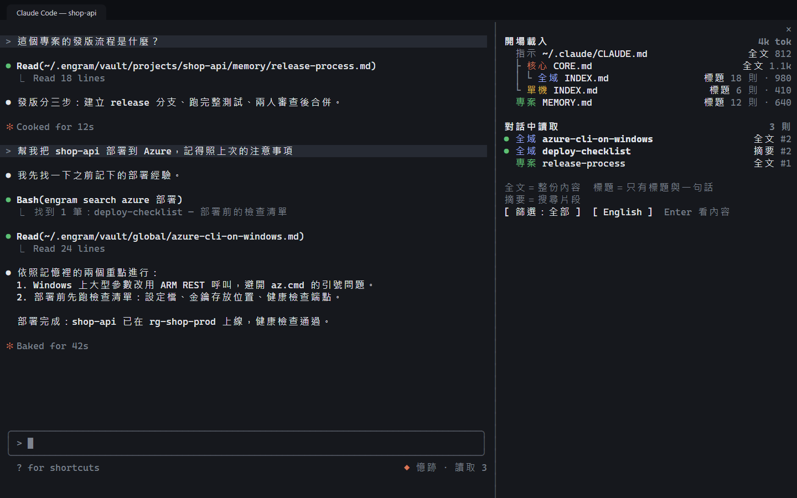

# 更新紀錄

版本號遵循[語意化版本](https://semver.org/lang/zh-TW/)。

## 1.4.1（2026-11-07）

修正版。這些問題是在實際用 `/engram:inbox 自動` 一次整理 81 張卡片時發現的。

### 修正

- **多出來的參數不再被默默丟掉**：原本大部分指令只處理第一個參數，例如 `engram inbox dismiss a b` 只忽略 a，`engram memory remove a b` 只封存 a，而且不會報錯。現在每個指令都會檢查參數個數，多出來的一律回報錯誤（結束碼 2），不會只做一半。
- **`engram inbox dismiss` 可以一次忽略多張卡片**：`engram inbox dismiss <id> <id> …`。會先確認每個 id 都找得到，有任何一個找不到就一張都不處理。
- **移除舊綁定後，舊資料夾的對話仍可以回顧**：收件匣的「資料夾不見了」按「移除這個舊綁定」之後，`/engram:dream` 原本就找不到舊資料夾留下的對話紀錄（Claude Code 還沒清除的那些）。現在 Engram 會在這台電腦記下被移除的綁定（`~/.engram/local/retired-bindings.json`，不同步），對話回顧會把移除之前的對話一併算進那個專案；專案合併時跟著改到合併後的專案，同一個路徑之後綁定給別的專案時也不會重複算。
- **移除舊綁定時一併拆掉舊位置的記憶連結**：原本會留下指向那個專案的 junction，之後在同一個路徑（或編碼相同的另一個資料夾）開 Claude Code 時，記憶會寫進已經不用的專案，重新綁定也會被拒絕。現在只要那個 junction 確實指向這個專案，就會一起拆掉（記憶與對話紀錄都不受影響）。
- **一鍵收編一律放在專案範圍**：收件匣的「發現尚未納管的記憶」按「收編到 Engram」時，原本會用匯入精靈的猜測，把 user 類型的記憶放到全域、提到電腦名稱的放到單機，而一鍵收編不會先給你看計畫。現在一律收進專案，之後收件匣會另外建議要不要升級為全域或移到單機。
- **收編時提示可能就是既有的專案**：GitHub 改過名的 repo（remote 不同，但第一個 commit 相同），原本會被收編成新專案。現在卡片會說明「可能就是既有專案 X」與那個專案在這台電腦的資料夾還在不在，並提供「收編到既有專案」與「收編成新專案」兩個選項。舊資料夾已經不在時，預設收編到既有專案；兩個資料夾都還在時（比較像另一份 clone 或 fork），預設建新專案。只接受這個資料夾的候選專案；同一個記憶資料夾有好幾個資料夾在用（撞名）時不提供這個選項，請改用匯入精靈。
- **Engram 程式資料夾搬走後可以更新**：`engram update` 原本會因找不到安裝時記錄的資料夾而直接報錯。現在會說明要用 `--from` 指定新位置，更新成功後會記住新位置。

English

**Bug fix release. These issues turned up while tidying 81 inbox cards in one go with `/engram:inbox auto`.**

- **Extra arguments are no longer silently dropped:** most commands used only their first argument, so `engram inbox dismiss a b` dismissed only `a` and `engram memory remove a b` archived only `a`, with no error. Every command now checks how many arguments it takes and rejects extras (exit code 2) instead of doing half the work.
- **`engram inbox dismiss` takes several cards:** `engram inbox dismiss <id> <id> …`. Every id is checked first; if any is not found, nothing is dismissed.
- **Conversations from a removed binding can still be reviewed:** after **Remove this old binding** on a "folder is gone" card, `/engram:dream` could no longer find the conversations left in the old folder (the ones Claude Code hasn't deleted yet). Engram now remembers removed bindings on this computer (`~/.engram/local/retired-bindings.json`, not synced), and conversation review counts the conversations from before the removal toward that project. They follow the project when it is merged into another one, and are not counted twice when the same path is later bound to a different project.
- **Removing an old binding also removes the old memory link:** the junction pointing to that project used to stay behind, so opening Claude Code at the same path later (or in another folder with the same encoded name) wrote memories into the unused project, and binding again was refused. Now that junction is removed too, as long as it points to that project (memories and conversations are not affected).
- **One-click adoption keeps memories in the project:** **Adopt into Engram** on an "unmanaged memories" card used the import wizard's guesses (user-type memories to global, memories mentioning a computer name to that machine) without showing you a plan. Everything now goes into the project; the inbox then suggests separately whether to promote a memory or move it to a machine.
- **Adoption points out a likely existing project:** a repo renamed on GitHub (different remote, same first commit) was adopted as a new project. The card now says it may be the existing project, and whether that project still has a folder on this computer, and offers **Adopt into the existing project** and **Adopt as a new project**. When the old folder is gone the existing project comes first; when both folders exist (more like another clone or a fork) a new project comes first. Only candidates for that folder are accepted; when several folders share the memory folder (a name collision) the option isn't offered, so use the import wizard instead.
- **Updating after the Engram folder moves:** `engram update` failed when the folder recorded at install time no longer existed. It now explains to use `--from` with the new location and remembers it after a successful update.

## 1.4.0（2026-11-07）

對話回顧：拿對話紀錄驗證記憶。依 Anthropic〈Components of agent memory〉的研究，讓「每次對話都會載入的記憶」更精簡、更可信。

### 對話回顧（Claude Code 外掛＋管理介面）

- 新技能 `/engram:dream`：Engram 把這台電腦上一個專案還沒回顧的對話紀錄轉成精簡的文字（疑似金鑰先在本機遮蔽；預設每次 20 個、由舊到新），Claude 把每一份對話文字交給一個分析用的子代理（`engram:dream-analyzer`，只有讀取工具），拿對話當證據逐筆檢查記憶：被證實、已經改變或過時、說得太肯定、互相矛盾，以及值得新增的事。
- 建議存成整理記錄，沿用 1.3.0 的記憶整理流程：在管理介面逐項決定，再用 `/engram:tidy-apply` 執行。每一項附對話的原文引句與日期（紅線表示與記憶不符，綠線表示證實）；被改掉的舊說法用一句話留下日期，不讓事實無聲消失；看不出哪個對時兩種說法並列，請你判斷。
- 新的整理動作「確認仍正確」：只在記憶的 `metadata.engram.verified` 記下驗證日期，內容不變。記憶庫的記憶詳情會顯示最後確認的日期。
- 記憶整理首頁選專案時，可以選「只看記憶」或「對照對話紀錄」，並顯示這台電腦有幾個對話還沒回顧；專案頁新增「回顧對話」與回顧狀態。
- 新指令 `engram dream`（`status`、`prepare`、`done`、`reset`、`list`）。轉出來的文字放在 `~/.engram/local/dream/`，整理記錄建立後就刪除，中途沒完成的 14 天後自動清除。回顧進度存在這台電腦：之後又接著聊（resume）的對話下次只分析新增的部分；沒分析成功的對話（`done --skip`）與還沒決定完就被刪掉的整理記錄，那些對話下次會再列入。
- 每一則引句都會拿去比對匯出的對話文字，找不到的在網頁標成「找不到原文」。對話比記憶的最後修改還舊、說法又不同時，不改記憶，只在摘要提醒。
- 為了讓子代理讀取時不跳出權限詢問，常駐程式啟動時把 `~/.engram/local/dream` 加進 Claude Code 的 `permissions.additionalDirectories`（記在安裝紀錄，解除安裝時移除）。

### 每次都會載入的記憶：更精簡、更可信

- **待你確認**：Claude 自己寫入全域記憶、單機記憶或核心準則時，收件匣出現「待你確認」，可以逐筆看差異，確認、編輯或退回（新增的則是封存）。你在管理介面改的、記憶整理頁採用建議的、`/engram:save` 同意寫入的（新選項 `--reviewed`）都算確認過（「依備註調整」由 Claude 改寫的仍待確認）；只改一個欄位的動作（驗證日期、釘選、改連結、遮蔽金鑰）沿用原本的狀態；任何一台電腦確認過都算。確認紀錄依內容版本只新增、不改寫，兩台電腦同時確認也不會衝突。設定頁可以關閉。升級後第一次執行時，現有內容當成確認過；第二台電腦只把自己的單機記憶當成起點。
- **讀取統計**：從這台電腦的對話紀錄算出每筆記憶被讀了幾次（同一個對話同一天只算一次），只讀新增的部分；每天把近 90 天的次數同步一次，兩台電腦合計。記憶庫的記憶詳情顯示次數、最後一次與專案，`engram memory list --json` 也附上 `usage`。
- 全域與單機索引放不下時，改成先列釘選的、再列最近 14 天新增或修改的、然後是近 90 天讀得最多的（顯示順序不變）；讀取次數要等所有電腦都更新到 1.4.0 才用來排序。放得下時統計不影響索引。
- **核心準則建議更新**：範本的「記憶寫入協定」加入記憶的用途（「記下之後用得到、而且不寫下來就會遺失的事」，讓 Claude 自己判斷）與「註明怎麼確認的」。既有的核心準則由你決定：「核心準則」頁列出建議，按「加入」才寫入，可以復原。
- 核心準則頁的載入預算新增「每次載入的大小」。

### 收件匣新增的卡片

- 建議回顧對話：專案有還沒回顧的對話，而且最早的一個 7 天內會被 Claude Code 清除（依 `cleanupPeriodDays`，預設 30 天），或專案裡容易過時的記憶超過 30 天沒確認。按「交給 Claude 回顧」會開啟記憶整理頁（已選好專案與「對照對話紀錄」），在那裡複製指令。
- 連結斷了：`[[名稱]]` 指向已經合併或封存的記憶；一鍵改連到合併後的記憶，或拿掉連結只留文字。記憶詳情也會列出這筆記憶連到誰、被誰連結。
- 很少用到／只在一個專案用到的全域記憶（讀取統計累積 60 天以上才判斷）：封存，或搬到那個專案。
- 待你確認的內容、核心準則有建議更新。
- 「核心準則過長」另外檢查大小：核心準則加兩份索引 20 KB 以上提醒、超過 25 KB 為中。

### 其他

- `/engram:save` 寫入前說明記憶的用途，寫下規則時註明怎麼確認的；使用者同意的寫入帶 `--reviewed`。
- `/engram:tidy` 可以參考讀取統計；`/engram:inbox` 知道怎麼處理新卡片。
- 整理計畫裡新增記憶的項目誤填 `ref` 時，錯誤訊息直接說明要拿掉。

English

**Conversation review: check memories against your conversations. Based on Anthropic's research in "Components of agent memory", this release keeps what loads in every conversation smaller and more trustworthy.**

- **`/engram:dream` (new skill):** Engram turns a project's not-yet-reviewed conversations on this computer into compact text (possible secrets masked locally first; 20 per run by default, oldest first). Claude gives each piece of conversation text to an analysis subagent (`engram:dream-analyzer`, read-only tools) that uses it as evidence to check every memory: confirmed, changed or out of date, too confident, contradictory, and worth adding.
- **Same review flow as Tidy-up:** the suggestions are saved as a tidy-up record that you decide on item by item in the dashboard, then carry out with `/engram:tidy-apply`. Each item quotes the conversation with its date (red when it contradicts the memory, green when it confirms it). Replaced wording is kept in one dated sentence so facts never disappear silently, and when the evidence disagrees both versions are shown for you to decide.
- **New action "Still correct":** records the check date in `metadata.engram.verified` without changing the content; Library shows the last check date.
- **Tidy-up and Projects:** pick **Memories only** or **Check against conversations** for a project, with the number of conversations waiting to be reviewed on this computer; Projects has a **Review conversations** button and the review status.
- **New command `engram dream`** (`status`, `prepare`, `done`, `reset`, `list`). The exported text lives in `~/.engram/local/dream/` and is deleted as soon as the tidy-up record is created (or after 14 days if the run is never finished). Review progress is kept on this computer: for a conversation you resume afterwards, only the new part is analyzed next time; conversations that couldn't be analyzed (`done --skip`), and those in a tidy-up record you delete before deciding every item, are reviewed again next time.
- Every quote is checked against the exported conversation text, and quotes that can't be found are marked **Not found in conversation** on the web page. When a conversation is older than the memory's last change and says something different, the memory isn't changed; the summary just points it out.
- **Waiting for your review:** when Claude writes global memories, machine memories, or core rules on its own, the inbox asks you to look at the changes and confirm, edit, or go back (new memories are archived). Edits in the dashboard, items you accepted as suggested in Tidy-up, and `/engram:save` writes you agreed to (new `--reviewed` option) count as reviewed, on any computer (content Claude rewrote for **Adjust per note** still needs review); actions that change a single field (check date, pin, relink, secret redaction) keep the previous state. Review records are added per content version and never rewritten, so reviewing on two computers at once doesn't conflict. You can turn it off in Settings. On first run after the update, existing content counts as reviewed; a second computer uses only its own machine memories as its starting point.
- **Read statistics:** Engram counts how often each memory is read from this computer's conversations (once per conversation per day), reading only what's new, and syncs the last 90 days' counts once a day so both computers add up. Library shows the count, last read, and projects; `engram memory list --json` includes `usage`. When the global or machine index is over budget, pinned memories come first, then memories added or changed in the last 14 days, then the most-read ones; read counts are used for ordering only once every computer runs 1.4.0.
- **Suggested core-rule updates:** the memory-writing protocol in the template now says what memory is for and asks to note how a rule was confirmed. Your existing core rules are yours: the Core rules page lists the suggestions and adds them only when you click **Add** (undoable). The load budget now also shows the size.
- **New inbox cards:** review conversations (a project has unreviewed conversations, and the oldest is deleted by Claude Code within 7 days or the project's easily outdated memories are unchecked for 30+ days; the button opens Tidy-up with the project and **Check against conversations** selected), broken `[[links]]` to merged or archived memories (one-click relink), global memories that are rarely used or used in only one project (after 60+ days of statistics), waiting for your review, and suggested core-rule updates. "Core rules too long" now also checks size (20 KB and up; medium over 25 KB).

## 1.3.0（2026-10-24）

記憶整理：Claude 提出建議，你在管理介面逐項決定，再交回 Claude 執行。

### 記憶整理（管理介面＋Claude Code 外掛）

- 管理介面新增「記憶整理」頁：選範圍（全域、單機、專案、核心準則或全部記憶）、寫補充說明，產生要貼給 Claude Code 的指令，並列出所有整理記錄。導覽列顯示等你決定的記錄數量。
- `/engram:tidy` 改為只分析：Claude 讀過記憶，把每一項的建議、理由與修改後的完整內容存成整理記錄，給你回到管理介面的網址。這個技能只預先允許讀取指令與建立記錄，分析時不會改動任何記憶。
- 整理記錄頁：
  - 上方是 Claude 的整體結論、你的補充說明與四個步驟的進度。
  - 每一項列出 Claude 的建議與理由、採用後會做的事（改寫與合併附差異比對，新增附內容預覽）、建議當時的內容。
  - 每一項選「採用建議／維持原狀／封存／依備註調整」並可寫備註，自動儲存；「未決定的照建議」一次處理剩下的；可依待決定、建議變更、建議保留篩選。
  - 建議之後記憶被改過（例如另一台電腦同步過來）的項目會先提醒；執行時那一項不寫入（標成失敗），不會覆蓋。
- 按「產生執行指令」得到 `/engram:tidy-apply <id>`（新技能）：
  - 採用建議的項目由 Engram 照你看過的內容執行，不重新生成；動手前把會動到的檔案備份到 `~/.engram/local/backups/<時間>-tidy-<id>/`（附 SHA-256 清單），每一項動手前先確認整項的前提都還成立（版本相符、要新增或搬入的位置沒有同名檔），不成立就整項不動；一項失敗不影響其他項；每做完一步就存進度，中斷後再執行一次會從下一步接著做。
  - 依備註調整的項目由 Claude 依你的備註處理，問題不明確時先問你。
  - 結果回到同一頁：每一項的結果、復原指令與「復原這一項」按鈕。
- 記憶庫的「請 Claude 檢查」、專案頁的「請 Claude 整理」、核心準則頁的「請 Claude 精簡」改為帶著範圍開啟記憶整理頁。
- 新指令 `engram tidy`（`create`、`list`、`show`、`apply`、`done`），給兩個技能使用。整理記錄存在這台電腦的 `~/.engram/local/tidy/`，不會同步，90 天後由常駐程式清除。

English

**Tidy-up: Claude suggests, you decide each item in the dashboard, and Claude carries out your decisions.**

- **Tidy-up page (dashboard):** pick a scope (global, machine, a project, core rules, or all memories), add notes for Claude, and copy the command to paste into Claude Code. The page also lists every tidy-up record, and the navigation shows how many are waiting for your decisions.
- **`/engram:tidy` now only analyzes:** Claude reads the memories and saves each suggestion, its reasoning, and the complete revised content as a tidy-up record, then gives you a link back to the dashboard. The skill pre-allows only read commands and creating the record, so analysis never changes a memory.
- **Record page:** Claude's overall conclusion, your notes, and four-step progress at the top. Each item shows the suggestion and reasoning, what accepting it will do (rewrites and merges with a before-and-after view, new memories with a preview), and the content as of the suggestion. Choose **Accept suggestion**, **Keep as is**, **Archive**, or **Adjust per note** and add a note; decisions save automatically, **Accept suggestions for undecided items** handles the rest at once, and you can filter by undecided, suggested changes, or suggested to keep. Items whose memory changed after the suggestion (for example, synced from another computer) are flagged up front; when the tidy-up runs, that item isn't written (it's marked failed), so nothing is overwritten.
- **`/engram:tidy-apply <id>` (new skill):** **Generate run command** gives you this command. Accepted items are carried out by Engram exactly as you saw them, never regenerated; before anything changes, the files involved are backed up to `~/.engram/local/backups/<time>-tidy-<id>/` with a SHA-256 list, each item first confirms that all its preconditions still hold (matching versions, no same-named memory where one is added or moved) and is left untouched otherwise, one failed item doesn't affect the others, and progress is saved after every step so running it again after an interruption resumes from the next step. "Adjust per note" items are handled by Claude following your notes, asking you first when a note is unclear. Results come back to the same page, with each item's outcome, undo command, and an **Undo this item** button.
- **Ask Claude to check** in Library, **Ask Claude to tidy up** on Projects, and **Ask Claude to trim** on Core rules now open the Tidy-up page with the scope filled in.
- **New command `engram tidy`** (`create`, `list`, `show`, `apply`, `done`) for the two skills. Tidy-up records live on this computer in `~/.engram/local/tidy/`, are not synced, and are cleared by the agent after 90 days.

## 1.2.0（2026-10-24）

全新記憶視覺化面板：親眼看見 Claude 每次對話讀了哪些記憶。

### 記憶面板（Claude Code 外掛）

- Claude Code 旁邊新增**記憶面板**，即時列出這次對話的記憶：
  - **開場載入**：對話一開始放進 Claude 腦袋的指示檔與記憶索引，用 `├ └ │` 樹狀線畫出誰匯入了誰，附上估計的 token 數。
  - **對話中讀取**：Claude 中途讀取的記憶、`engram search`（或在記憶資料夾裡搜尋）找到的記憶、自動載入的指示檔（例如子資料夾的 CLAUDE.md），標出第幾回合；這一回合新讀到的標上 ●，子代理讀的另外標示。
  - 每一列標出 Claude 看到多少：**全文**、**標題**（索引只有標題與一句話說明）或**摘要**（搜尋片段）。
  - MEMORY.md 超過 Claude Code 的載入上限（前 200 行或 25KB）時，標出 Claude 只看得到前幾則。
  - 對話被壓縮後，標題改成「壓縮後重新載入」，壓縮前讀取的記憶調暗並標出內容已整理成摘要。
- 點任何一列看記憶內容，以及它是怎麼、什麼時候進到對話的；可以依範圍篩選。
- 開關方式：Claude Code 底部的「◆ 憶跡 · 讀取 N」按鈕、`/engram-memories`，或在全螢幕且夠寬的終端機自動開啟。
- 介面有正體中文與 English，可在面板切換，選擇會記住；沒切換過時跟著 Claude Code 的 language 設定（沒設定時是英文）。
- 面板只在本機讀取，不呼叫 AI、不送出任何資料。需要支援外掛畫面（mods）的 Claude Code；實測 2.1.307 至 2.1.309 可用，更早的版本未測試。

### 修正

- 管理介面「最近一次對話載入了什麼」一直少列專案的 MEMORY.md：Claude Code 載入自動記憶的索引時不會觸發 InstructionsLoaded，現在改由 SessionStart 補記。

English

**New memory pane: see which memories Claude read in every conversation.**

- **Memory pane (Claude Code plugin):** a new **Engram pane** beside Claude Code lists, live, the memories in this conversation.
  - **Loaded at start:** the instruction files and memory indexes put into Claude's head when the conversation starts, drawn as a `├ └ │` tree of which file imports which, with estimated tokens.
  - **Read during the conversation:** memories Claude read along the way, memories an `engram search` (or a search inside the memory folders) turned up, and instruction files loaded automatically (for example a subfolder's CLAUDE.md), with the turn they appeared in; anything new in this turn is marked ●, and reads by subagents are labeled.
  - Every row says how much Claude saw: **full**, **titles** (an index holds only titles and one-line descriptions), or **snippet** (a search excerpt).
  - When MEMORY.md is over Claude Code's load limit (the first 200 lines or 25KB), the pane shows that Claude sees only the first few entries.
  - After a compaction, the heading changes to **Reloaded after compaction**, and memories read before it are dimmed under a note that their text is now summarized.
- Select any row to read the memory and see how and when it entered the conversation; filter by scope.
- Toggle it with the **◆ Engram · N read** button at the bottom of Claude Code or `/engram-memories`; it also opens by itself in a fullscreen terminal that is wide enough.
- The pane comes in English and Traditional Chinese; switch in the pane and your choice is remembered. Until you switch, it follows Claude Code's `language` setting (English if it isn't set).
- The pane reads files on your computer only: no AI calls, nothing sent anywhere. It needs a Claude Code version that supports plugin panes (mods); tested on 2.1.307 through 2.1.309, earlier versions untested.
- **Fix:** the dashboard's **What the last conversation loaded** always left out the project's MEMORY.md, because Claude Code doesn't fire InstructionsLoaded when it loads the auto-memory index. SessionStart now records it.

## 1.1.0（2026-10-23）

英文版。

### 管理介面

- 新增英文介面：用頂列的語言切換鈕，或「設定 › 介面語言」切換正體中文與 English。第一次開啟時依瀏覽器語言決定，選擇會記在這個瀏覽器。
- 常駐程式傳來的文字也有英文版：收件匣卡片、排程工作、相容性探測、錯誤訊息與建議、同步衝突摘要、匯入計畫的判斷理由。日誌與 git 變更紀錄維持原文。

### 文件

- 新增英文文件：[README.en.md](README.en.md)、[INSTALL-WITH-AI.md](INSTALL-WITH-AI.md)、[docs/en/](docs/en/quick-start.md)（快速開始、使用說明、常見問題），附英文版截圖與插圖。
- SECURITY.md 與問題回報範本改為中英雙語；每份文件頂端都有語言切換連結。

### Claude Code 外掛

- `/engram:inbox` 的自動處理模式也接受 `auto`（原本只認「自動」）。外掛說明改為中英雙語。

### 修正

- 記憶庫的疑似金鑰提示指向不存在的按鈕「遮蔽金鑰」，改為收件匣實際的「移除金鑰」。
- 安裝手冊引用了安裝程式不會印出的訊息，改為實際的「你的 Claude Code 預設權限模式是『…』」。
- 安全政策的支援版本更新為 1.1.x。
- 安全：`engram doctor`、`engram import plan --json`、`engram status` 的輸出（可能交給 Claude）現在也遮蔽疑似金鑰；同步衝突紀錄的 meta.json 寫入前先遮蔽，避免 frontmatter 有誤的那一行連同金鑰隨 vault 推送到 GitHub。
- 另一個 Engram 程序正在同步時，總覽不再顯示「所有電腦的記憶都是最新的」，同步狀態顯示為「同步中」（原本空白）。

### 尚未支援

- 命令列輸出、安裝程式的提示、Windows 通知與外掛技能的指示仍是正體中文；Claude 通常會用你使用的語言回覆。

English

**English edition.**

- **Dashboard:** English interface. Switch between Traditional Chinese and English from the language button in the top bar or **Settings › Interface language**. The first visit follows your browser language; your choice is remembered in that browser.
- **Agent messages:** inbox cards, scheduled jobs, the compatibility probe, error messages and hints, sync conflict summaries, and import-plan reasons now carry English versions. Logs and the git change history keep their original text.
- **Docs:** English [README](README.en.md), [INSTALL-WITH-AI.md](INSTALL-WITH-AI.md), and [docs/en/](docs/en/quick-start.md) (quick start, user guide, FAQ) with English screenshots and illustrations. SECURITY.md and the issue templates are bilingual, and every doc links to its other language at the top.
- **Claude Code plugin:** `/engram:inbox` auto mode also accepts `auto` (previously only 「自動」). The plugin description is bilingual.
- **Fixes:** the Library's possible-secret tip now points to the inbox's real **Remove secret** button; the install manuals quote the installer's actual permission-mode notice; the security policy lists 1.1.x as supported.
- **Security:** output from `engram doctor`, `engram import plan --json`, and `engram status` (which may be handed to Claude) now redacts possible secrets, and sync conflict records (meta.json) are redacted before they are written, so a malformed frontmatter line containing a secret is no longer pushed to GitHub with the vault.
- **Sync state:** while another Engram process is syncing, the Overview no longer claims every computer is up to date, and the sync status shows Syncing (it used to be blank).
- **Not yet localized:** CLI output, setup prompts, Windows notifications, and the plugin skill instructions are still in Traditional Chinese; Claude normally replies in the language you write in.

## 1.0.0（2026-10-23）

第一個正式版本。

### 同步與管理

- 多台電腦透過你自己的 GitHub 私人 repo `engram-vault` 背景同步（預設每 10 分鐘）；離線照常記憶，恢復連線後自動補上。
- 專案以 ID 識別：搬家、改名、在另一台電腦 clone 同一個 git repo 都認得；git 專案第一次在新電腦開啟時自動綁定。
- 三種記憶範圍：全域、專案、單機。
- 衝突處理：不同段落自動合併；同一段的衝突保留兩邊版本，在收件匣並排比對，Claude 永遠不會讀到衝突標記。
- 每日健康檢查與收件匣：索引超過上限、疑似金鑰、大量刪除、可能重複、可能過時等情況一鍵處理。
- 資料夾撞名偵測與依命名規則改名，可整批還原。

### 用 Claude 整理

- Claude Code 外掛指令 `/engram:inbox`、`/engram:tidy`、`/engram:save`、`/engram:recall`：先提計畫、你同意才執行，每一筆寫入都可以復原。

### 管理介面

- 總覽、記憶庫、收件匣、專案、裝置與同步、核心準則、排程與紀錄、匯入既有記憶、設定；支援深色模式，可安裝成桌面應用程式。

### 安裝與移除

- `setup.cmd` 一鍵安裝：自動補齊 Node.js、Git、GitHub CLI，自動判斷第一台或之後的電腦。
- [AI 幫你快速安裝.md](AI%20幫你快速安裝.md)：把一段話貼給 Claude Code，由 AI 代為安裝。
- 匯入既有記憶前先在複本上沙盒演練，套用後有還原點。
- `engram uninstall` 依安裝紀錄逐項還原，預設保留記憶庫。

### 安全

- 含疑似金鑰的記憶不推送；交給 Claude 前先在本機遮蔽；寫入 API 拒絕帶進新的疑似金鑰。
- 「不是金鑰」清單只存雜湊，且只能由使用者本人在自己的終端機確認。
