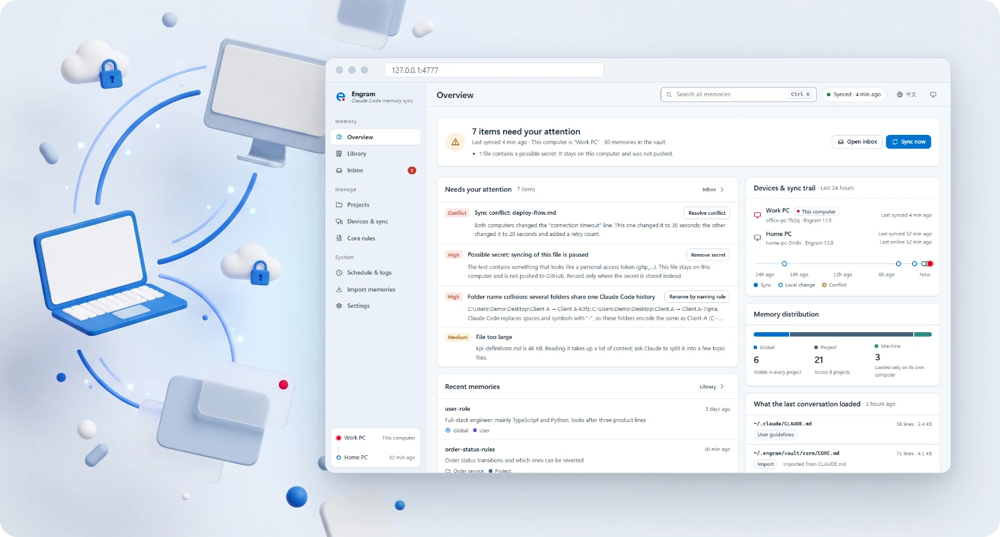
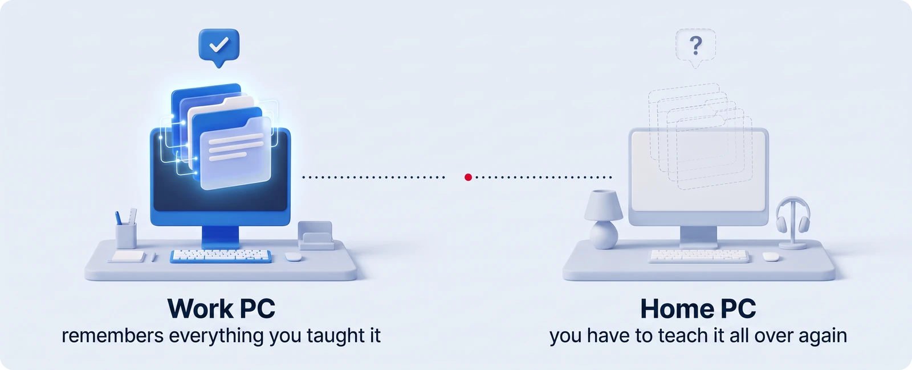
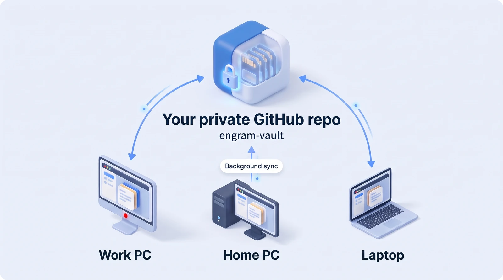
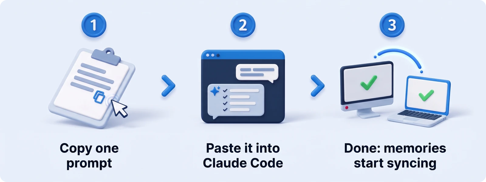
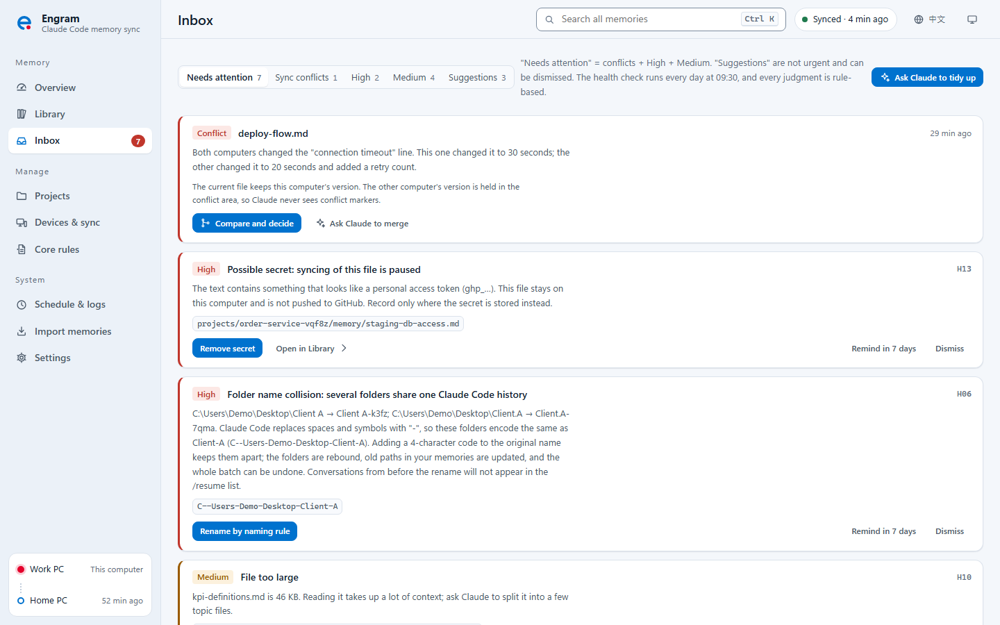
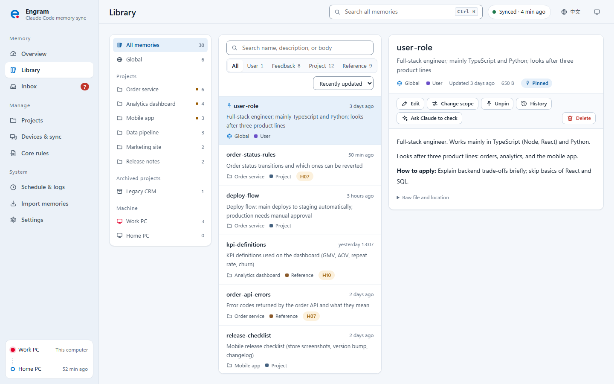
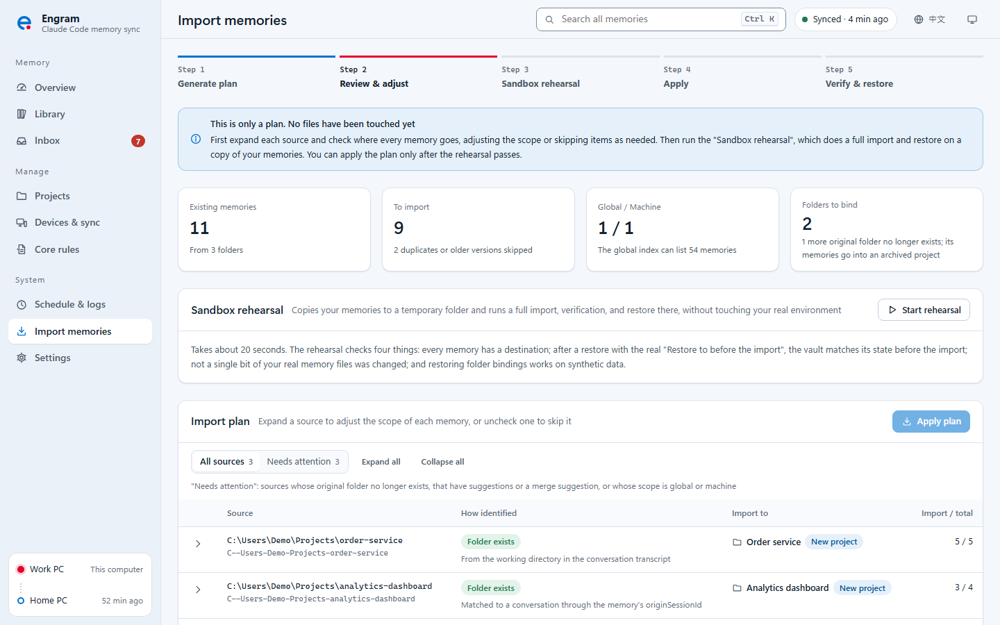
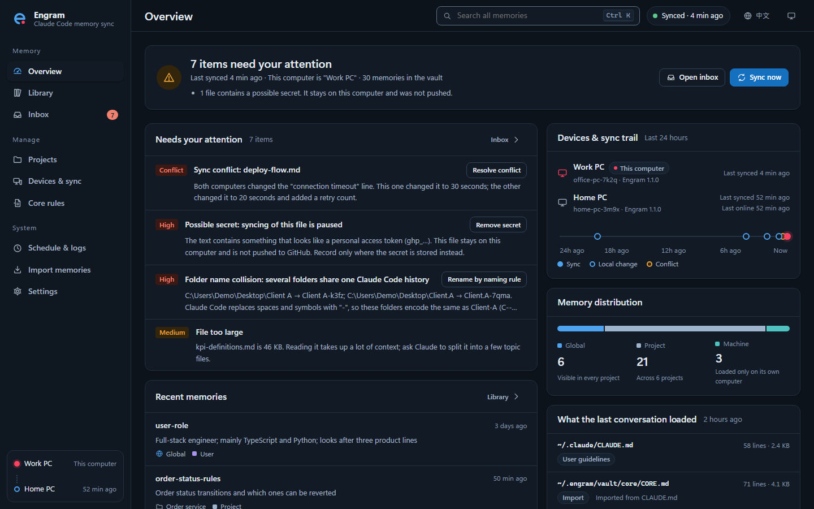
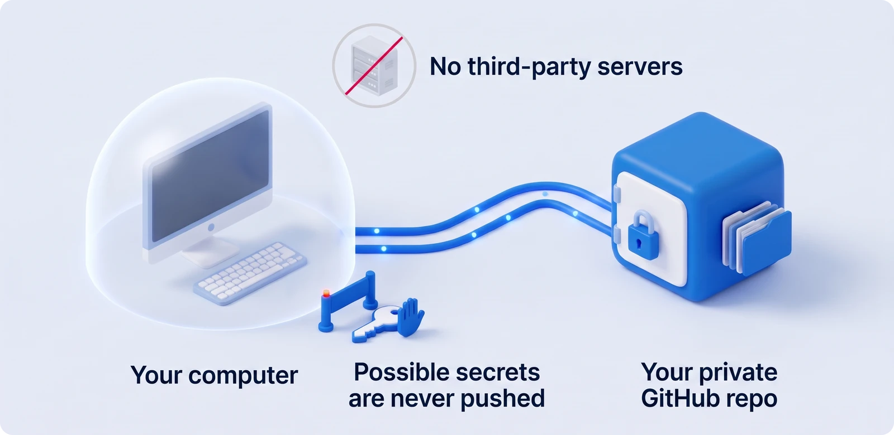

<p align="center"><a href="README.md">繁體中文</a> · <b>English</b></p>

<p align="center">
  <picture>
    <source media="(prefers-color-scheme: dark)" srcset="docs/assets/wordmark-dark.svg">
    
  </picture>
</p>

<h3 align="center">Claude remembers you on every computer</h3>

<p align="center">
  Cross-device sync, tidying, and recovery for Claude Code memory.<br>
  Your memories live in your own private GitHub repo. Open the same project at work, at home, or on your laptop, and Claude remembers what you've taught it.
</p>

<p align="center">
  
  
  
  
</p>

<p align="center">
  <a href="INSTALL-WITH-AI.md"><b>Install with AI</b></a> ·
  <a href="docs/en/quick-start.md">Install it yourself</a> ·
  <a href="docs/en/user-guide.md">User guide</a> ·
  <a href="docs/en/faq.md">FAQ</a>
</p>

<p align="center">
  
</p>

> **Language support.** The dashboard is available in English and Traditional Chinese (switch languages in the top bar or in Settings). For now, the command-line output, the setup script's prompts, the agent's Windows notifications, and the instructions inside the Claude Code plugin skills are in Traditional Chinese. Claude normally replies in the language you write in.

## Why Engram

Claude Code automatically remembers your habits, project conventions, and the pitfalls you've run into. But those memories live in **one folder on one computer**:

<p align="center">
  
</p>

| What happens | The result |
| --- | --- |
| You teach Claude something at work, then open the same project at home | You have to teach it all over again |
| A project folder is moved or renamed, or it has a Chinese name with the same character count as another folder | Memories vanish, or get mixed up with another project |
| After a few months of use, the memories keep piling up | Duplicate, outdated, or misfiled entries go untidied; once the index passes 200 lines, Claude never sees the rest |

Engram turns memory into an asset that **follows you, follows your project, and can always be undone**.

## Features

| | Feature | What you get |
| :---: | --- | --- |
|  | **Automatic sync across computers** | Syncs in the background (every 10 minutes by default). Claude Code never waits on the network: it keeps remembering offline and catches up as soon as you're back online. |
|  | **Projects are recognized by ID, not by path** | Move or rename a folder, or clone the same git repo on another computer, and Engram still knows it's the same project. |
|  | **Three scopes, each memory in its place** | Personal preferences go in **Global** and show up in every project. Install paths and network settings go in **Machine** and never end up on another computer. |
|  | **Everything can be undone** | Every change has a history. Before an import, Engram rehearses the whole thing on a copy; after you apply it, you can restore with one click. Your original memory files are always kept. |
|  | **Conflicts without the fuss** | If two computers edit different sections, Engram merges them automatically. Only when the same section is edited does it ask you to compare the two versions side by side. Claude never sees conflict markers. |
|  | **Secrets don't leak** | Memories that look like they contain passwords, tokens, or connection strings stay on your computer and are never pushed. The inbox reminds you to redact them. |
|  | **Let Claude tidy up** | In Claude Code, type `/engram:inbox` or `/engram:tidy`. Claude reads the content and lays out a plan first; it acts only after you approve. |
|  | **A dashboard that shows it all** | Overview, Library, Inbox, Projects, and Devices & sync in one interface. Supports dark mode and can be installed as a desktop app. |

## How it works in 30 seconds

<p align="center">
  
</p>

- Engram **does not modify Claude Code**. It only uses three mechanisms Claude Code officially provides: the memory folder, `CLAUDE.md` imports, and hooks.
- Your vault is a git repo at `%USERPROFILE%\.engram\vault`, synced to a private repo **under your own account**. Engram has no server and collects no data.
- Day-to-day operation **makes no AI calls**: health checks use rules, and secret redaction happens on your computer.

## Install

You need: **Windows 11**, a signed-in **Claude Code** (the official installer version), and a **GitHub account**. If Node.js, Git, or GitHub CLI are missing, Engram installs them for you. The installer's prompts are in Traditional Chinese for now (see the language note above); with Option 1, Claude translates them for you as it goes.

### Option 1: let AI install it (recommended, about 10 minutes)

<p align="center">
  
</p>

Open Claude Code and paste in this whole message:

```text
Please install Engram (the memory sync tool for Claude Code) for me.
Install guide: https://raw.githubusercontent.com/Sen-CaPoo/engram/main/INSTALL-WITH-AI.md
Read the entire guide before you start and follow its steps. Before any step that changes my computer, explain it to me in plain language and get my approval.
```

Claude checks your environment, installs what's missing, shows you the install plan for approval, then completes and verifies the installation. All you do is click a few times in the browser when you sign in to GitHub. See [INSTALL-WITH-AI.md](INSTALL-WITH-AI.md) for details.

### Option 2: one-click install

1. Get Engram: click **Code → Download ZIP** at the top right of the GitHub page and unzip it, or run `git clone https://github.com/Sen-CaPoo/engram.git`.
2. Double-click **`setup.cmd`** in the folder. It installs missing tools, walks you through signing in to GitHub, lists the install plan, and installs only after you type `y` to approve.
3. When it's done, your browser opens the dashboard. Go to **Import memories** to bring in your old memories.

See the [Quick start](docs/en/quick-start.md) for the complete steps and what each screen looks like.

### Second computer

The steps are exactly the same. Engram notices that `engram-vault` already exists on your GitHub, connects to it automatically, and downloads the memories from your first computer.

> **Keep the Engram folder after installing.** You'll need it for updates. Updating takes two steps: get the new version (`git pull`, or download a new ZIP over the old folder), then run `engram update`.

## Everyday use

**You don't have to do anything.** Claude remembers things as usual, and Engram handles the rest in the background:

1. **Conversation start**: Claude knows which computer and which project it's in, and where global and machine memories should be written.
2. **Conversation end**: Engram tidies the index, checks for possible secrets, and saves everything to your vault.
3. **Every 10 minutes (default)**: Engram exchanges changes with your other computers.
4. **Once a day**: a health check runs, and anything that needs your decision goes into the inbox.

When you want to tidy up on your own, type these in Claude Code:

| Command | What it's for |
| --- | --- |
| `/engram:inbox` | Has Claude read through the inbox card by card, explaining its reasoning and recommendations; it acts only after you approve. Add `auto` to have it handle the items it's confident about directly |
| `/engram:tidy` | A deep tidy of one project, the global scope, the machine scope, or the core rules: finds duplicate, outdated, contradictory, or misfiled memories |
| `/engram:save` | Saves what's worth remembering long-term from this conversation as a memory |
| `/engram:recall` | Finds relevant experience in memories from other projects and other computers; read-only |

<table>
  <tr>
    <td width="50%"><br><sub><b>Inbox</b>: every card has a one-click fix, or <b>Ask Claude</b></sub></td>
    <td width="50%"><br><sub><b>Library</b>: search, edit, change scope, view history</sub></td>
  </tr>
  <tr>
    <td width="50%"><br><sub><b>Import memories</b>: rehearse on a copy first; you can apply only after it passes</sub></td>
    <td width="50%"><br><sub><b>Dark mode</b>: follows your system setting</sub></td>
  </tr>
</table>

## Privacy and security

<p align="center">
  
</p>

- **Your data lives in only two places**: your computer, and a private repo under your own GitHub account. Conversation transcripts are never synced.
- **No AI calls**: your Claude quota is used in only two cases: the compatibility probe when Claude Code is updated (synthetic data only, and you can turn it off in the dashboard), and when you type an `/engram` command yourself.
- **Secret protection**: memories that look like they contain secrets are never pushed, and any detected secrets are redacted on your computer before anything is handed to Claude for tidying.
- **Fully removable**: before installing, Engram lists every location it will change and records each one; `engram uninstall` reverts them one by one from that record, and keeps your vault by default.
- **Company data**: if your company doesn't allow work data on a personal GitHub account, use a private repo under your company's organization instead, or use Engram on a single computer only.

See [SECURITY.md](SECURITY.md) for details.

## FAQ

**Does it cost anything?** No. Engram is free under the MIT license.

**Does it support macOS or Linux?** Not yet. Engram currently supports Windows 11 only (background sync uses Windows Task Scheduler).

**What if my company network blocks GitHub?** Your memories are still saved locally and sync automatically once you're back on a network that can reach GitHub.

**What if I want to stop using it?** Run `engram uninstall`. Your computer returns to how it was before installation, and your vault is kept by default.

More questions are answered in the [FAQ](docs/en/faq.md).

## Documentation

| Document | Who it's for |
| --- | --- |
| [INSTALL-WITH-AI.md](INSTALL-WITH-AI.md) | Anyone who wants Claude to do the installation (it's also the manual the AI follows) |
| [Quick start](docs/en/quick-start.md) | Anyone who wants to install step by step on their own |
| [User guide](docs/en/user-guide.md) | The full feature set: inbox, conflicts, colliding folders, pausing and removing, command cheat sheet |
| [FAQ](docs/en/faq.md) | Common questions and troubleshooting |
| [Changelog](CHANGELOG.md) | Changes in each version (Traditional Chinese, with an English summary from 1.1.0) |

## About the name


**Engram** is a neuroscience term for the physical trace a memory leaves in the brain; the Chinese name 憶跡 (yìjì, "memory trace") carries the same meaning. The logo is a lowercase e drawn in a single stroke: the continuous trail stands for memory, the loop stands for sync, and the red dot at the opening stands for "now, this computer".

## License

[MIT](LICENSE) © 2026 Sen-CaPoo

Claude and Claude Code are trademarks of Anthropic. Engram is an independently developed third-party tool and is not affiliated with or endorsed by Anthropic.
