<p align="center"><a href="README.md">繁體中文</a> · <b>English</b></p>

<p align="center">
  <picture>
    <source media="(prefers-color-scheme: dark)" srcset="docs/assets/wordmark-dark.svg">
    
  </picture>
</p>

<h3 align="center">The memory and environment steward for Claude Code</h3>

<p align="center">
  Claude remembers you on every computer, and follows through on what you've taught it.<br>
  Cross-device sync, tidying, and recovery for Claude Code memory, plus guardrails, environment checks, and environment sync. Your memories live in your own private GitHub repo: open the same project at work, at home, or on your laptop, and Claude knows what you've taught it and stops stepping into the same pitfalls.
</p>

<p align="center">
  
  
  
  
</p>

<p align="center">
  <a href="INSTALL-WITH-AI.md"><b>Install with AI</b></a> ·
  <a href="docs/en/quick-start.md">Install it yourself</a> ·
  <a href="docs/en/user-guide.md">User guide</a> ·
  <a href="docs/en/faq.md">FAQ</a>
</p>

<p align="center">
  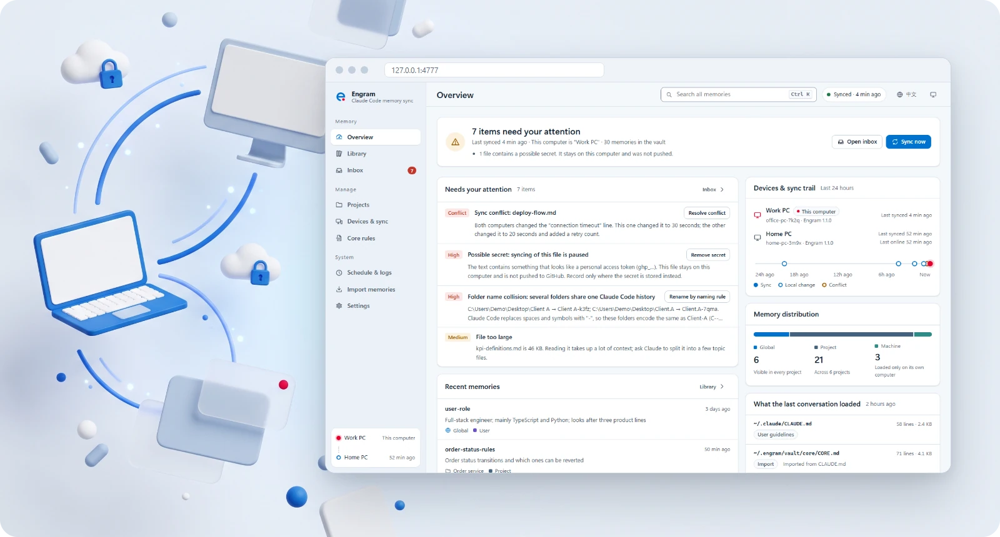
</p>

> **Language support.** The dashboard is available in English and Traditional Chinese (switch languages in the top bar or in Settings). For now, the command-line output, the setup script's prompts, the agent's Windows notifications, and the instructions inside the Claude Code plugin skills are in Traditional Chinese. Claude normally replies in the language you write in.

## What's new

<!-- How to maintain: keep only the three most recent versions here. Write the new version in the large block at the top; shrink the previous large block into the first cell of the two-column table below, and drop the table's old second cell (its full notes stay in CHANGELOG.md). -->

### 2.0.0 · From remembering to doing: the memory and environment steward

Engram no longer stops at making Claude remember you. It now helps get things done too: important memories show up at the right time, pitfalls you've hit become guardrails, and the whole Claude Code environment is looked after. Version 2.0 has four lines of work:

| | What you get |
| --- | --- |
| **Memory that shows up at the right time** | Your corrections and preferences always stay in the index (once every computer is on 2.0.0). When you send a message, context recall brings up at most 3 related memories. Guardrails stop commands that are known to go wrong before Claude sends them. A memory can "graduate" into one line of the core rules, a guardrail reminder, or an environment setting |
| **Autopilot 2.0** | It follows only the preferences you confirmed yourself. Suggestions it didn't carry out are kept in the holding area instead of disappearing. If it hits a usage limit or your sign-in has expired, it stops and notifies you. You get a digest of results every week |
| **Environment steward** | Every day it checks this computer's Claude Code environment, shows how two computers differ, and lets several computers share one set of settings (settings synced from another computer are applied only after you approve them on this one). Update one computer to a new version, and the others (those installed with git) catch up on their own |
| **Quieter and steadier** | The background save does nothing when nothing has changed. When sync keeps failing, it diagnoses itself and notifies you. The vault is packed automatically every week. Projects you haven't used for a long time go dormant on their own, and projects that look like the same one get a merge suggestion |

<p align="center">
  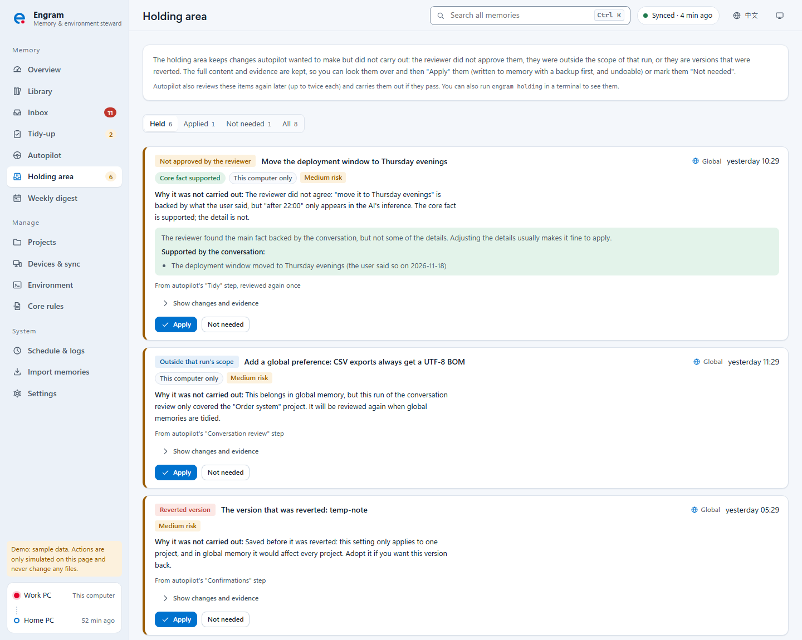
</p>

<p align="center">
  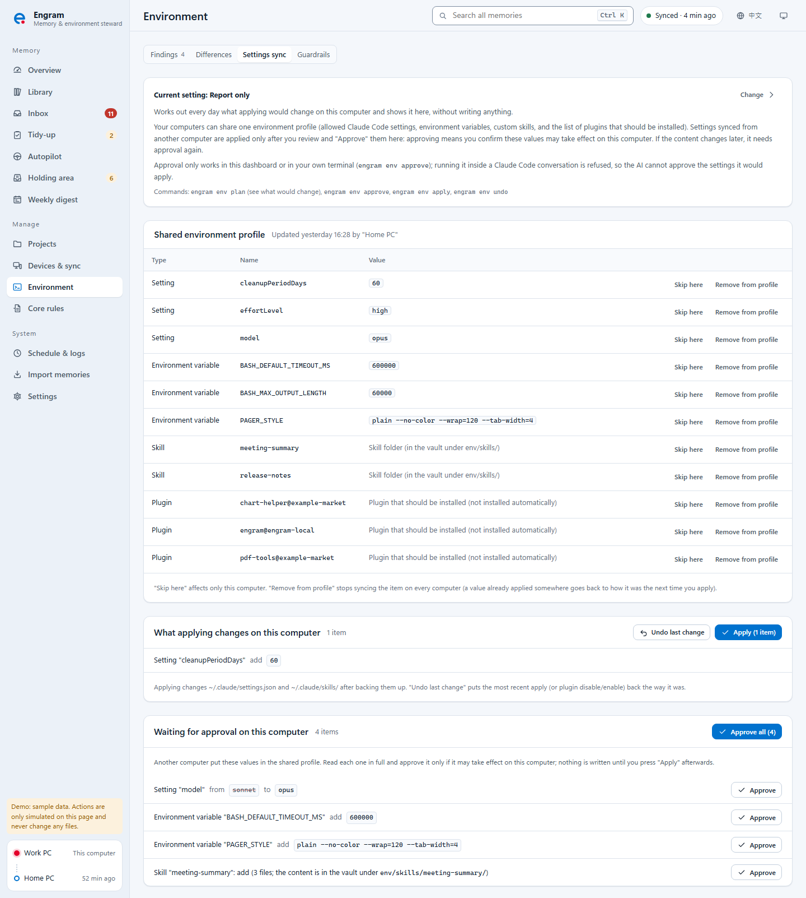
</p>

<p align="center">
  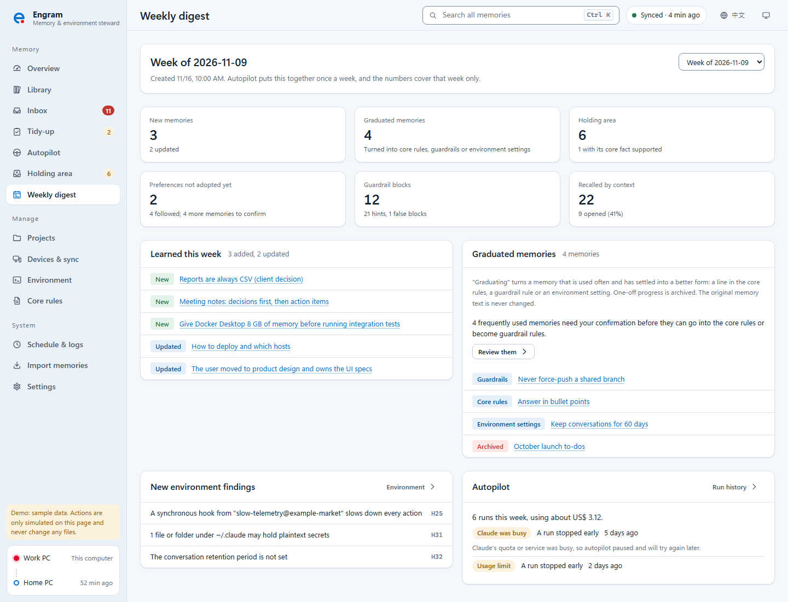
</p>

The upgrade is free. From 2.0 on, autopilot no longer splits or condenses memories. Environment settings, skills, and "block" guardrail rules that sync from another computer take effect only after you approve them once on each computer. Update every computer to 2.0.0: the new index rules take effect only once all of them are updated (with only one updated, the shared indexes are temporarily written the old way, and nothing is lost); 1.x has no automatic updates, so the first upgrade from 1.x is manual: `git pull`, then `engram update`. See the [user guide](docs/en/user-guide.md) and the [changelog](CHANGELOG.md) for details.

<table>
  <tr>
    <td width="50%" valign="top">
      <b>1.6.0 · Every computer is equal, and a roomier budget</b><br><br>
      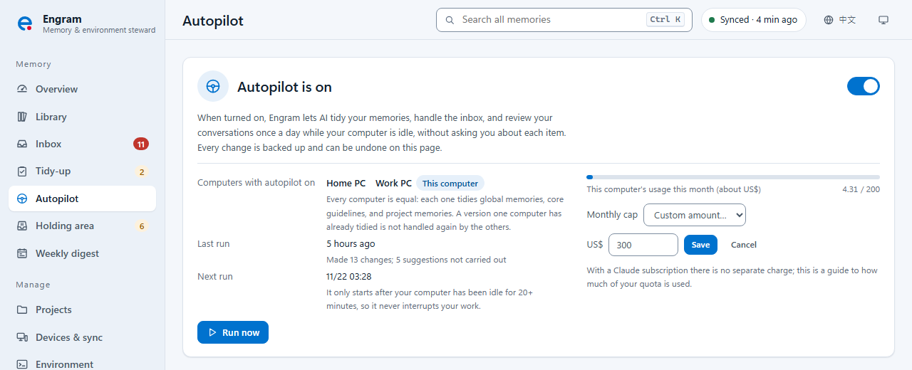<br>
      Autopilot no longer leaves shared memories to a single computer: every computer with autopilot on is equal, and a version one computer has already tidied isn't handled again by the others. The default monthly cap is now about US$200, the per-run cap is gone, and you can set your own cap (1 to 1000). A reviewer's "no" is remembered. <a href="docs/en/user-guide.md#autopilot-hand-all-the-tidy-up-work-to-ai">User guide</a>
    </td>
    <td width="50%" valign="top">
      <b>1.5.0 · Autopilot: hand all the tidy-up work to AI</b><br><br>
      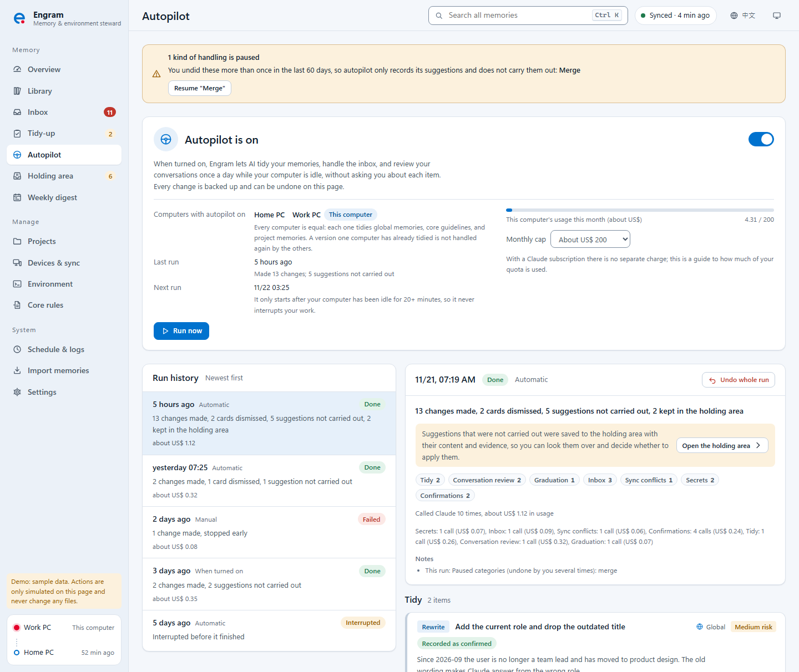<br>
      Once it's on, inbox cards, duplicate and outdated memories, conversation review, sync conflicts, checking what Claude wrote, even secrets inside memories, are handled by AI on its own once a day while your computer is idle. Every change comes with its reason, passes a second AI review, and can be undone with one click. <a href="docs/en/user-guide.md#autopilot-hand-all-the-tidy-up-work-to-ai">User guide</a>
    </td>
  </tr>
</table>

Older versions are in the [changelog](CHANGELOG.md).

## Why Engram

Claude Code automatically remembers your habits, project conventions, and the pitfalls you've run into. But those memories live in **one folder on one computer**:

<p align="center">
  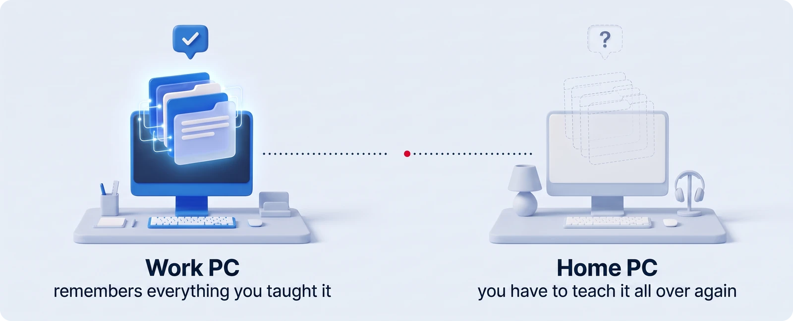
</p>

| What happens | The result |
| --- | --- |
| You teach Claude something at work, then open the same project at home | You have to teach it all over again |
| A project folder is moved or renamed, or it has a Chinese name with the same character count as another folder | Memories vanish, or get mixed up with another project |
| After a few months of use, the memories keep piling up | Duplicate, outdated, or misfiled entries go untidied; once the index passes 200 lines, Claude never sees the rest |
| Claude still steps into the same pitfall after you've corrected it | The memory sits in the index and never gets read, or the same way of writing a command fails again and again |
| The Claude Code settings on your computers slowly drift out of step | One computer works fine while another slows down or stops working, and you can't tell what's different |

Engram turns memory into an asset that **follows you, follows your project, and can always be undone**, and looks after your whole Claude Code environment too.

## Features

| | Feature | What you get |
| :---: | --- | --- |
| 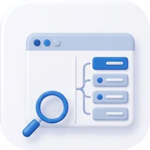 | **See what Claude read** | A memory pane beside Claude Code lists, live, the memories this conversation loaded and read, each marked full, titles, or snippet, so you can tell what an answer is based on. |
|  | **Automatic sync across computers** | Syncs in the background (every 10 minutes by default). Claude Code never waits on the network: it keeps remembering offline and catches up as soon as you're back online. |
|  | **Projects are recognized by ID, not by path** | Move or rename a folder, or clone the same git repo on another computer, and Engram still knows it's the same project. |
|  | **Three scopes, each memory in its place** | Personal preferences go in **Global** and show up in every project. Install paths and network settings go in **Machine** and never end up on another computer. |
|  | **Everything can be undone** | Every change has a history. Before an import, Engram rehearses the whole thing on a copy; after you apply it, you can restore with one click. Your original memory files are always kept. |
|  | **Conflicts without the fuss** | If two computers edit different sections, Engram merges them automatically. Only when the same section is edited does it ask you to compare the two versions side by side. Claude never sees conflict markers. |
|  | **Secrets don't leak, and writes are checked** | Memories that look like they contain passwords, tokens, or connection strings stay on your computer and are never pushed. The inbox reminds you to redact them. When Claude writes to the memories that load in every conversation, the inbox asks you to look at the changes and confirm or go back. |
|  | **Let Claude tidy up and verify** | Pick a scope in the dashboard; Claude analyzes it and suggests changes with the revised content. `/engram:dream` also uses your recent conversations as evidence to find memories that are outdated or wrong. You review the changes item by item on a web page and decide, and only then does Claude act; every item can be undone. If you'd rather not decide item by item, turn on **Autopilot** and hand tidying, review, and the inbox entirely to AI: it follows only the preferences you've confirmed, suggestions it didn't carry out are kept in the holding area, and you can look over and undo everything afterwards. |
|  | **A dashboard that shows it all** | Overview, Library, Inbox, Holding area, Weekly digest, Projects, Environment, and Devices & sync in one interface. Supports dark mode and can be installed as a desktop app. |

### New in 2.0: from remembering to doing

| Feature | What you get |
| --- | --- |
| **Important memories don't get squeezed out** | When the index can't hold everything, pinned memories and your corrections and preferences always stay at the front. When a project's index is nearly full, each line is shortened automatically. Both take effect only once every computer is on 2.0.0; while versions are mixed, the shared indexes are temporarily written the old way, and nothing is lost. |
| **Related memories show up by themselves** | Context recall: when you send a message, it brings up at most 3 related memories from your global memories, this computer's memories, and the current project's memories. Only Claude sees them. It runs on your computer and makes no AI calls. |
| **Guardrails** | Command-writing pitfalls you've hit become rules, checked before Claude sends a Bash or PowerShell command. When a rule is confident, it blocks the command and tells Claude the right way to write it; the rest only remind. A rule that blocked something by mistake is temporarily lowered to a reminder. |
| **Memory graduation** | Autopilot regularly judges which memories are really rules or settings, and turns them into one line in the core rules, a guardrail reminder, or an environment setting. One-off progress notes are archived. |
| **Holding area and weekly digest** | Suggestions autopilot didn't carry out are kept together with their evidence, and you apply them or mark them as not needed. You also get a digest of results every week. |
| **Environment check and differences between computers** | Every day it checks this computer's Claude Code environment (hooks that slow things down, settings that no longer work, plugins that aren't used, and more), and lists where two computers differ. It reads only names, versions, hashes, and timings, never setting values. |
| **Environment sync** | Several computers share one set of settings, skills, and plugin list. Whatever syncs from another computer is applied only after you approve it on this computer; it is backed up first and can be undone. |
| **Automatic updates** | After one computer updates to a new version, your other computers that were installed with git check every day and update themselves. A failed update is rolled back automatically and you are notified. |

## How it works in 30 seconds

<p align="center">
  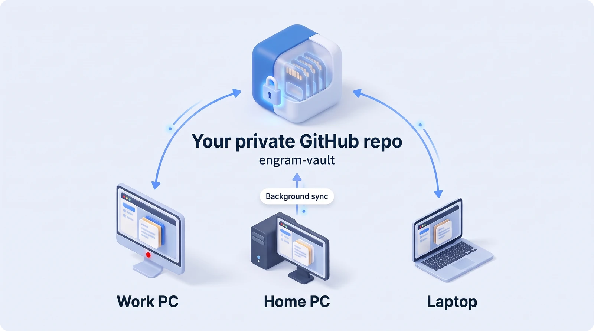
</p>

- Engram **does not modify Claude Code**. It only uses mechanisms Claude Code officially provides: the memory folder, `CLAUDE.md` imports, hooks, and a plugin pane (the memory pane).
- Your vault is a git repo at `%USERPROFILE%\.engram\vault`, synced to a private repo **under your own account**. Engram has no server and collects no data.
- Day-to-day operation **makes no AI calls**: health checks, context recall, guardrails, and the environment check all use rules that run on your computer, and secret redaction happens on your computer. Only when you turn on autopilot does it use your Claude quota in the background, once a day.

## Install

You need: **Windows 11**, a signed-in **Claude Code** (the official installer version), and a **GitHub account**. If Node.js, Git, or GitHub CLI are missing, Engram installs them for you. The installer's prompts are in Traditional Chinese for now (see the language note above); with Option 1, Claude translates them for you as it goes.

### Option 1: let AI install it (recommended, about 10 minutes)

<p align="center">
  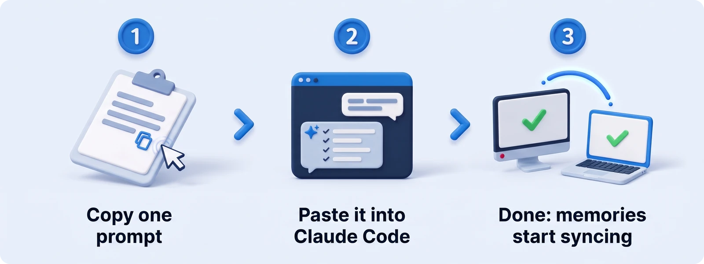
</p>

Open Claude Code and paste in this whole message:

```text
Please install Engram (the memory and environment steward for Claude Code) for me.
Install guide: https://raw.githubusercontent.com/Sen-CaPoo/engram/main/INSTALL-WITH-AI.md
Read the entire guide before you start and follow its steps. Before any step that changes my computer, explain it to me in plain language and get my approval.
```

Claude checks your environment, installs what's missing, shows you the install plan for approval, then completes and verifies the installation. All you do is click a few times in the browser when you sign in to GitHub. See [INSTALL-WITH-AI.md](INSTALL-WITH-AI.md) for details.

### Option 2: one-click install

1. Get Engram: click **Code → Download ZIP** at the top right of the GitHub page and unzip it, or run `git clone https://github.com/Sen-CaPoo/engram.git`.
2. Double-click **`setup.cmd`** in the folder. It installs missing tools, walks you through signing in to GitHub, lists the install plan, and installs only after you type `y` to approve.
3. When it's done, your browser opens the dashboard. Go to **Import memories** to bring in your old memories.

See the [Quick start](docs/en/quick-start.md) for the complete steps and what each screen looks like.

### Second computer

The steps are exactly the same. Engram notices that `engram-vault` already exists on your GitHub, connects to it automatically, and downloads the memories from your first computer.

> **Keep the Engram folder after installing.** You'll need it for updates. Updating takes two steps: get the new version (`git pull`, or download a new ZIP over the old folder), then run `engram update`. With several computers, a computer installed with git catches up on its own after another one updates (a computer installed from a ZIP has to be updated by hand).

## Everyday use

**You don't have to do anything.** Claude remembers things as usual, and Engram handles the rest in the background:

1. **Conversation start**: Claude knows which computer and which project it's in, and where global and machine memories should be written.
2. **When you send a message or run a command**: context recall brings up related memories, and guardrails stop known-bad ways of writing Bash or PowerShell commands before they are sent.
3. **Conversation end**: Engram tidies the index, checks for possible secrets, and saves everything to your vault.
4. **Every 10 minutes (default)**: Engram exchanges changes with your other computers.
5. **Once a day**: a health check and an environment check run, and anything that needs your decision goes into the inbox. When another computer has released a new version, this one updates automatically.
6. **With autopilot on**: once a day while the computer is idle, AI handles the inbox, tidies memories, and reviews conversations, so you don't even need to open the inbox; what it did is on the **Autopilot** page, where you can undo it. You get a digest every week.

When you want to tidy up on your own, type these in Claude Code:

| Command | What it's for |
| --- | --- |
| `/engram:autopilot` | Autopilot: turn it on or off, run once now, see what it did, undo |
| `/engram:inbox` | Has Claude read through the inbox card by card, explaining its reasoning and recommendations; it acts only after you approve. Add `auto` to have it handle the items it's confident about directly |
| `/engram:tidy` | A deep tidy of the global scope, the machine scope, one project, the core rules, or everything: Claude makes suggestions, and you decide each item under **Tidy-up** in the dashboard (which can also generate the command) |
| `/engram:tidy-apply` | Carries out the decisions you made on the Tidy-up page; the results come back to the same page |
| `/engram:dream` | Conversation review: checks a project's memories against this computer's recent conversations and adds what was missed; you decide on the suggestions item by item on the Tidy-up page too |
| `/engram:save` | Saves what's worth remembering long-term from this conversation as a memory |
| `/engram:recall` | Finds relevant experience in memories from other projects and other computers; read-only |
| `/engram-memories` | Toggles the memory pane, showing which memories this conversation loaded and read (or select **◆ Engram** at the bottom) |

Commands you'll use often in a terminal:

| Command | What it's for |
| --- | --- |
| `engram ui` | Opens the dashboard |
| `engram status` / `engram doctor` | Shows this computer's status and sync state; checks memory links, the GitHub connection, and the background agent one by one |
| `engram holding` | The holding area: suggestions autopilot didn't carry out (`adopt`, `dismiss`) |
| `engram guardrails` | The guardrail rules and their hits over the last 30 days (`test "<command>"` tries out a command) |
| `engram env` | The environment check (`diff` shows how two computers differ; `plan`, `approve`, `apply`, and `undo` handle environment sync, and you approve in your own terminal) |
| `engram autopilot` | Autopilot's status and switch (`preferences` lists the preferences it follows, `digest` shows the weekly digest) |
| `engram update` | Deploys a new version (`--rollback` goes back to the previous one) |

The full list of commands is in the [user guide](docs/en/user-guide.md#16-command-cheat-sheet).

<table>
  <tr>
    <td width="50%">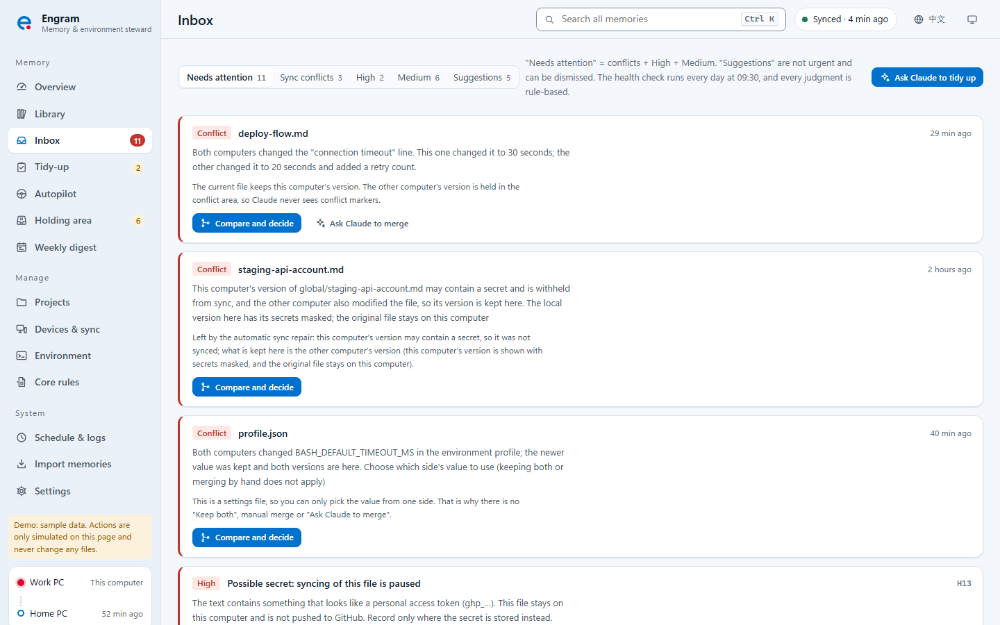<br><sub><b>Inbox</b>: every card has a one-click fix, or <b>Ask Claude</b></sub></td>
    <td width="50%">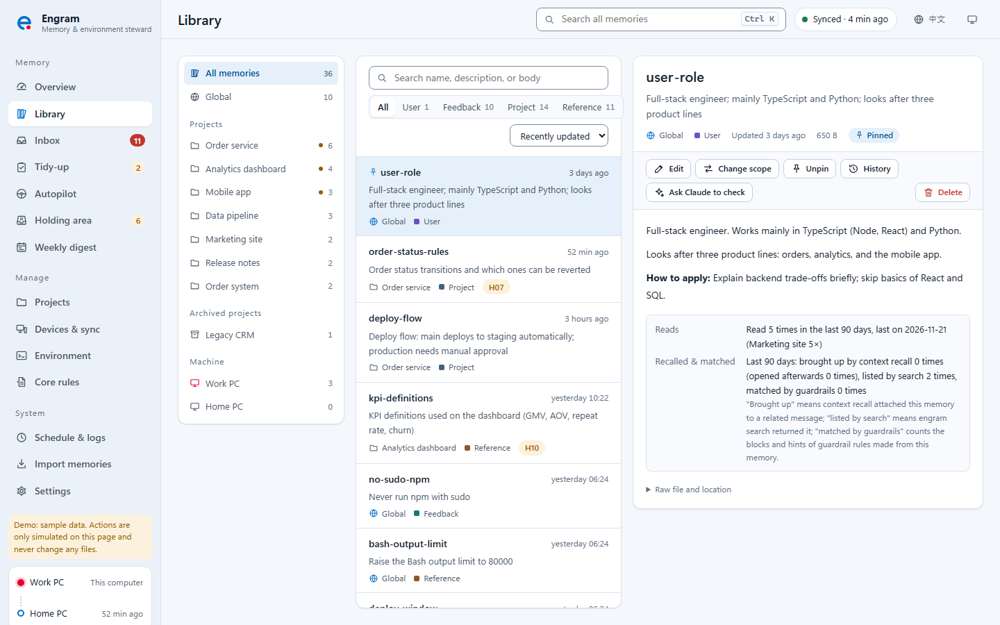<br><sub><b>Library</b>: search, edit, change scope, view history</sub></td>
  </tr>
  <tr>
    <td width="50%">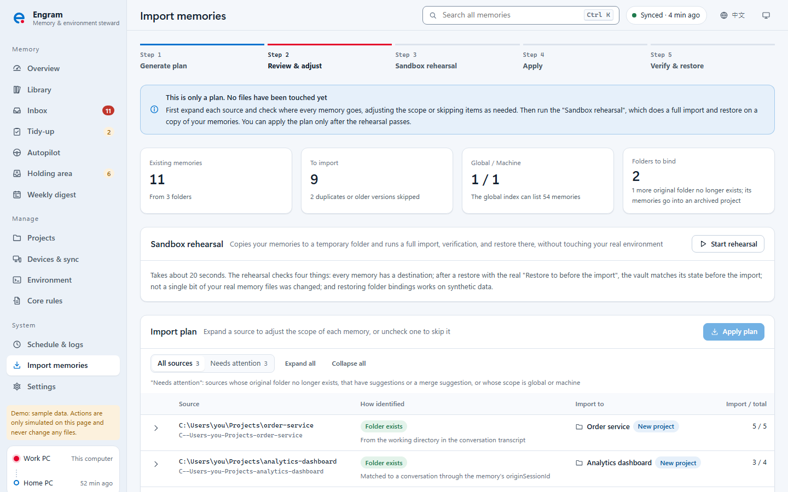<br><sub><b>Import memories</b>: rehearse on a copy first; you can apply only after it passes</sub></td>
    <td width="50%">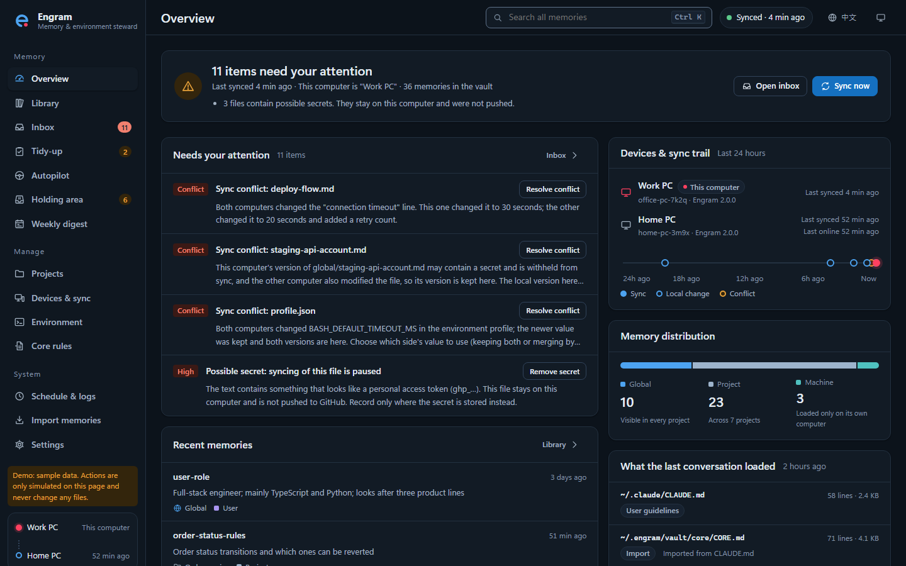<br><sub><b>Dark mode</b>: follows your system setting</sub></td>
  </tr>
</table>

## Privacy and security

<p align="center">
  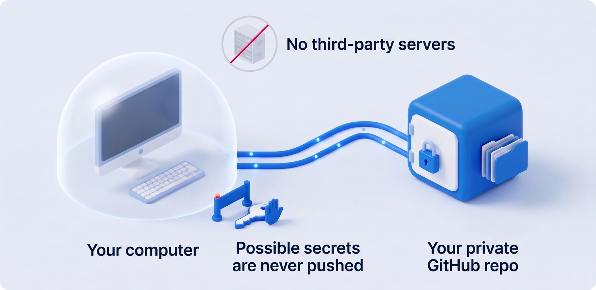
</p>

- **Your data lives in only two places**: your computer, and a private repo under your own GitHub account. Conversation transcripts are never synced: read statistics and conversation review read them on this computer, and only each memory's read count is synced.
- **What 2.0 adds to syncing**: environment fingerprints (names, versions, and hashes, plus the start of each hook command; no environment variable values), the shared environment profile and custom skills, guardrail rules, holding-area items that contain no conversation text, and the release information used for automatic updates. Holding-area items produced by conversation review, the exact words you used to correct Claude, and the various hit records stay on this computer. See the [FAQ](docs/en/faq.md#what-syncs-to-my-private-vault-and-what-stays-on-this-computer) for the full list.
- **No AI calls**: your Claude quota is used in only three cases: the compatibility probe when Claude Code is updated (synthetic data only, and you can turn it off in the dashboard), when you type an `/engram:` command yourself (`/engram:dream` analyzes several conversations, so it uses more than the other commands), and when you turn on autopilot (once a day, with a monthly cap of about US$200 at API list prices by default; no extra charge on a subscription). Autopilot calls Claude with the Claude Code sign-in on your computer and sends the same kind of content as when you use Claude Code yourself, with possible secrets masked on your computer first. The memory pane, read statistics, context recall, guardrails, and the environment check are computed on your computer only and use no quota.
- **Secret protection**: memories that look like they contain secrets are never pushed, and any detected secrets are redacted on your computer before anything is handed to Claude for tidying.
- **Fully removable**: before installing, Engram lists every location it will change and records each one; `engram uninstall` reverts them one by one from that record, and keeps your vault by default.
- **Company data**: if your company doesn't allow work data on a personal GitHub account, use a private repo under your company's organization instead, or use Engram on a single computer only.

See [SECURITY.md](SECURITY.md) for details.

## FAQ

**Does it cost anything?** No. Engram is free under the MIT license.

**Does it support macOS or Linux?** Not yet. Engram currently supports Windows 11 only (background sync uses Windows Task Scheduler).

**What if my company network blocks GitHub?** Your memories are still saved locally and sync automatically once you're back on a network that can reach GitHub.

**What if I want to stop using it?** Run `engram uninstall`. Your computer returns to how it was before installation, and your vault is kept by default.

**Will it change my Claude Code settings by itself?** No. Environment sync only reports by default. Settings that sync from another computer are applied only after you approve them on this computer, and a backup is made first so you can undo it.

**Do I have to pay or reinstall to upgrade to 2.0?** Neither. Update the usual way; see [Updating](docs/en/user-guide.md#15-updating).

More questions are answered in the [FAQ](docs/en/faq.md).

## Documentation

| Document | Who it's for |
| --- | --- |
| [INSTALL-WITH-AI.md](INSTALL-WITH-AI.md) | Anyone who wants Claude to do the installation (it's also the manual the AI follows) |
| [Quick start](docs/en/quick-start.md) | Anyone who wants to install step by step on their own |
| [User guide](docs/en/user-guide.md) | The full feature set: autopilot and the holding area, context recall, guardrails, the environment steward, inbox, conflicts, colliding folders, pausing and removing, command cheat sheet |
| [FAQ](docs/en/faq.md) | Common questions and troubleshooting |
| [Changelog](CHANGELOG.md) | Changes in each version (Traditional Chinese, with an English summary from 1.1.0) |

## About the name


**Engram** is a neuroscience term for the physical trace a memory leaves in the brain; the Chinese name 憶跡 (yìjì, "memory trace") carries the same meaning. The logo is a lowercase e drawn in a single stroke: the continuous trail stands for memory, the loop stands for sync, and the red dot at the opening stands for "now, this computer".

## License

[MIT](LICENSE) © 2026 Sen-CaPoo

Claude and Claude Code are trademarks of Anthropic. Engram is an independently developed third-party tool and is not affiliated with or endorsed by Anthropic.
