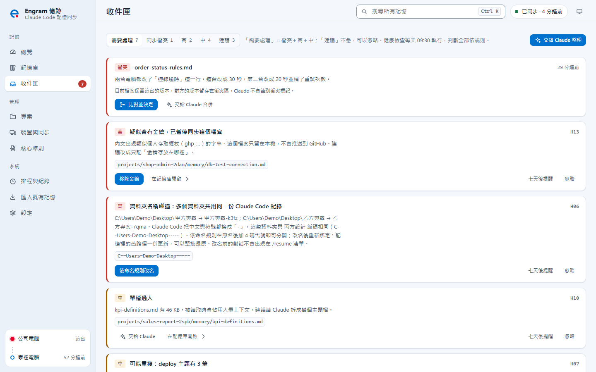
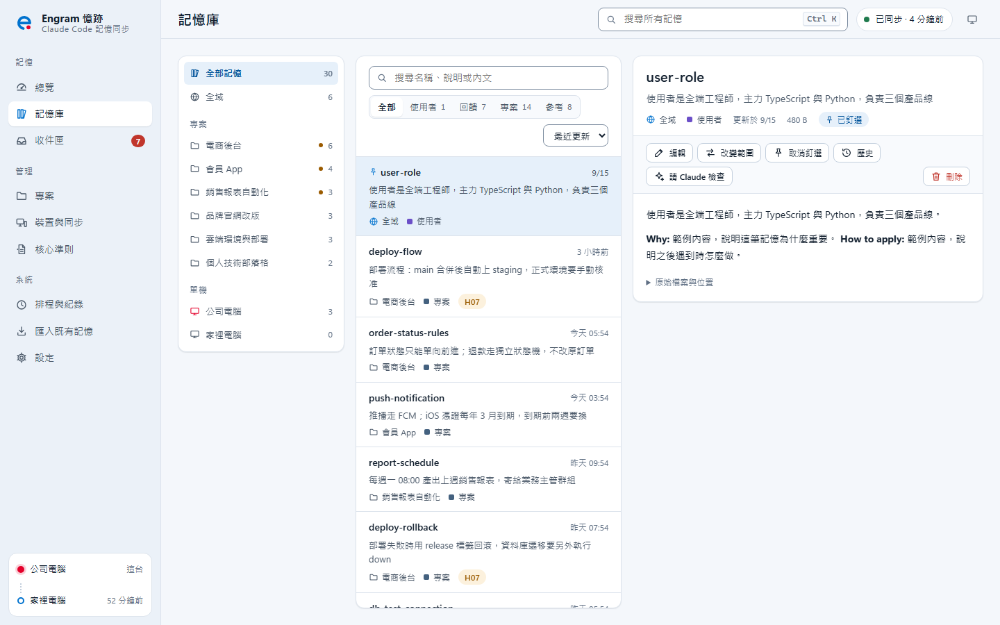
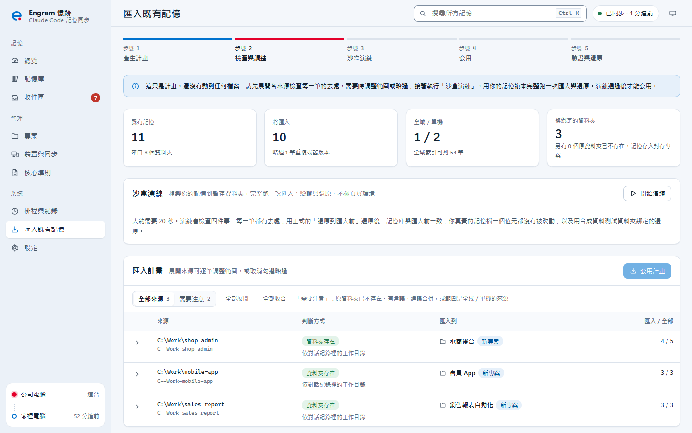
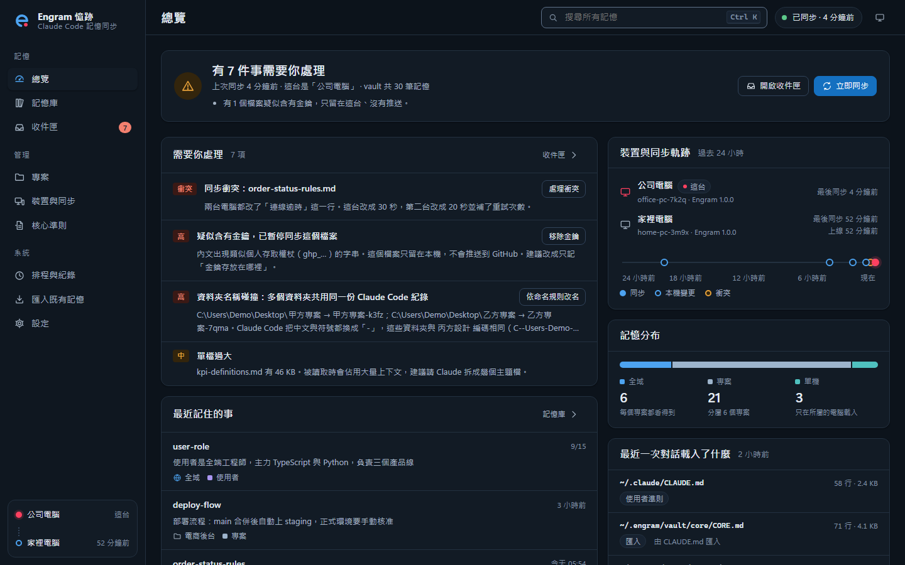

<p align="center">
  <picture>
    <source media="(prefers-color-scheme: dark)" srcset="docs/assets/wordmark-dark.svg">
    
  </picture>
</p>

<h3 align="center">讓 Claude 在每一台電腦都記得你</h3>

<p align="center">
  Claude Code 記憶的跨裝置同步、整理與復原。<br>
  記憶存在你自己的 GitHub 私人 repo，公司、家裡、筆電打開同一個專案，Claude 都記得你教過的事。
</p>

<p align="center">
  
  
  
  
</p>

<p align="center">
  <a href="AI%20幫你快速安裝.md"><b>交給 AI 安裝</b></a> ·
  <a href="docs/快速開始.md">自己安裝</a> ·
  <a href="docs/使用說明.md">使用說明</a> ·
  <a href="docs/常見問題.md">常見問題</a>
</p>

<p align="center">
  
</p>

## 為什麼需要 Engram

Claude Code 會自動記下你的習慣、專案慣例與踩過的坑。但這些記憶只存在**一台電腦的一個資料夾**裡：

<p align="center">
  
</p>

| 你遇到的狀況 | 結果 |
| --- | --- |
| 在公司教過 Claude 的事，回家開同一個專案 | 全部要重教一次 |
| 專案資料夾搬家、改名，或用了字數相同的中文名稱 | 記憶消失，或和別的專案混在一起 |
| 用了幾個月，記憶越來越多 | 重複、過時、放錯專案的內容沒人整理；索引超過 200 行，後面的 Claude 根本讀不到 |

Engram 把記憶變成**跟著你走、跟著專案走、隨時能復原**的資產。

## 功能

| | 功能 | 你得到什麼 |
| :---: | --- | --- |
|  | **多台電腦自動同步** | 背景自動同步（預設每 10 分鐘）。開 Claude Code 不用等網路，離線照常記憶，恢復連線後自動補上。 |
|  | **專案用 ID 認，不用路徑認** | 資料夾搬家、改名，或在另一台電腦 clone 同一個 git repo，都認得是同一個專案。 |
|  | **三種範圍各歸其位** | 個人偏好放「全域」，每個專案都看得到；安裝路徑、網路設定放「單機」，不會跑到別台電腦。 |
|  | **什麼都能復原** | 每個變更都有歷史。匯入前先在複本上完整演練，套用後隨時一鍵還原；原始記憶檔一律保留。 |
|  | **衝突不吵你** | 兩台改了不同段落就自動合併；改到同一段才請你並排比對，Claude 永遠不會讀到衝突標記。 |
|  | **金鑰不外流** | 偵測到疑似密碼、權杖、連線字串的記憶，只留在本機、不會推送，並在收件匣提醒你遮蔽。 |
|  | **交給 Claude 整理** | 在 Claude Code 輸入 `/engram:inbox`、`/engram:tidy`，Claude 讀過內容、先列計畫，你同意才動手。 |
|  | **看得見的管理介面** | 總覽、記憶庫、收件匣、專案、裝置與同步，一個介面全部看清楚；支援深色模式，可安裝成桌面應用程式。 |

## 30 秒看懂運作方式

<p align="center">
  
</p>

- Engram **不修改 Claude Code**，只使用官方提供的三種機制：記憶資料夾、`CLAUDE.md` 匯入與 hooks。
- 記憶庫是一個 git repo，放在 `%USERPROFILE%\.engram\vault`，同步到**你自己帳號**底下的私人 repo。Engram 沒有伺服器，不蒐集任何資料。
- 日常運作**不呼叫 AI**：健康檢查用規則判斷，金鑰遮蔽在本機完成。

## 安裝

需要：**Windows 11**、已登入的 **Claude Code**（官方安裝程式版本）、一個 **GitHub 帳號**。Node.js、Git、GitHub CLI 缺少的話會自動補齊。

### 方法一：交給 AI 安裝（推薦，約 10 分鐘）

<p align="center">
  
</p>

打開 Claude Code，把下面這段話整段貼上：

```text
請幫我安裝 Engram（Claude Code 記憶同步工具）。
安裝手冊：https://raw.githubusercontent.com/Sen-CaPoo/engram/main/AI%20%E5%B9%AB%E4%BD%A0%E5%BF%AB%E9%80%9F%E5%AE%89%E8%A3%9D.md
請先完整讀完手冊再開始，照步驟進行；任何會改動電腦的步驟，都先用白話跟我說明並取得我的同意。
```

Claude 會檢查環境、補齊工具、列出安裝計畫給你確認，再完成安裝與驗證。你只需要在登入 GitHub 時點幾下瀏覽器。詳見 [AI 幫你快速安裝.md](AI%20幫你快速安裝.md)。

### 方法二：一鍵安裝

1. 下載 Engram：點右上角 **Code → Download ZIP** 並解壓縮，或執行 `git clone https://github.com/Sen-CaPoo/engram.git`。
2. 雙擊資料夾裡的 **`setup.cmd`**。它會補齊工具、帶你登入 GitHub、列出安裝計畫，等你輸入 `y` 同意後才安裝。
3. 安裝完成後瀏覽器會開啟管理介面，到「匯入既有記憶」把舊記憶收進來。

完整步驟與畫面說明見 [快速開始](docs/快速開始.md)。

### 第二台電腦

步驟完全一樣。Engram 會發現你 GitHub 上已經有 `engram-vault`，自動接上並下載第一台的記憶。

> **安裝後請保留 Engram 資料夾**，之後更新版本會用到。更新只要兩步：取得新版程式（`git pull`，或下載新的 ZIP 覆蓋原資料夾），再執行 `engram update`。

## 日常使用

**什麼都不用做。** Claude 照平常記憶事情，Engram 在背景處理其餘的事：

1. **對話開始**：Claude 知道自己在哪台電腦、哪個專案，也知道全域與單機記憶要寫到哪裡。
2. **對話結束**：整理索引、檢查有沒有疑似金鑰，存進記憶庫。
3. **每 10 分鐘（預設）**：和其他電腦交換變更。
4. **每天一次**：健康檢查，有需要你決定的事就放進收件匣。

想主動整理時，在 Claude Code 裡輸入：

| 指令 | 用途 |
| --- | --- |
| `/engram:inbox` | 讓 Claude 逐張讀過收件匣，說明判斷依據與建議；你同意後才執行。加上「自動」直接處理有把握的項目 |
| `/engram:tidy` | 深度整理一個專案、全域、單機或核心準則：找出重複、過時、矛盾、放錯範圍的記憶 |
| `/engram:save` | 把這次對話值得長期記住的事存成記憶 |
| `/engram:recall` | 從其他專案、其他電腦的記憶找出相關經驗，只讀不寫 |

<table>
  <tr>
    <td width="50%"><br><sub><b>收件匣</b>：每張卡片都有一鍵處理，或「交給 Claude」</sub></td>
    <td width="50%"><br><sub><b>記憶庫</b>：搜尋、編輯、改變範圍、查看歷史</sub></td>
  </tr>
  <tr>
    <td width="50%"><br><sub><b>匯入既有記憶</b>：先在複本演練，通過才能套用</sub></td>
    <td width="50%"><br><sub><b>深色模式</b>：跟隨系統設定</sub></td>
  </tr>
</table>

## 隱私與安全

<p align="center">
  
</p>

- **你的資料只在兩個地方**：你的電腦，以及你自己 GitHub 帳號底下的私人 repo。對話紀錄（transcript）不會同步。
- **不呼叫 AI**：只有兩種情況會用到你的 Claude 額度：Claude Code 改版時的相容性探測（只用合成資料，可在介面關閉），以及你主動輸入 `/engram` 指令時。
- **金鑰保護**：疑似金鑰的記憶不會推送；交給 Claude 整理前，偵測到的金鑰會先在本機遮蔽。
- **可完整移除**：安裝前列出所有會改動的位置，每一項都記錄下來；`engram uninstall` 依紀錄逐項還原，預設保留你的記憶庫。
- **公司資料**：如果公司不允許把工作資料放在個人 GitHub，可以改用公司組織底下的私人 repo，或只在單機使用。

詳見 [SECURITY.md](SECURITY.md)。

## 常見問題

**要付費嗎？** 不用。Engram 以 MIT 授權免費提供。

**支援 macOS 或 Linux 嗎？** 目前只支援 Windows 11（背景同步使用 Windows 工作排程器）。

**公司網路擋住 GitHub 怎麼辦？** 記憶照常存在本機，回到能連 GitHub 的網路後自動補同步。

**不想用了怎麼辦？** 執行 `engram uninstall`，電腦會還原到安裝前，記憶庫預設保留。

更多問題見 [常見問題](docs/常見問題.md)。

## 文件

| 文件 | 給誰看 |
| --- | --- |
| [AI 幫你快速安裝.md](AI%20幫你快速安裝.md) | 想讓 Claude 代為安裝的人（也是給 AI 照做的手冊） |
| [快速開始](docs/快速開始.md) | 想自己一步步安裝的人 |
| [使用說明](docs/使用說明.md) | 完整功能：收件匣、衝突、資料夾撞名、暫停與移除、指令速查 |
| [常見問題](docs/常見問題.md) | 常見疑問與疑難排解 |
| [更新紀錄](CHANGELOG.md) | 每個版本的變更 |

## 關於名稱


**Engram**（記憶痕跡）是神經科學用語，指一段記憶在大腦裡留下的實體痕跡；中文名「憶跡」取其意。Logo 是一筆寫成的 e：連續的軌跡代表記憶，環形代表同步，開口處的紅點代表「現在，這台電腦」。

## 授權

[MIT](LICENSE) © 2026 Sen-CaPoo

Claude 與 Claude Code 是 Anthropic 的商標。Engram 是獨立開發的第三方工具，與 Anthropic 沒有隸屬或合作關係。
