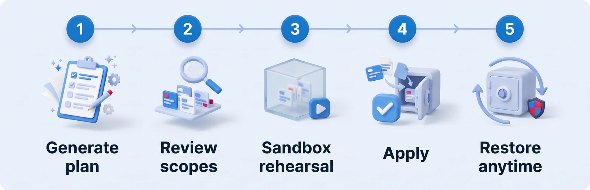

[繁體中文](../快速開始.md) · **English**

# Quick start

About 15 minutes to share one set of Claude Code memories across your computers. The whole installation is one file to run, and every other step is listed first and waits for your approval.

> Don't want to do it yourself? Paste the message at the top of [INSTALL-WITH-AI.md](../../INSTALL-WITH-AI.md) into Claude Code and let it do the work for you.

> **Language support.** The dashboard is available in English and Traditional Chinese (switch languages in the top bar or in Settings). For now, the command-line output, the setup script's prompts, the agent's Windows notifications, and the instructions inside the Claude Code plugin skills are in Traditional Chinese. Claude normally replies in the language you write in. This guide glosses each step so you know what it is asking.

## 1. Before you start

| You need | Notes |
| --- | --- |
| Windows 11 | The built-in winget is required; the installer uses it to install any missing tools |
| Claude Code | Installed with the official installer and signed in at least once. The installer does not install Claude Code for you |
| A GitHub account | Your vault goes into a private repo under your account. If you don't have an account yet, sign up at [github.com](https://github.com) first |
| Node.js, Git, GitHub CLI | You don't need to install these yourself; the installer installs whatever is missing. If Node.js is already installed but older than version 22, the installer asks you to upgrade it first |

> **Check your company's policy first.** Memories can contain customer and project details. If your company doesn't allow work data on a personal GitHub account, use a private repo under your company's GitHub organization instead (ask an administrator to create an empty repo, then add `--remote <repo URL>` when you install; see [section 7](#7-install-from-the-command-line)), or use Engram on a single computer only (`--local`).

## 2. Get Engram

Pick one:

- **With git (recommended, easiest to update later)**:
  ```powershell
  git clone https://github.com/Sen-CaPoo/engram.git "$HOME\engram"
  ```
- **Download the ZIP**: on the GitHub page click **Code → Download ZIP** and unzip it somewhere convenient, for example `C:\Users\YourName\engram`.

**Keep this folder.** You'll need it for updates.

## 3. Double-click `setup.cmd`

It does four things in order, and each step is shown on screen:

| Step | What it does |
| --- | --- |
| 1/4 Check tools (檢查必要工具) | If Node.js, Git, or GitHub CLI is missing, installs it with winget |
| 2/4 Sign in to GitHub (登入 GitHub…) | If you're not signed in yet, opens a browser so you can sign in once |
| 3/4 Install Engram (安裝 Engram) | Asks for this computer's name (for example "Work PC"), lists the install plan, and waits for you to type `y` to approve |
| 4/4 Open the dashboard (開啟管理介面) | Opens `http://127.0.0.1:4777` in your browser |

The prompts on screen are in Traditional Chinese for now. The only things you have to answer are the computer's name (any name you like) and `y` to approve the install plan.

The installer works out whether this is your first computer or a later one: if your GitHub doesn't have an `engram-vault` yet, it creates a private repo; if it already does, it connects to it and downloads the memories your other computers have already synced.

> **Want to see what it will do first?** In a terminal, run `setup.cmd -DryRun -Label "Work PC"`. It only checks; it installs nothing and changes nothing. If all the tools are present and you're signed in to GitHub, it ends by printing the install plan a real run would use; otherwise it lists what's still missing.
>
> **A Windows security warning?** The first time you run a file downloaded from the internet, Windows may ask whether you want to run it. Choose **Run**.

**Tip**: open the dashboard in Edge, and from its menu choose **Apps › Install this site as an app**. After that you can open it from the Start menu.

## 4. Import your existing memories (first time)

If you've been using Claude Code for a while, your computer already holds old memories. In the dashboard, go to **Import memories** and work through it in order:

<p align="center">
  
</p>

1. **Generate plan**: Engram lists which project each memory belongs to, plus the suggested scope and action. Duplicates and older versions are skipped automatically. This step writes nothing.
2. **Check the suggested scopes**: the rule of thumb is one question: **would this still hold true on another computer?** If not, it goes in **Machine**. If so, ask next: **would it still hold true in a different project?** If so, it goes in **Global**; if not, it goes in **Project**.
3. **Start rehearsal**: it runs a complete import, verification, and restore on a copy without touching any real files, in about 20 seconds. **Apply plan** can't be clicked until all four checks pass.
4. **Apply plan**: when it finishes, Engram shows a restore point (for example `engram-import-20261022-…`), and you can restore with one click at any time afterwards. Your original memory files are always kept and never deleted.

## 5. Confirm it's connected

1. **Open a new Claude Code conversation**: in any project folder you've imported, start a new conversation and ask Claude, "Can you see Engram's status?" It should answer with something like "Work PC · project: xxx · bound". (The status text Engram injects is in Traditional Chinese for now, so Claude may quote parts of it as 專案：xxx · 已綁定.)
2. **Check the status in a terminal**: open a new PowerShell, Command Prompt, or Git Bash window and run:
   ```powershell
   engram status
   engram doctor
   ```
   `doctor` checks the memory links, the GitHub connection, the agent, and the sign-in task one by one. If a project you just imported has a conversation open, its link connects automatically once that conversation ends; until then it's normal to see ✗.

## 6. Second computer

The steps are exactly the same as for the first one: get Engram, double-click `setup.cmd`, and choose a different name (for example "Home PC").

- **Git projects**: as long as the remote is the same, the first time you open Claude Code on this computer it connects automatically.
- **This computer has old memories too**: import them the same way under **Import memories**; anything identical to the first computer is skipped automatically.
- **Folders that aren't git repos**: they start out as a new project. On the **Projects** page you can use **Merge into another project** to merge one with the same project from the other computer.

## 7. Install from the command line

If you'd rather not use `setup.cmd` and want to control every step yourself, first install Node.js 22 or later, Git, and GitHub CLI yourself and run `gh auth login`, then run this in the Engram folder:

```powershell
node app/bin/engram.mjs install --label "Work PC"                      # works out whether this is the first computer or a later one
node app/bin/engram.mjs install --remote <url> --label "Work PC"       # choose the vault, for example a repo in your company's organization
node app/bin/engram.mjs install --local --label "Work PC"              # use this computer only, no sync
node app/bin/engram.mjs install --dry-run                              # only list the plan, change nothing
```

Other options: `--no-cli` (don't create the `engram` terminal command), `--no-schedule` (don't create the sign-in task), `--yes` (skip the confirmation prompt).

## 8. What the installation changes

| Location | What it does |
| --- | --- |
| `%USERPROFILE%\.engram\` | The vault, the program itself, local state, and backups |
| `~/.claude/CLAUDE.md` | Adds a two-line Engram block at the end of the file and leaves the existing content alone; backed up before the change |
| Claude Code plugin `engram` | Hooks at the start and end of conversations, and the `/engram` commands |
| npm global command `engram` | Lets you type `engram` in an ordinary terminal; add `--no-cli` during installation if you don't want it |
| Windows Task Scheduler `\Engram\Agent` | Starts Engram in the background at sign-in and syncs every 10 minutes |
| Project folders bound during import | `.claude\settings.local.json` gets one `autoMemoryDirectory` line; folders that aren't git repos also get a `.claude\engram.json` marker |
| `~/.claude/settings.json` and the memory folder | Only when the default permission mode is auto or bypassPermissions: the original memory folder is backed up and replaced with a link, and the link's path is added to `additionalDirectories` |

Every item is recorded in the installation record. `engram uninstall` first lists the removal plan, then reverts each item one by one after you approve, and keeps your vault by default.

> **Recommended: set Claude Code's default permission mode to auto.** It works without this: opening Claude Code from a project root works completely normally, and only when it's opened from a subfolder will Engram's memory not be used. The install plan reminds you of your current setting.

## Next steps

- [User guide](user-guide.md): inbox, conflicts, colliding folders, tidying with AI, pausing and removing
- [FAQ](faq.md): common questions about installing and using Engram, and troubleshooting
