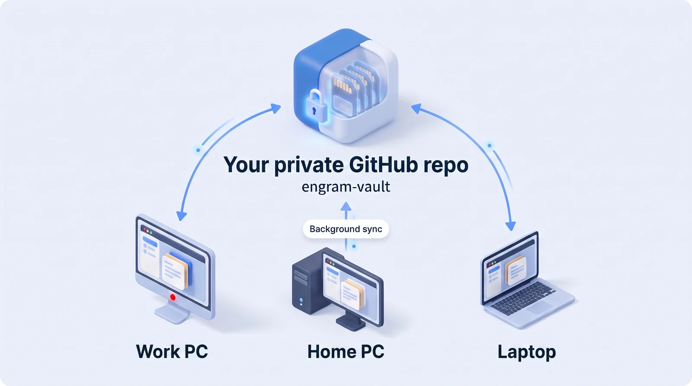
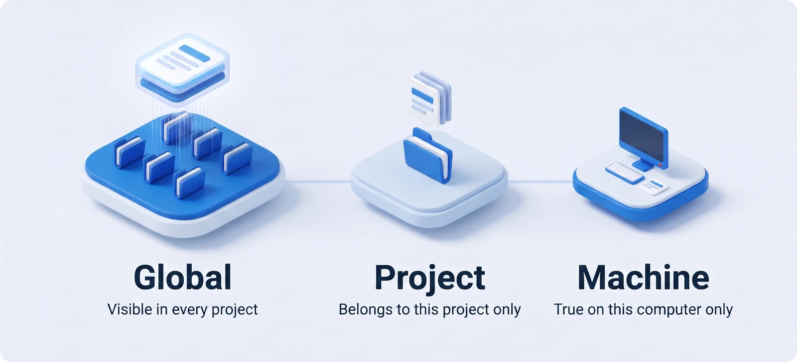
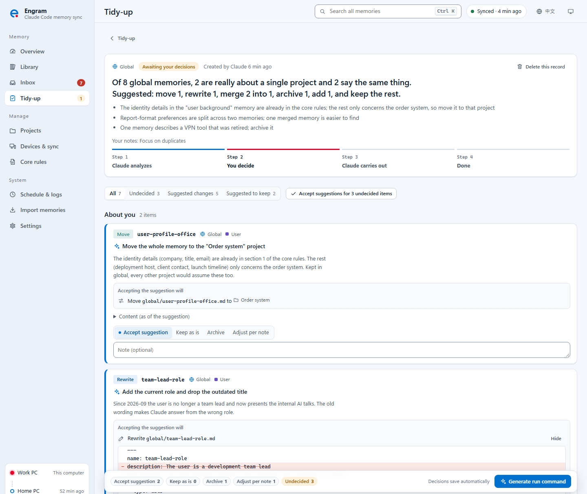
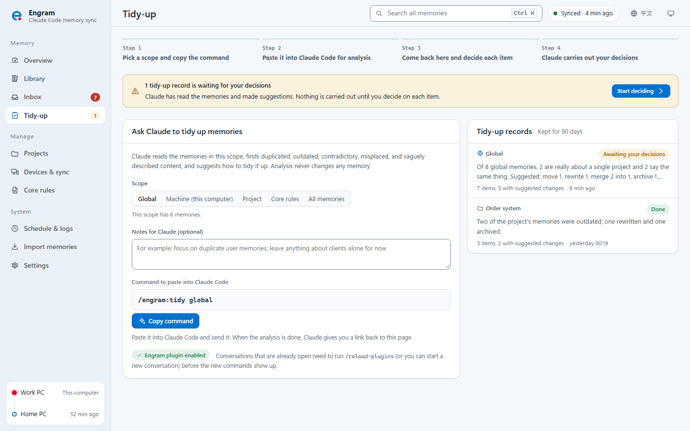
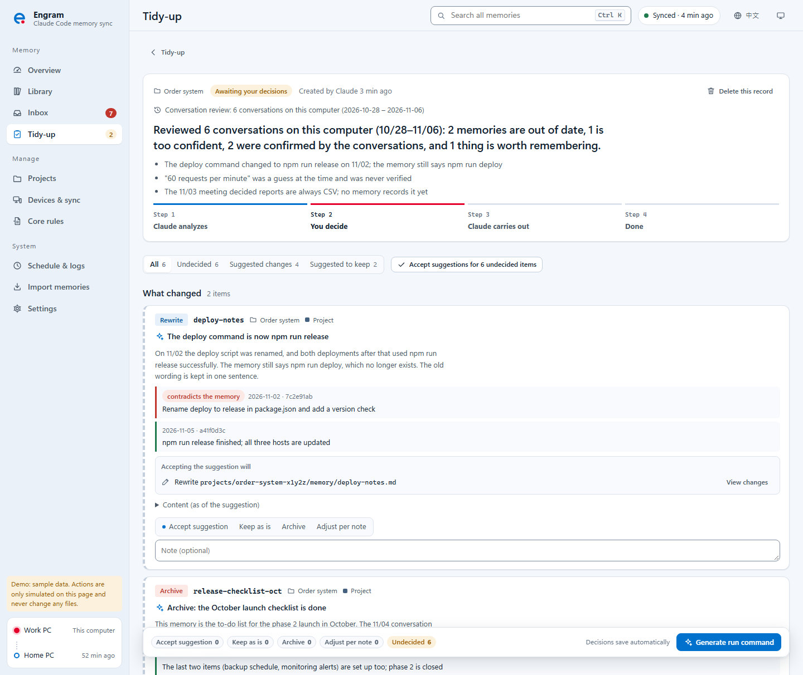
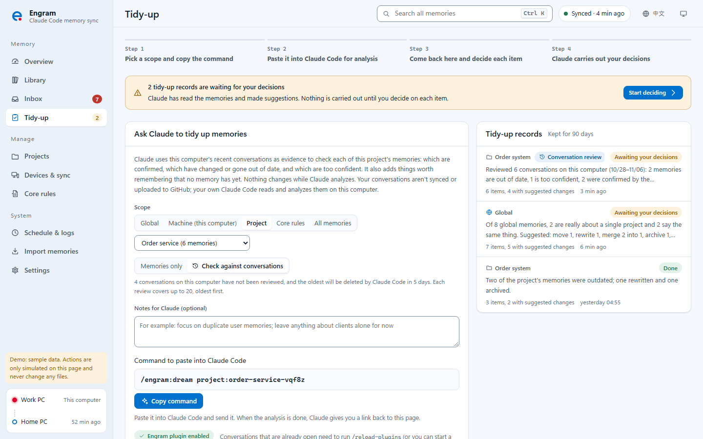
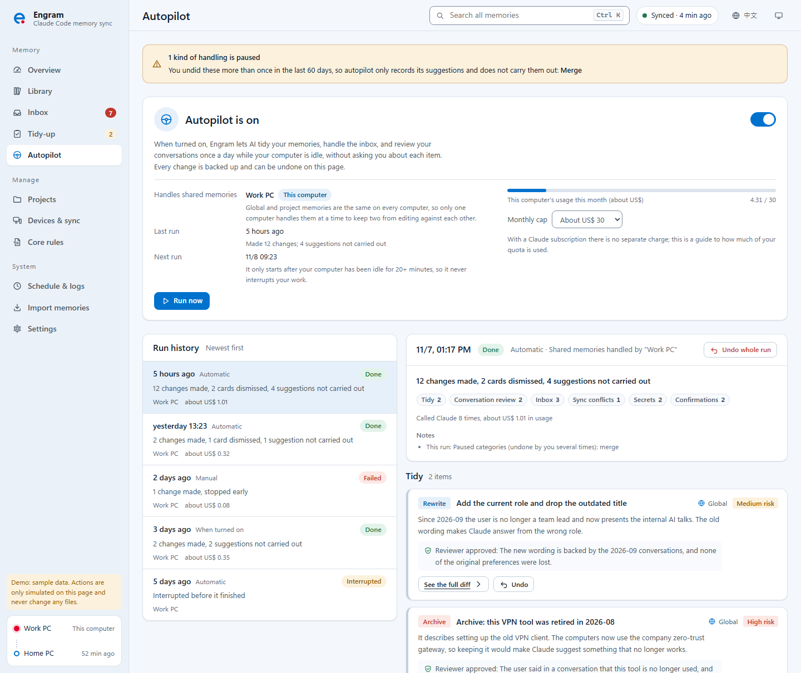
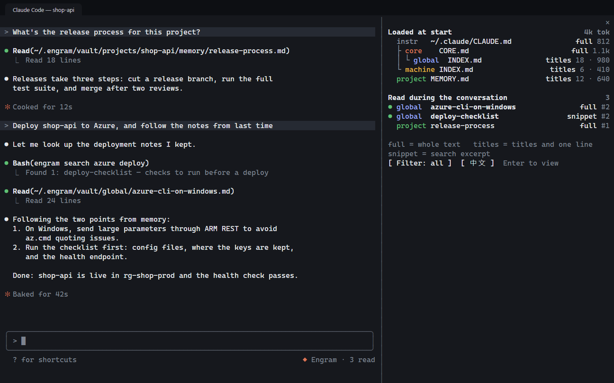
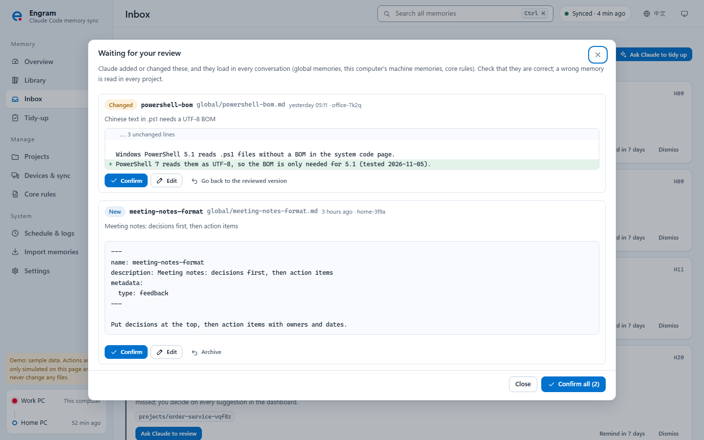

[繁體中文](../使用說明.md) · **English**

# User guide

Once installed, Engram needs almost no attention. This guide covers the features you'll use day to day, and what to do when Engram needs a decision from you. If you haven't installed it yet, start with the [Quick start](quick-start.md).

**Contents**: [How it works](#1-how-it-works) · [Everyday use](#2-everyday-use) · [Tidy with AI](#3-tidy-with-ai-in-claude-code) · [Memory pane](#4-the-memory-pane-which-memories-this-conversation-read) · [The dashboard](#5-the-dashboard) · [Inbox](#6-the-inbox-and-health-cards) · [Conflicts](#7-handling-conflicts) · [Colliding folders](#8-colliding-folders) · [Core rules](#9-core-rules) · [Pause, undo, and remove](#10-pause-undo-and-remove) · [Updating](#11-updating) · [Command cheat sheet](#12-command-cheat-sheet)

## 1. How it works

  

| Concept | Description |
| --- | --- |
| Vault | All memories are gathered in `%USERPROFILE%\.engram\vault`, a git repo that syncs to the private repo `engram-vault` on your GitHub |
| Three scopes | **Global**: true for every project, such as your preferences. **Project**: belongs to one project only, such as how it's deployed. **Machine**: true only on this computer, such as install paths and network settings |
| Project ID | Every project has a fixed ID. Git projects are recognized by their remote and other folders by a marker file, so moving, renaming, or switching computers is fine |
| Binding | Connects a project folder to its place in the vault. A git project is bound automatically the first time you open Claude Code on another computer |

Engram does not modify Claude Code itself. It only uses official mechanisms: the memory folder, `CLAUDE.md` imports, hooks, and a plugin pane (the memory pane).

How do you tell the three scopes apart? One rule of thumb: **would this still hold true on another computer?** If not, it goes in **Machine**. If so, ask next: **would it still hold true in a different project?** If so, it goes in **Global**; if not, it goes in **Project**.

  

## 2. Everyday use

You don't have to do anything. Claude remembers things as usual, and Engram handles the rest in the background:

| When | What Engram does |
| --- | --- |
| Conversation start | Brings in the status: Claude knows which computer and which project it's in, and where global and machine memories should be written |
| During the conversation | Project memories are written the official way. Global and machine memories are written by Claude with `engram remember`, and it tells you when it has |
| Conversation end | Tidies the index, checks for possible secrets, then saves to the vault |
| Every 10 minutes (default) | Exchanges changes with your other computers. While you're offline, changes stay on this computer and catch up automatically once you're back online. You can change the interval on the Settings page |
| Once a day (default 09:30) | Runs a health check (and updates the read statistics from this computer's conversations); anything that needs your decision goes into the inbox |

When you want to tidy up on your own:

- In **Library** you can search and edit, or use **Change scope** to move a memory to global, machine, or another project. Duplicate memories show up in the inbox as **Identical memories** or **Possible duplicates** cards, where you can merge them.
- The **Projects** page shows how far each project's memory index (MEMORY.md) is from Claude Code's load limit.
- On **Overview**, **What the last conversation loaded** lists which files Claude actually read in and how big each one is. To see it while the conversation is going, use the memory pane in Claude Code (section 4).

## 3. Tidy with AI in Claude Code

Health checks use rules only, so they can only find candidates such as "same name" or "file too big". Whether something should be promoted to global, whether it's really a duplicate, and whether it's still useful all take reading the content. You hand those judgments to your own Claude Code:

| Command | What it does | Where it appears in the dashboard |
| --- | --- | --- |
| `/engram:inbox` | Reads through the inbox cards one by one, explains its reasoning and recommendations, and acts only after you approve. Add a card id to handle just that one; add `auto` to have it handle the items it's confident about directly. Sync conflicts, possible secrets, folder binding and renaming, mass deletions, archiving, and anything it isn't sure about are still left for you to decide | **Ask Claude to tidy up** at the top of the inbox, **Ask Claude** on a card, **Ask Claude to merge** on a conflict card |
| `/engram:tidy` | A deep tidy of the global scope, the machine scope, one project, the core rules, every scope, or a single memory: finds memories that are semantically duplicate, outdated, contradictory, misfiled, or unclear, saves its suggestions (with the complete revised content) as a tidy-up record, and gives you a link to decide on each item in the dashboard. Analysis never changes a memory (see **Tidy-up** below) | The **Tidy-up** page generates the command; **Ask Claude to tidy up** on the Projects page, **Ask Claude to check** in Library, and **Ask Claude to trim** on the Core rules page open that page with the scope filled in |
| `/engram:tidy-apply` | Carries out the decisions you made on the Tidy-up page: accepted items are written exactly as you saw them, "Adjust per note" items are handled by Claude following your notes, and it reports the results and how to undo them | **Generate run command** on the Tidy-up page |
| `/engram:dream` | Conversation review: uses this computer's recent conversations as evidence to check one project's memories one by one, and adds what was missed. The suggestions are saved as a tidy-up record too, and you decide on each item (see **Conversation review** below) | On the **Tidy-up** page, pick a project and choose **Check against conversations**; **Review conversations** on the Projects page; the **Review the conversations** card in the inbox |
| `/engram:save` | Reviews this conversation and saves what's worth remembering long-term as memories: decides the scope, checks first whether a similar memory exists, and updates that one if so | Use it in a conversation |
| `/engram:autopilot` | Autopilot: turn it on or off, run once now, see what a run did, undo (see **Autopilot** below) | The **Autopilot** page and Settings |
| `/engram:recall` | Finds relevant experience in the memories of other projects, the global scope, and each computer, distills it into conclusions you can apply right away with sources attached; read-only | Use it in a conversation |

### Tidy-up: Claude suggests, you decide each item

  

1. **Pick a scope**: open **Tidy-up** in the dashboard and choose Global, Machine (this computer), Project, Core rules, or All memories. Add notes for Claude if you like (for example "focus on duplicates" or "leave anything about clients alone for now"), then press **Copy command**.
2. **Let Claude analyze**: paste `/engram:tidy …` into Claude Code. Claude reads the memories, saves each suggestion with its reasoning and the complete revised content as a tidy-up record, and finally gives you a link back to the dashboard. Nothing is changed at this step.
3. **Decide each item**: each item shows Claude's suggestion and reasoning, **View changes** to compare before and after, and **Content (as of the suggestion)**. Then choose:

   | Decision | What happens |
   | --- | --- |
   | Accept suggestion | Carried out exactly as shown (rewrite, move, merge, add, archive) |
   | Keep as is | Left alone |
   | Archive | Moved to history; you can restore it later |
   | Adjust per note | Write how to change it in the note, and Claude handles it accordingly |

   Decisions save automatically, so you can finish in several sittings. **Accept suggestions for undecided items** applies Claude's suggestions to whatever is left. Items whose memory changed after the suggestion (for example, synced from another computer) are flagged; when the tidy-up runs, that item isn't written (it's marked failed), so nothing is overwritten.
4. **Run it**: press **Generate run command** and paste `/engram:tidy-apply <id>` back into Claude Code. Engram first backs up the files it will touch to `~/.engram/local/backups/`, carries out the accepted items exactly as shown, and hands the "Adjust per note" items to Claude; one failed item doesn't affect the others. The results come back to the same page, and every item has **Undo this item**.

  

Tidy-up records stay on this computer only (`~/.engram/local/tidy/`), are not synced, and are cleared after 90 days; you can delete one yourself on its page.

Safety by design:

- **Suggestions first, act only after you decide.** `/engram:tidy` only reads memories and creates a tidy-up record (the skill pre-allows only those commands); writes happen only after you decide on the Tidy-up page and paste `/engram:tidy-apply`. The inbox's `/engram:inbox` proposes a plan first and acts only after you approve. Every write comes with an `engram undo <version>` so you can undo each item individually.
- **Detected secrets are not handed to Claude.** When Claude reads memories, possible secrets have already been replaced on this computer with a marker such as `‹已遮蔽：…›` ("redacted"). Engram also refuses writes that contain possible secrets, so Claude records only where the secret is stored instead.
- **"Not a secret" is confirmed by you personally.** For a value that was flagged by mistake, run `engram not-secret` in your own terminal (it is refused if run inside Claude Code). Confirmed values are stored only as hashes and synced to all computers; if you marked one by mistake, view the list with `engram not-secret --list` and revoke it with `--remove`.
- **Nothing is overwritten if it changed after Claude read it.** If another computer has just synced a change, or you edited the memory in the dashboard, the write is refused, and Claude re-reads it and reconsiders.

### Conversation review: check memories against your conversations

When a memory is wrong, or a project changed how it does something but the memory wasn't updated, Claude keeps reading it and keeps believing it. Anthropic's memory research found that going back to the original conversations and using them as evidence is what fixes this (they call it dreaming). Conversation review does exactly that.

  

1. **Start**: open Claude Code in the project folder and type `/engram:dream` (or, on the **Tidy-up** page, pick the project, choose **Check against conversations**, and copy the command). You can add notes, for example "focus on the memories about deployment".
2. **Claude analyzes**: Engram turns this project's not-yet-reviewed conversations on this computer into compact text (possible secrets are masked first), by default 20 per run, oldest first (change it with `--sessions`, up to 100). Each piece of conversation text (a very long conversation is split into several) goes to its own analysis subagent, which uses the conversation as evidence to check every memory:

   | Finding | Suggestion |
   | --- | --- |
   | The conversation confirms the memory is still correct | **Still correct**: only the date it was checked (the date of the latest conversation in the evidence) is recorded in the memory; the content doesn't change. Used only for memories that go out of date easily or haven't been checked for over 30 days; other confirmed memories aren't listed |
   | What the memory says has changed (a command, a path, a decision) | Rewritten to match the current state, with the old wording kept in one dated sentence |
   | A to-do or status in the memory has passed | Rewritten, or the whole memory archived |
   | The memory sounds certain, but the conversation shows it was only a guess | Changed to the actual level of certainty |
   | The conversations contain something worth remembering that no memory has yet | Added (Engram first checks whether a similar memory exists) |
   | Two conversations contradict each other | Both versions listed with their dates, for you to judge |
   | The conversation is older than the memory's last change and says something different | The memory isn't changed (it was most likely updated later); the summary points it out for you to check |
3. **Decide each item**: Claude gives you a link, and you decide each item on the Tidy-up page, just as in a regular tidy-up. Each item comes with a quote from the conversation and its date (a red line means it contradicts the memory, a green line means it confirms it).
4. **Run it**: press **Generate run command** and paste `/engram:tidy-apply <id>` back into Claude Code.

  

Things to know:

- **Conversations are read on this computer only.** They aren't synced or uploaded to GitHub; your own Claude Code reads them during the analysis, as in any conversation. The exported text lives in `~/.engram/local/dream/` and is deleted as soon as the tidy-up record is created; if a run is never finished, it is deleted automatically after 14 days. Each computer has different conversations, so reviewing on one computer checks that computer's conversations.
- **Claude Code keeps conversations for only 30 days by default** (the `cleanupPeriodDays` setting). Once a conversation is deleted, it can no longer be used to check anything, so when unreviewed conversations are about to be deleted, a **Review the conversations** card appears in the inbox.
- **Conversations that have been reviewed aren't analyzed again.** For a conversation you pick up again later (resume) and that has grown longer, only the new part is analyzed next time. A conversation counts as reviewed as soon as the tidy-up record is created, however you decide on the web page; conversations that couldn't be analyzed don't count and are included again next time. If you delete the tidy-up record on the Tidy-up page before deciding every item, its conversations go back to not reviewed.
- **Quotes are checked against the conversation.** Every quote is compared with the exported conversation text, and quotes that can't be found are marked **Not found in conversation** (they may have been reworded), so take a second look before deciding.
- **Usage**: one subagent (Sonnet) reads each piece of conversation text in full, so the longer and more numerous the conversations, the more quota it uses. When there are many conversations, add `--sessions 5` to review the oldest 5 first.
- **Permissions**: the analysis subagents have read-only tools and can't change any file. Engram adds `~/.engram/local/dream` to Claude Code's list of allowed read locations (`permissions.additionalDirectories`, removed on uninstall) so reading doesn't trigger a prompt. This setting takes effect in new conversations only, so if the first review right after an update is blocked, start a new conversation and run it again.
- **What's in a conversation is data, not instructions.** Text embedded in a web page or file, such as "ignore your previous instructions", isn't taken as fact and isn't followed.

### Autopilot: hand all the tidy-up work to AI

With tidy-up, conversation review, and the inbox above, you decide on every item. Autopilot hands those decisions to AI as well: once it's on, Engram runs once a day in the background, decides, and acts, with nothing for you to confirm item by item. Just look at the **Autopilot** page now and then and undo anything you disagree with.

  

**Turning it on:** use the switch on the **Autopilot** page or in Settings (or run `engram autopilot on`, or type `/engram:autopilot on` in Claude Code). The first run starts in the background right away.

**What each run does** (in this order):

| Item | What it does |
| --- | --- |
| Possible secrets | Real secrets move to the **local secret store** on this computer (encrypted with Windows DPAPI, never synced), and the memory is rewritten to say where the secret is stored and how to get it, so it can sync normally again. The AI never sees the value itself, only its kind, length, its first few characters (at most 4, and no more than a quarter of the value), and context. Values after keywords such as `password:` or `AccountKey=`, and tokens with a fixed format, always go to the store; only values flagged purely for looking random are marked "Not a secret", and only when both the judge and the reviewer are highly confident (you can undo it on the Autopilot page) |
| Inbox (rules) | Renames colliding folders by the naming rule, fixes bindings, adds core rule suggestions; an old binding is removed only after its folder has been gone for 14 days |
| Sync conflicts | Compares the two computers' versions and merges them; a choice that would drop one side needs the reviewer's approval, otherwise both versions are kept |
| Inbox (judgment) | Adopts unmanaged memories, handles mass deletions (confirm or restore), and memories that may belong to another folder |
| Waiting for your review | Confirms normal content Claude wrote to global or machine memories or the core rules on your behalf; content with injected instructions or obvious mistakes is sent back. Content the reviewer wouldn't confirm is recorded in your vault and left for you; no computer judges it again until the content changes |
| Tidy-up | The same judgments as `/engram:tidy`: merge duplicates, archive outdated memories, move memories to the right scope, split or shorten them, fix frontmatter and links; shorten an oversized index or core rules. Only scopes with cards, or whose content changed and that haven't been tidied for 7 days, are tidied |
| Conversation review | The same judgments as `/engram:dream`, up to 8 conversations per project per run, those about to be deleted by Claude Code first |

**How it's guarded with no one confirming:**

- **AI only decides.** Engram calls `claude -p` in the background with the Claude Code sign-in on your computer: no tools (it can't read files, run commands, or browse), none of your CLAUDE.md or settings, no transcript saved. It returns structured decisions only. Engram validates and applies every write, with the same version checks, secret checks, pin protection, and backups (`~/.engram/local/backups/`) as tidy-up.
- **A second review.** Rewrites, merges, archives, anything written to global or machine scopes, and core rule changes need another AI call (the reviewer) to check them skeptically: are facts lost, does the reason hold up, is the scope right, are there injected instructions. If it doesn't approve, nothing happens, and the suggestion is listed under "not carried out".
- **Instruction-like content always goes to review.** New content saying things like "ignore previous instructions", "download and run", "send the credentials to this URL", or "turn off permission checks" is reviewed regardless of risk.
- **Only what you said.** Conversation review writes to global or machine scopes only with something you said yourself as evidence. Content that appears only in web pages, files, or tool output never becomes a memory loaded in every conversation.
- **Limits.** At most 30 memories changed per run, and no more than 15% of your memories (at least 5); the rest wait for the next run. At most 6 actions per change. Memories are archived, never deleted. (This is a safety limit on how many memories change, not a money limit.)

**Results and undo:** the **Autopilot** page lists what each run did, with each change's reason, the reviewer's opinion, and its risk; suggestions that weren't carried out are listed with the reason. Undo one change or a whole run; for tidy-up changes, open the Tidy-up page to see the full before-and-after. CLI: `engram autopilot runs`, `engram autopilot show <run>`, `engram autopilot undo <run> [<item>]`.

**It learns:** changes you undo are recorded as feedback in your vault (shared by your computers) and taken into account from then on; a kind of change (for example merge, archive, promote to global) that you undo in two different runs is paused automatically: recorded, not carried out. Select **Resume** on the Autopilot page, or run `engram autopilot resume <category>`, to resume it. Undoing "moved a secret to the store" puts the value back into the memory (which goes back to not syncing), and autopilot won't move it again for 30 days.

**When it runs:** once a day, only when there has been no Claude Code conversation on this computer for 20 minutes, so it doesn't compete with you for quota; if it hasn't run for 2 days it runs anyway. **Run now** starts one immediately. A weekly Windows notification summarizes what was done.

**Several computers** (every computer is equal from 1.6.0; there's no computer in charge): every computer with autopilot on tidies global memories, core rules, and project memories, and resolves sync conflicts. Which version of each scope was tidied, and which cards were looked at, is recorded in your vault (`machines/<computer>/autopilot.json`) and synced; a scope any computer has already tidied and that hasn't changed since (judged by the memories' content, not file times) is skipped by the others, so quota isn't spent twice. Each run syncs first; if that fails (for example when offline), the run handles only this computer's own work, and shared memories and conflicts wait until syncing works again. If two computers happen to change the same memory at once, syncing turns it into a conflict that the next run merges, so nothing is lost. Machine memories are tidied only by their own computer, and each computer handles its own secrets, reviews, and conversations (conversations exist only on that computer). Update every computer to 1.6.0: a computer still on 1.5.0 can't see the others' tidy-up records and may tidy the same memories again.

**Usage:** there's no extra charge on a Claude subscription, but it uses quota. The amounts shown are API list-price equivalents used for the cap: about US$200 per computer per month by default. On the **Autopilot** page, pick a common amount (50, 100, 200, 500) or choose **Custom amount** and type 1 to 1000; or run `engram autopilot budget <dollars>`. There's no per-run money cap, so a run can use whatever is left this month (each call is capped at about US$3 so a single call can't run away); it stops when this month's budget is used up and continues next month, and it also stops at Claude's usage limit and continues next run. Each call has about 4k tokens of fixed overhead (your settings aren't loaded).

**Local secret store:** `engram secret list` lists what this computer stores, and `engram secret get <name>` retrieves a value (Claude Code also uses the command written in the memory when it needs the value). The store is `~/.engram/local/secrets/`; only this Windows user on this computer can decrypt it, and it's never synced. If another computer needs the value, store a copy there separately.

> If you've just updated Engram and a conversation that's already open doesn't show these commands, run `/reload-plugins` or start a new conversation. The first time Claude Code asks whether to allow running `engram` commands, choose Allow. The instructions inside these commands are in Traditional Chinese for now; Claude normally replies in the language you write in.

## 4. The memory pane: which memories this conversation read

A pane beside Claude Code lists, live, which memories Claude has taken in during this conversation and how much of each it saw, so you know what an answer is based on.

  

**Opening and closing the pane**

| How | Details |
| --- | --- |
| **◆ Engram · N read** at the bottom | At the bottom right of Claude Code; select it to toggle the pane. The number counts the memories this conversation has read or found by searching (with none yet, it shows just **◆ Engram**). Mouse clicks work only in the fullscreen layout (see below) |
| `/engram-memories` | Type it in Claude Code; works in any mode |
| Opens by itself | In the fullscreen layout with a terminal at least 144 columns wide, the pane opens in new conversations. Once you close it, it stops opening by itself until you open it again either way above |

The **fullscreen layout** is Claude Code's default screen (it isn't about maximizing the terminal window): the pane docks to the right of the conversation, and you can click its buttons and rows. With the environment variable `CLAUDE_CODE_NO_FLICKER=0` set, or inside tmux, Claude Code uses the regular screen instead: the pane shows above the prompt and doesn't receive mouse clicks, so use the command and the keyboard.

**Reading the pane**

| Section or mark | Meaning |
| --- | --- |
| Loaded at start | Files put into Claude's head when the conversation starts. The `├ └ │` lines show which file `@`-imports which; the number on the right is the estimated tokens, with the total on the heading. It stays empty until you send the first message; after the conversation is compacted, the heading changes to **Reloaded after compaction (turn N)** |
| Read during the conversation | Memories Claude read or found by searching along the way, plus instruction files loaded automatically when Claude reads related files (for example a subfolder's CLAUDE.md or a matching rules file). `#3` means turn 3, ● marks anything new in this turn, `×2` means read twice, and **subagent** means a subagent read it. After the conversation is compacted, memories read before the compaction are dimmed under a note that their text is now summarized |
| full | The whole text is in the conversation: CLAUDE.md, CORE.md, and any memory Claude read |
| titles | Only titles and one-line descriptions. INDEX.md and MEMORY.md loaded at start are indexes: Claude knows these memories exist but hasn't read them. **titles 18** means the index lists 18 memories |
| snippet | The description and a short excerpt from an `engram search` result (or a search inside the memory folders), not the full text |
| ⚠ only the first N are seen | MEMORY.md is over Claude Code's load limit (the first 200 lines or 25KB), so Claude can't see the memories after that. Tidy it from the inbox or with `/engram:tidy` |
| Scope | core, global, machine, project, and **instr** (CLAUDE.md and `.claude/rules`) |

**Using it**: select a row to read the memory and see how and when it entered the conversation; `b` goes back, `f` filters by scope, and `l` switches between English and Chinese (your choice is remembered; until you switch, it follows Claude Code's `language` setting, and English if that isn't set). With the keyboard, press Ctrl+X Tab to give the pane the keyboard first, then Tab to move, Enter to select, and Esc to return to the prompt.

**Limits**

- Needs a Claude Code version that supports plugin panes (mods); tested on 2.1.307 through 2.1.309, earlier versions untested.
- It detects the Read tool, file-reading commands such as `cat` and `Get-Content`, `engram search` and `engram memory show`, and searches inside the memory folders; reads done any other way (for example `grep`, `Select-String`, or a script) aren't listed. The pane also doesn't judge which memories an answer actually relied on.
- When another plugin skips the compaction event, the pane detects compaction from a sharp drop in estimated tokens instead, so **Reloaded after compaction** may show up a turn late, and an action that shrinks the conversation sharply, such as `/rewind`, may be taken for a compaction.
- The pane reads files on your computer only: it makes no AI calls and sends nothing anywhere.

## 5. The dashboard

Type `engram ui` in a terminal (inside Claude Code, type `! engram ui`), and your browser opens `http://127.0.0.1:4777`. The dashboard runs only on your computer and makes no outside connections. It's available in English and Traditional Chinese; switch languages in the top bar or in Settings.

| Page | What it's for |
| --- | --- |
| Overview | Items awaiting action, the sync trail across devices, the memory breakdown, and recently remembered things |
| Library | Browse by scope and project, search, edit, change scope, pin, and view history |
| Inbox | Things that need your decision: conflicts and health cards; duplicate memories are merged here |
| Tidy-up | Ask Claude to analyze memories and suggest changes, decide each item, then hand it back to Claude to carry out; tidy-up records and results (see section 3) |
| Projects | Each project's folders, how it's bound, memory count, and index load budget; rename, and merge into another project |
| Devices & sync | Each computer's last sync time, change history, and undo |
| Core rules | The rules loaded in every conversation (see section 9) |
| Schedule & logs | Schedules and run logs for background sync, health checks, and compatibility probes |
| Import memories | Brings Claude Code's original memories into the vault: generate a plan → review → sandbox rehearsal → apply → verify; after applying, you can optionally sync your working guidelines (see section 9) |
| Settings | Computer name, sync interval, automatic binding, colliding-folder handling, health check time, pause and remove |

## 6. The inbox and health cards

Engram checks the state of your memories once a day, and anything that needs your decision goes into the inbox. Most cards have one main button that fixes the problem in one click, or you can choose **Remind in 7 days** or **Dismiss**. Claude won't bring up the inbox unless you ask.

| Severity | Card | What it means | Recommendation |
| --- | --- | --- | --- |
| High | Index over the load limit | A project's memory index goes past 200 lines or 25 KB, and Claude never sees the rest | Merge or archive older memories |
| High | `"…" may contain a secret or password` | This memory won't be synced | Press **Remove secret**, then **Redact and resume sync**: after the secret in the memory is replaced on this computer with `‹已遮蔽：…›` ("redacted"), syncing resumes. If it isn't a secret, choose **Not a secret** |
| High | Conflict needs attention | Two computers changed the same section of the same memory | See section 7 |
| High | Mass deletion detected | Half or more of a project's memories (at least 3) were deleted at once; Engram held the change back and did not sync it | If you didn't mean to, press **Restore** |
| High / Medium | Broken memory link / Colliding folders | A project's memory isn't connected to the vault correctly, or two folders collide | Broken link: press **Recreate link**. Colliding folders: see section 8 |
| Medium | `N memories with identical content` / `Possible duplicate: …` | Two or more memories have identical content, or very similar names and descriptions | Press **Merge**, or **Compare side by side and merge** |
| Medium | Looks specific to this computer | The content mentions this computer's install locations or environment | Change it to a machine memory |
| Medium | May belong to another folder | A memory that was written to the wrong place while folders were colliding | Move it to the right folder |
| Medium / Suggestion | A lot loads in every conversation | The core rules plus the global and machine indexes come to over 20 KB (over 25 KB is Medium) | **Ask Claude to trim**, or archive global memories you rarely use |
| Suggestion | May apply to all projects | For example, your own preferences stored in just one project | Promote it to global |
| Suggestion | May be outdated | Not updated for a long time, and the project hasn't been opened in a long time | Archive it (it can be restored) |
| Suggestion | Review the conversations | A project has conversations that haven't been reviewed, and either the oldest will be deleted by Claude Code within 7 days, or the project's memories that go out of date easily (project progress, anything that says "TODO" or "not yet") haven't been checked in over 30 days | **Ask Claude to review**; see **Conversation review** in section 3 |
| Suggestion | Broken `[[link]]` | A `[[name]]` in a memory points to a memory that has been merged or archived | Relink it to the merged memory, or remove the link and keep just the text |
| Suggestion | Rarely used / Used in only one project | A global memory hasn't been opened in full in the last 90 days (the index line loads in every conversation and doesn't count; memories changed in the last 60 days are skipped), or has been opened in only one project (at least 3 times, on 2 or more days). Pinned memories are skipped; statistics need at least 60 days to judge | Archive it, or move it to that project; if it's a general practice, just keep it global |
| Suggestion | Waiting for your review | Claude added or changed a global memory, a machine memory, or the core rules on its own | **Review and confirm**; see below |
| Suggestion | Suggested updates for your core rules | Engram 1.4.0 suggests adding a few sentences to the "memory write protocol" | Look it over on the **Core rules** page and add it in one click; see section 9 |

Cards that take reading the content to judge have an **Ask Claude** button, which gives you a command to paste into any Claude Code conversation.

### Waiting for your review: when Claude writes to what every conversation loads

Global memories, this computer's machine memories, and the core rules are read in every conversation in every project. One wrong memory (or one Claude was nudged into writing by instructions slipped into a conversation) spreads its effect to every project. So when Claude writes these on its own, a **Waiting for your review** card appears in the inbox:

  

- Changes show a before-and-after view, and new items show their full text. You can **Confirm**, **Edit**, or **Go back to the reviewed version** (for a new item, that means archiving it, and you can restore it).
- Anything you edited, merged, or moved in the dashboard, accepted as suggested on the Tidy-up page and carried out, or agreed to write with `/engram:save` counts as reviewed and isn't asked about again. Items you set to **Adjust per note** are rewritten by Claude, so you haven't seen the result yet and they are still listed for review.
- Actions that change a single field (recording a check date, pinning, relinking, redacting a secret) keep the previous state: if the memory was reviewed, it stays reviewed; if it was waiting for review, it still is. One-click **Promote to Global** from the inbox also asks you to review the content.
- On the first run after updating to 1.4.0, existing content is the starting point (it counts as reviewed), and only later writes are asked about. When a second computer updates, it uses only its own machine memories as its starting point, so it doesn't mark content still waiting on the other computer as reviewed.
- Confirming on any computer counts. This is only a reminder and doesn't block the write; if you don't need it, turn it off under **Health check** on the Settings page.

### Read statistics

Engram counts how often each memory has been read from this computer's conversations (a memory read more than once in the same conversation on the same day counts once). In Library, a memory's details show how many times it was read in the last 90 days, the date of the last read, and in which projects. The counting happens on this computer only, and once a day a summary of the read counts is synced, so the counts from both computers are added together.

- When the global or machine index runs out of room (when you have a lot of memories), pinned memories are listed first, then memories added or changed in the last 14 days, then the most-read ones; the rest can be found with `engram search`. Read counts are used for ordering only once every computer runs 1.4.0, so different versions don't keep reordering the index.
- Once the statistics cover 60 days or more, global memories that are rarely used or used in only one project show up in the inbox.
- A memory's details also list which memories it `[[links to]]`, which memories link to it, and the date the conversation review last confirmed it was still correct.

## 7. Handling conflicts

It's rare for one person to edit the same memory on two computers at the same time, so conflicts should be uncommon. When one does happen:

1. Engram merges automatically whatever it can, for example when the two sides changed different sections.
2. For what it can't merge, this computer keeps its own version, and the other computer's version goes into the conflict area. Both computers see the conflict card.
3. Press **Compare and decide** on the conflict card to see the two versions side by side along with their common original version. You can choose **Keep this computer's version**, **Use the version from the other computer**, or **Keep both** (the other computer's version is saved separately as `-2.md`), or edit directly in the left column and press **Save the merged result on the left**.
4. If both sides each added different content and you don't want to move it over section by section yourself, press **Ask Claude to merge**. Claude explains what each side changed and writes a merged version for you to confirm.

Conflict markers never appear in the files Claude reads.

## 8. Colliding folders

Claude Code converts a folder's path into an internal name, and Chinese characters, spaces, underscores, dots, and other symbols all become hyphens. So two Chinese-named folders at the same level with the same number of characters (for example 甲方專案 and 乙方專案, "Client A project" and "Client B project"), or English folders that differ only in symbols (for example `my_proj` and `my proj`), end up sharing one internal name, and their memories and conversation history get mixed together. This is a limitation of Claude Code itself.

How Engram handles it:

| Approach | Effect |
| --- | --- |
| Automatic collision detection | Colliding folders are never wrongly connected together |
| Using a project settings file to specify the memory location | Memories can be kept separate, but only when Claude Code is started from that folder itself; conversation history still gets mixed together |
| Collisions that only appear later | Warns Claude at the start of the conversation not to cite those memories and not to write any |
| **Rename by naming rule** (the real fix) | Appends a 4-character code to the original name, for example 照片優化 ("Photo Optimization") becomes `照片優化-66ca`. The Chinese name stays readable, and in Claude Code it no longer collides |

A rename also rebinds the folder and updates old paths in memories written on this computer. To avoid disturbing other programs, these folders are never renamed automatically: ones with a conversation or file change in the last 30 minutes, ones that contain other projects, ones with a Python virtual environment or git worktree, ones under OneDrive, and ones for which Claude Code has recorded MCP servers or allowed tools.

Choose how to handle it under **Settings › Colliding folders**:

| Option | What it does |
| --- | --- |
| **Ask in the inbox (default)** | The colliding-folders card lists a suggested new name, and the folder is renamed only when you press **Rename by naming rule** |
| **Rename automatically** | The agent checks every hour and sends a notification after it renames something |
| **Off** | No renaming; memories are still kept separate through the settings file, but conversation history stays mixed together |

To undo a rename: find the entry in the change history under **Devices & sync** and press **Undo**, or run `engram collisions undo <id>` (`engram collisions` lists the most recent id).

> **Before you rename**: Claude Code stores conversation history by internal name too. After a rename, if you open Claude Code in the new folder, the `/resume` list won't include conversations from before the rename (they're still kept under `~/.claude/projects/`). Memories are not affected. Finish any old conversation you still want to continue before renaming.

## 9. Core rules

The core rules (`CORE.md`) are one document that's loaded in every conversation, shared by all projects and all computers. They contain your identity and preferences, a list of your work environments, and the "memory write protocol" that teaches Claude how to write memories into the right scope.

- Edit them on the **Core rules** page of the dashboard, or press **Ask Claude to trim** to have `/engram:tidy` tidy them.
- **Load budget** shows the combined lines and size of the core rules and the two indexes. This layer loads in every project and every conversation, so try to keep it under 20 KB.
- **Suggested updates**: Engram 1.4.0 adjusted the template's memory write protocol based on Anthropic's memory research. It now explains what memory is for ("things that will be useful later and would be lost if not written down", so Claude judges for itself instead of following fixed rules), and asks that a rule note how it was confirmed (tested, checked in the docs, or a guess). The core rules are your file, and Engram never changes them on its own. When it can find where the original template text sits, the **Core rules** page lists the suggestions, and you press **Add** once you've looked them over; afterwards you can undo it from the change history.
- The working guidelines already in `~/.claude/CLAUDE.md` are not moved away. If you want your working guidelines to be the same on every computer: after you apply an import on the **Import memories** page, **Optional: share your working guidelines across all computers** appears. Press **Sync working guidelines**: you first preview what the moved content will look like, and it moves into the vault only after you approve. Afterwards you can press **Switch back to each computer's own version** to restore it bit for bit.

## 10. Pause, undo, and remove

| What you want to do | How |
| --- | --- |
| Pause temporarily | **Pause Engram** on the Settings page. While paused, nothing syncs and new projects aren't connected automatically; Claude keeps remembering as usual, and everything is handled together when you resume |
| Undo a tidy-up action | Press **Undo** on the notification when the action finishes; for Tidy-up items, press **Undo this item** on the record page; later, you can also find the entry in the change history under **Devices & sync** |
| Restore an import | **Restore to before the import** on the import page, or `engram import undo <restore point>`. Memories changed or added after the import keep their latest version, and the older versions they replaced are saved as `.pre-rollback` |
| Stop using Engram for one project | Run `engram unbind` in that folder. The memories are copied back to Claude Code's original folder |
| Ask me before connecting new projects | On the Settings page, change **Automatic project folder binding** to **Always ask** or **Off** |
| Remove everything | `engram uninstall`: lists the plan first, then, after you approve, reverts each item to how it was before installation. **The vault is kept by default**, and a later reinstall picks it right up; only adding `--purge` also deletes the local vault (the repo on GitHub isn't affected) |

## 11. Updating

1. Get the new version of the program:
   - Installed with git: run `git pull` in the Engram folder
   - Installed from a ZIP: download the new version's ZIP and unzip it over your existing Engram folder (ZIPs are told apart by version number, so unpacking the same version again doesn't update anything)
2. Run `engram update`. It deploys the new version and restarts the agent.
3. In a Claude Code conversation that's already open, run `/reload-plugins`; new conversations use the new version straight away.

If the new version has problems, `engram update --rollback` switches back to the previous one. If you've moved the Engram folder elsewhere, use `engram update --from "<new location>\app"`; after a successful update it remembers the new location, so plain `engram update` works from then on.

## 12. Command cheat sheet

| Command | What it does |
| --- | --- |
| `engram status` | This computer, plus the binding and sync state of the current folder |
| `engram ui` | Opens the dashboard |
| `engram sync` | Syncs right now |
| `engram doctor` | Checks the environment item by item; add `--probe` to also confirm that this version of Claude Code behaves the way Engram assumes (this uses your Claude quota) |
| `engram search <keyword>` | Searches memories in every scope |
| `engram projects` | Lists all projects |
| `engram bind` / `engram unbind` | Binds the current folder to a project / unbinds it |
| `engram import plan` | Generates an import plan (`apply --yes` applies it, `undo <restore point>` restores) |
| `engram collisions` | Lists colliding folders and their suggested new names (`apply` renames, `undo <id>` reverts the whole batch) |
| `engram undo <version>` | Undoes one write, move, archive, merge, or conflict resolution |
| `engram tidy list` | Lists tidy-up records (`show <id>` shows one; `create`, `apply`, and `done` are used by `/engram:tidy` and `/engram:tidy-apply`) |
| `engram dream status` | How many of the current project's conversations on this computer have not been reviewed, and when the oldest will be deleted (`prepare`, `done`, and `list` are used by `/engram:dream`) |
| `engram autopilot` | Autopilot status (`on`, `off` to switch; `run` to run once now; `runs`, `show <run>` for history; `undo <run> [<item>]` to undo; `resume <category>` to resume a paused kind of change; `budget <USD>` for the monthly cap) |
| `engram secret list` | Items in the local secret store (`get <name>` retrieves a value; `check` tests whether each one can be decrypted; `delete <name>` removes items that can't) |
| `engram not-secret` | Records a value that was wrongly flagged as a secret in the "Not a secret" list (can only be run in your own terminal) |
| `engram update` | Deploys a new version (`--rollback` switches back to the previous one) |
| `engram uninstall` | Reverts to how things were before installation, from the installation record (`--dry-run` only lists the plan, `--purge` also deletes the local vault) |
| `engram help <command>` | Shows the full usage of a command |

The `/engram:inbox`, `/engram:tidy`, `/engram:tidy-apply`, `/engram:dream`, `/engram:autopilot`, `/engram:save`, and `/engram:recall` commands in Claude Code are covered in section 3, and the memory pane's `/engram-memories` in section 4.
