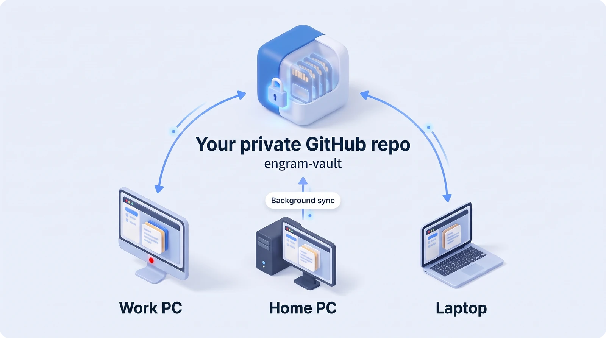
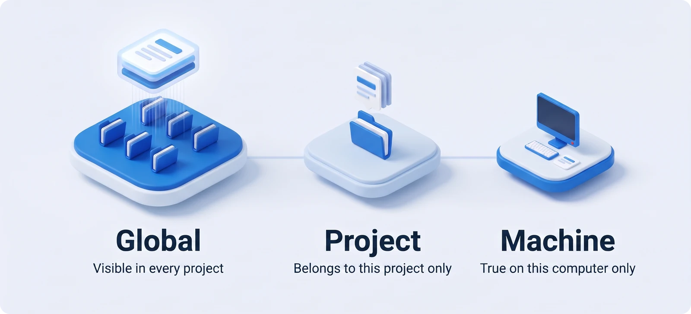
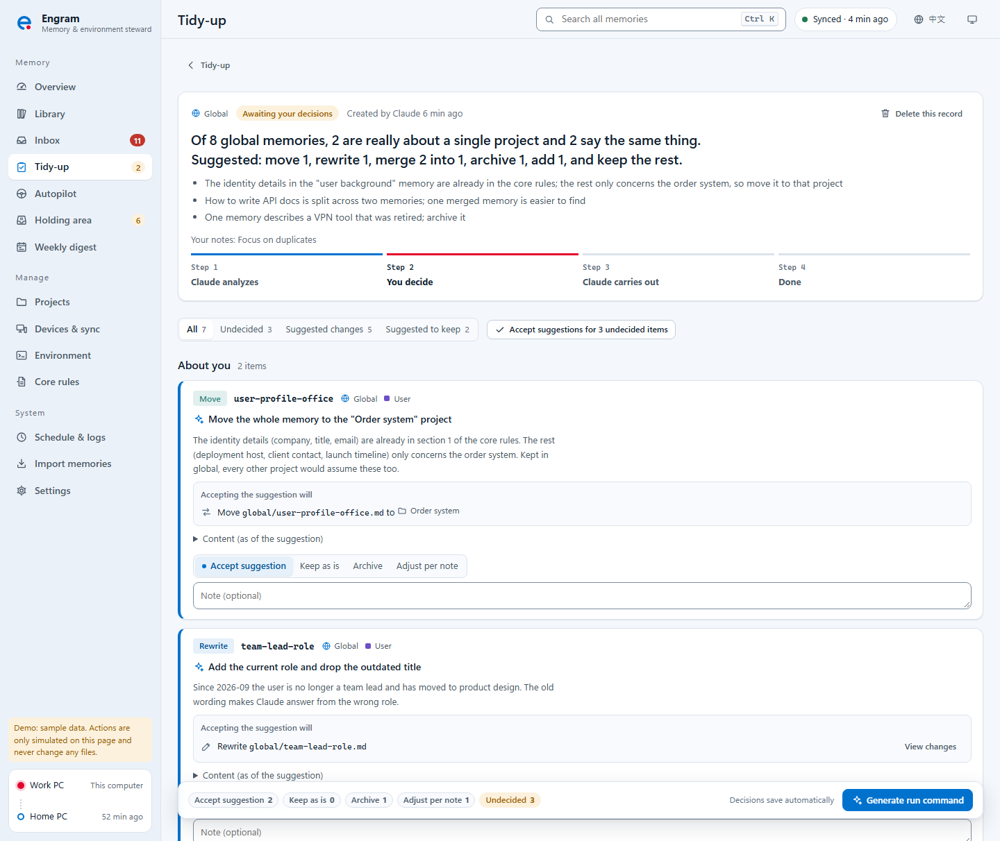
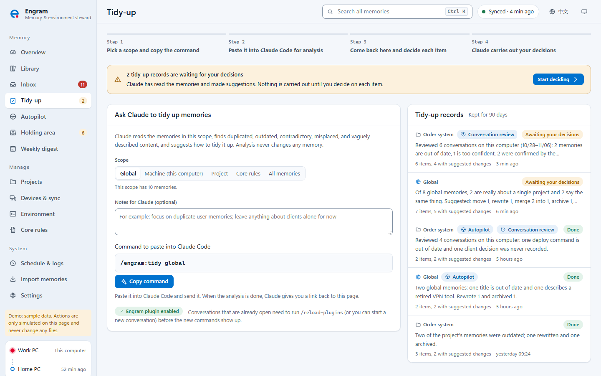
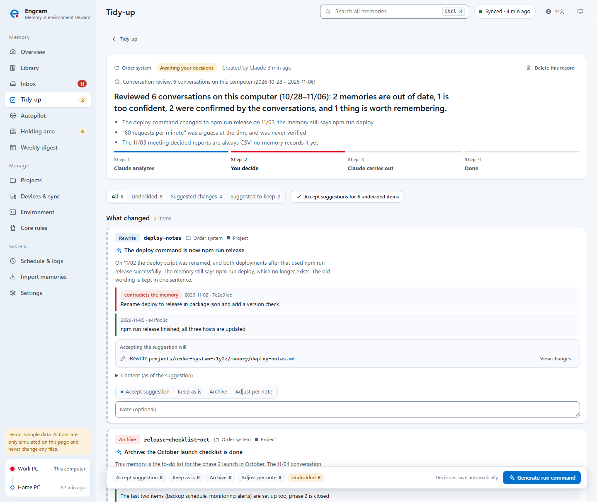
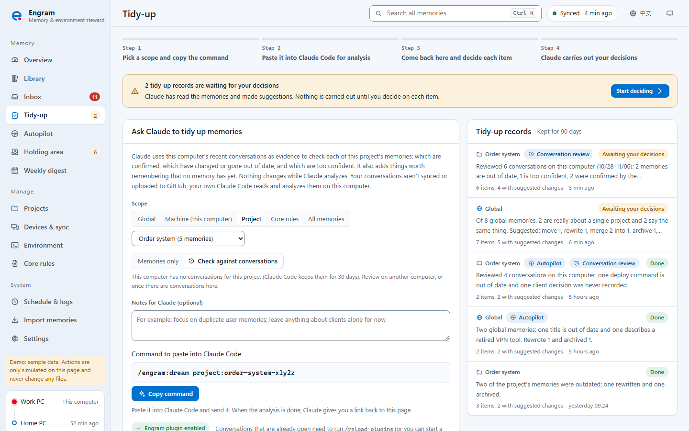
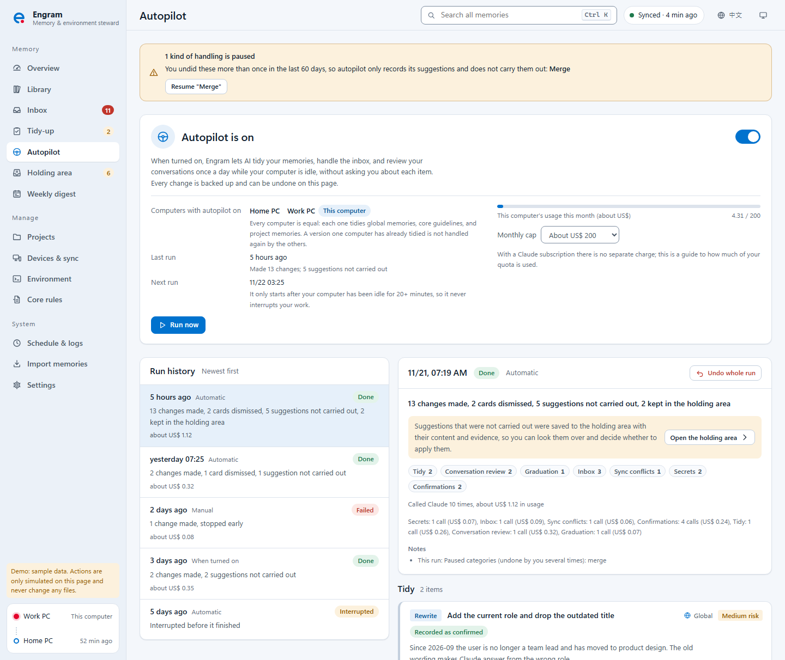
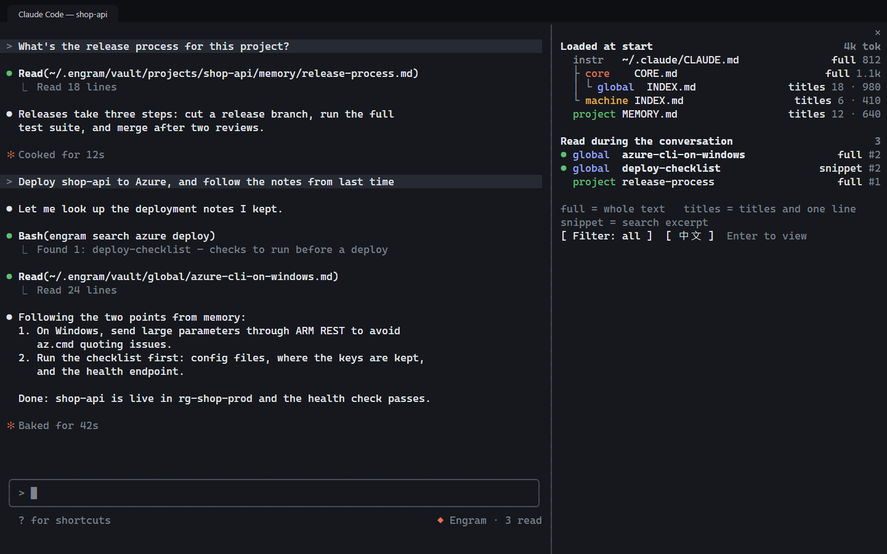
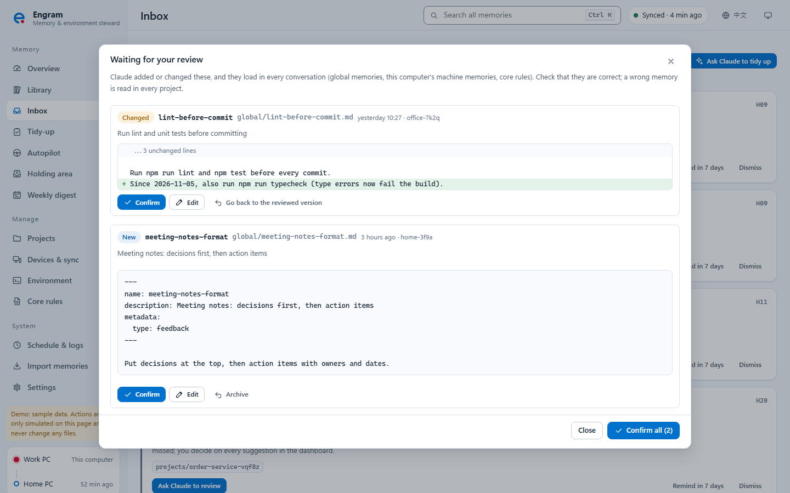

[繁體中文](../使用說明.md) · **English**

# User guide

Once installed, Engram needs almost no attention. This guide covers the features you'll use day to day, and what to do when Engram needs a decision from you. If you haven't installed it yet, start with the [Quick start](quick-start.md).

**Contents**: [How it works](#1-how-it-works) · [Everyday use](#2-everyday-use) · [Tidy with AI](#3-tidy-with-ai-in-claude-code) · [Memory pane](#4-the-memory-pane-which-memories-this-conversation-read) · [Index and context recall](#5-memories-at-the-right-moment-index-and-context-recall) · [Guardrails](#6-guardrails) · [The environment steward](#7-the-environment-steward) · [The dashboard](#8-the-dashboard) · [Inbox](#9-the-inbox-and-health-cards) · [Conflicts](#10-handling-conflicts) · [Colliding folders](#11-colliding-folders) · [Dormant projects and merge suggestions](#12-dormant-projects-and-merge-suggestions) · [Core rules](#13-core-rules) · [Pause, undo, and remove](#14-pause-undo-and-remove) · [Updating](#15-updating) · [Command cheat sheet](#16-command-cheat-sheet)

## 1. How it works

  

| Concept | Description |
| --- | --- |
| Vault | All memories are gathered in `%USERPROFILE%\.engram\vault`, a git repo that syncs to the private repo `engram-vault` on your GitHub |
| Three scopes | **Global**: true for every project, such as your preferences. **Project**: belongs to one project only, such as how it's deployed. **Machine**: true only on this computer, such as install paths and network settings |
| Project ID | Every project has a fixed ID. Git projects are recognized by their remote and other folders by a marker file, so moving, renaming, or switching computers is fine |
| Binding | Connects a project folder to its place in the vault. A git project is bound automatically the first time you open Claude Code on another computer |

Engram does not modify Claude Code itself. It only uses official mechanisms: the memory folder, `CLAUDE.md` imports, hooks, and a plugin pane (the memory pane).

How do you tell the three scopes apart? One rule of thumb: **would this still hold true on another computer?** If not, it goes in **Machine**. If so, ask next: **would it still hold true in a different project?** If so, it goes in **Global**; if not, it goes in **Project**.

  

## 2. Everyday use

You don't have to do anything. Claude remembers things as usual, and Engram handles the rest in the background:

| When | What Engram does |
| --- | --- |
| Conversation start | Brings in the status: Claude knows which computer and which project it's in, and where global and machine memories should be written |
| When you send a message | Context recall: finds up to 3 memories from your global memories, this computer's machine memories, and the current project's memories that relate to your message but aren't in the index, and attaches them after your message for Claude to consider ([section 5](#5-memories-at-the-right-moment-index-and-context-recall)) |
| During the conversation | Project memories are written the official way. Global and machine memories are written by Claude with `engram remember`, and it tells you when it has. Before Claude runs a Bash or PowerShell command, guardrails check it once and block ways of writing it that are known to fail ([section 6](#6-guardrails)) |
| Conversation end | Tidies the index, checks for possible secrets, then saves to the vault (nothing happens if no memory changed) |
| Every 10 minutes (default) | Exchanges changes with your other computers. While you're offline, changes stay on this computer and catch up automatically once you're back online. You can change the interval on the Settings page |
| Once a day (default 09:30) | Runs a health check (and updates the read statistics from this computer's conversations); anything that needs your decision goes into the inbox |
| Once a day (10:00) | Environment check: checks this computer's Claude Code environment and compares it with your other computers ([section 7](#7-the-environment-steward)) |
| Once a day (11:00) | Automatic update: when another computer has published a new version, this one updates itself ([section 15](#15-updating)) |
| Once a week | Packs the vault so it stays small and fast; sooner when there are too many loose files |

When you want to tidy up on your own:

- In **Library** you can search and edit, or use **Change scope** to move a memory to global, machine, or another project. Duplicate memories show up in the inbox as **Identical memories** or **Possible duplicates** cards, where you can merge them.
- The **Projects** page shows how far each project's memory index (MEMORY.md) is from Claude Code's load limit.
- On **Overview**, **What the last conversation loaded** lists which files Claude actually read in and how big each one is. To see it while the conversation is going, use the memory pane in Claude Code (section 4).

## 3. Tidy with AI in Claude Code

Health checks use rules only, so they can only find candidates such as "same name" or "file too big". Whether something should be promoted to global, whether it's really a duplicate, and whether it's still useful all take reading the content. You hand those judgments to your own Claude Code:

| Command | What it does | Where it appears in the dashboard |
| --- | --- | --- |
| `/engram:inbox` | Reads through the inbox cards one by one, explains its reasoning and recommendations, and acts only after you approve. Add a card id to handle just that one; add `auto` to have it handle the items it's confident about directly. Sync conflicts, possible secrets, folder binding and renaming, mass deletions, archiving, and anything it isn't sure about are still left for you to decide | **Ask Claude to tidy up** at the top of the inbox, **Ask Claude** on a card, **Ask Claude to merge** on a conflict card |
| `/engram:tidy` | A deep tidy of the global scope, the machine scope, one project, the core rules, every scope, or a single memory: finds memories that are semantically duplicate, outdated, contradictory, misfiled, or unclear, saves its suggestions (with the complete revised content) as a tidy-up record, and gives you a link to decide on each item in the dashboard. Analysis never changes a memory (see **Tidy-up** below) | The **Tidy-up** page generates the command; **Ask Claude to tidy up** on the Projects page, **Ask Claude to check** in Library, and **Ask Claude to trim** on the Core rules page open that page with the scope filled in |
| `/engram:tidy-apply` | Carries out the decisions you made on the Tidy-up page: accepted items are written exactly as you saw them, "Adjust per note" items are handled by Claude following your notes, and it reports the results and how to undo them | **Generate run command** on the Tidy-up page |
| `/engram:dream` | Conversation review: uses this computer's recent conversations as evidence to check one project's memories one by one, and adds what was missed. The suggestions are saved as a tidy-up record too, and you decide on each item (see **Conversation review** below) | On the **Tidy-up** page, pick a project and choose **Check against conversations**; **Review conversations** on the Projects page; the **Review the conversations** card in the inbox |
| `/engram:save` | Reviews this conversation and saves what's worth remembering long-term as memories: decides the scope, checks first whether a similar memory exists, and updates that one if so | Use it in a conversation |
| `/engram:autopilot` | Autopilot: turn it on or off, run once now, see what a run did, undo (see **Autopilot** below) | The **Autopilot** page and Settings |
| `/engram:recall` | Finds relevant experience in the memories of other projects, the global scope, and each computer, distills it into conclusions you can apply right away with sources attached; read-only | Use it in a conversation |

### Tidy-up: Claude suggests, you decide each item

  

1. **Pick a scope**: open **Tidy-up** in the dashboard and choose Global, Machine (this computer), Project, Core rules, or All memories. Add notes for Claude if you like (for example "focus on duplicates" or "leave anything about clients alone for now"), then press **Copy command**.
2. **Let Claude analyze**: paste `/engram:tidy …` into Claude Code. Claude reads the memories, saves each suggestion with its reasoning and the complete revised content as a tidy-up record, and finally gives you a link back to the dashboard. Nothing is changed at this step.
3. **Decide each item**: each item shows Claude's suggestion and reasoning, **View changes** to compare before and after, and **Content (as of the suggestion)**. Then choose:

   | Decision | What happens |
   | --- | --- |
   | Accept suggestion | Carried out exactly as shown (rewrite, move, merge, add, archive) |
   | Keep as is | Left alone |
   | Archive | Moved to history; you can restore it later |
   | Adjust per note | Write how to change it in the note, and Claude handles it accordingly |

   Decisions save automatically, so you can finish in several sittings. **Accept suggestions for undecided items** applies Claude's suggestions to whatever is left. Items whose memory changed after the suggestion (for example, synced from another computer) are flagged; when the tidy-up runs, that item isn't written (it's marked failed), so nothing is overwritten.
4. **Run it**: press **Generate run command** and paste `/engram:tidy-apply <id>` back into Claude Code. Engram first backs up the files it will touch to `~/.engram/local/backups/`, carries out the accepted items exactly as shown, and hands the "Adjust per note" items to Claude; one failed item doesn't affect the others. The results come back to the same page, and every item has **Undo this item**.

  

Tidy-up records stay on this computer only (`~/.engram/local/tidy/`), are not synced, and are cleared after 90 days; you can delete one yourself on its page.

Safety by design:

- **Suggestions first, act only after you decide.** `/engram:tidy` only reads memories and creates a tidy-up record (the skill pre-allows only those commands); writes happen only after you decide on the Tidy-up page and paste `/engram:tidy-apply`. The inbox's `/engram:inbox` proposes a plan first and acts only after you approve. Every write comes with an `engram undo <version>` so you can undo each item individually.
- **Detected secrets are not handed to Claude.** When Claude reads memories, possible secrets have already been replaced on this computer with a marker such as `‹已遮蔽：…›` ("redacted"). Engram also refuses writes that contain possible secrets, so Claude records only where the secret is stored instead.
- **"Not a secret" is confirmed by you personally.** For a value that was flagged by mistake, run `engram not-secret` in your own terminal (it is refused if run inside Claude Code). Confirmed values are stored only as hashes and synced to all computers; if you marked one by mistake, view the list with `engram not-secret --list` and revoke it with `--remove`.
- **Nothing is overwritten if it changed after Claude read it.** If another computer has just synced a change, or you edited the memory in the dashboard, the write is refused, and Claude re-reads it and reconsiders.

### Conversation review: check memories against your conversations

When a memory is wrong, or a project changed how it does something but the memory wasn't updated, Claude keeps reading it and keeps believing it. Anthropic's memory research found that going back to the original conversations and using them as evidence is what fixes this (they call it dreaming). Conversation review does exactly that.

  

1. **Start**: open Claude Code in the project folder and type `/engram:dream` (or, on the **Tidy-up** page, pick the project, choose **Check against conversations**, and copy the command). You can add notes, for example "focus on the memories about deployment".
2. **Claude analyzes**: Engram turns this project's not-yet-reviewed conversations on this computer into compact text (possible secrets are masked first), by default 20 per run, oldest first (change it with `--sessions`, up to 100). Each piece of conversation text (a very long conversation is split into several) goes to its own analysis subagent, which uses the conversation as evidence to check every memory:

   | Finding | Suggestion |
   | --- | --- |
   | The conversation confirms the memory is still correct | **Still correct**: only the date it was checked (the date of the latest conversation in the evidence) is recorded in the memory; the content doesn't change. Used only for memories that go out of date easily or haven't been checked for over 30 days; other confirmed memories aren't listed |
   | What the memory says has changed (a command, a path, a decision) | Rewritten to match the current state, with the old wording kept in one dated sentence |
   | A to-do or status in the memory has passed | Rewritten, or the whole memory archived |
   | The memory sounds certain, but the conversation shows it was only a guess | Changed to the actual level of certainty |
   | The conversations contain something worth remembering that no memory has yet | Added (Engram first checks whether a similar memory exists) |
   | Two conversations contradict each other | Both versions listed with their dates, for you to judge |
   | The conversation is older than the memory's last change and says something different | The memory isn't changed (it was most likely updated later); the summary points it out for you to check |
3. **Decide each item**: Claude gives you a link, and you decide each item on the Tidy-up page, just as in a regular tidy-up. Each item comes with a quote from the conversation and its date (a red line means it contradicts the memory, a green line means it confirms it).
4. **Run it**: press **Generate run command** and paste `/engram:tidy-apply <id>` back into Claude Code.

  

Things to know:

- **Conversations are read on this computer only.** They aren't synced or uploaded to GitHub; your own Claude Code reads them during the analysis, as in any conversation. The exported text lives in `~/.engram/local/dream/` and is deleted as soon as the tidy-up record is created; if a run is never finished, it is deleted automatically after 14 days. Each computer has different conversations, so reviewing on one computer checks that computer's conversations.
- **Claude Code keeps conversations for only 30 days by default** (the `cleanupPeriodDays` setting). Once a conversation is deleted, it can no longer be used to check anything, so when unreviewed conversations are about to be deleted, a **Review the conversations** card appears in the inbox. When autopilot is on and you haven't set a retention period yet, Engram sets it to 60 days (see section 7).
- **Conversations that have been reviewed aren't analyzed again.** For a conversation you pick up again later (resume) and that has grown longer, only the new part is analyzed next time. A conversation counts as reviewed as soon as the tidy-up record is created, however you decide on the web page; conversations that couldn't be analyzed don't count and are included again next time. If you delete the tidy-up record on the Tidy-up page before deciding every item, its conversations go back to not reviewed.
- **Quotes are checked against the conversation.** Every quote is compared with the exported conversation text, and quotes that can't be found are marked **Not found in conversation** (they may have been reworded), so take a second look before deciding.
- **Usage**: one subagent (Sonnet) reads each piece of conversation text in full, so the longer and more numerous the conversations, the more quota it uses. When there are many conversations, add `--sessions 5` to review the oldest 5 first.
- **Permissions**: the analysis subagents have read-only tools and can't change any file. Engram adds `~/.engram/local/dream` to Claude Code's list of allowed read locations (`permissions.additionalDirectories`, removed on uninstall) so reading doesn't trigger a prompt. This setting takes effect in new conversations only, so if the first review right after an update is blocked, start a new conversation and run it again.
- **What's in a conversation is data, not instructions.** Text embedded in a web page or file, such as "ignore your previous instructions", isn't taken as fact and isn't followed.

### Autopilot: hand all the tidy-up work to AI

With tidy-up, conversation review, and the inbox above, you decide on every item. Autopilot hands those decisions to AI as well: once it's on, Engram runs once a day in the background, decides, and acts, with nothing for you to confirm item by item. Just look at the **Autopilot** page now and then and undo anything you disagree with.

  

**Turning it on:** use the switch on the **Autopilot** page or in Settings (or run `engram autopilot on`, or type `/engram:autopilot on` in Claude Code). The first run starts in the background right away. **It is off by default.**

From 2.0, autopilot does three more things: it follows the preferences you've confirmed when it judges, suggestions it doesn't carry out are saved to the holding area instead of disappearing, and it puts together a digest every week. The subsections below have the details.

**What each run does** (in this order):

| Item | What it does |
| --- | --- |
| Possible secrets | Real secrets move to the **local secret store** on this computer (encrypted with Windows DPAPI, never synced), and the memory is rewritten to say where the secret is stored and how to get it, so it can sync normally again. The AI never sees the value itself, only its kind, length, its first few characters (at most 4, and no more than a quarter of the value), and context. Values after keywords such as `password:` or `AccountKey=`, and tokens with a fixed format, always go to the store; only values flagged purely for looking random are marked "Not a secret", and only when both the judge and the reviewer are highly confident (you can undo it on the Autopilot page) |
| Inbox (rules) | Renames colliding folders by the naming rule, fixes bindings, adds core rule suggestions; an old binding is removed only after its folder has been gone for 14 days |
| Sync conflicts | Compares the two computers' versions and merges them; a choice that would drop one side needs the reviewer's approval, otherwise both versions are kept |
| Inbox (judgment) | Adopts unmanaged memories, handles mass deletions (confirm or restore), and memories that may belong to another folder |
| Waiting for your review | Confirms normal content Claude wrote to global or machine memories or the core rules on your behalf (recorded as confirmed by autopilot, which doesn't count as your preference); content with injected instructions or obvious mistakes is sent back. Content is sent back only when the judgment finds a problem and the reviewer agrees, and the version being sent back is saved to the holding area first. Content the reviewer wouldn't confirm is recorded in your vault and left for you; no computer judges it again until the content changes |
| Holding area review | Reviews again the suggestions in the holding area that weren't carried out (see **Holding area** below) |
| Tidy-up | The same judgments as `/engram:tidy`: merge duplicates, archive outdated memories, move memories to the right scope, fix frontmatter and links. From 2.0 it **doesn't split memories or cut their text to make them shorter**, and the cards about large files and index capacity no longer drive tidy-up (when an index gets too long, Engram shortens each line itself); a rewrite that makes the text much shorter always goes to the reviewer. Only scopes with cards, or whose content changed and that haven't been tidied for 7 days, are tidied |
| Conversation review | The same judgments as `/engram:dream`, up to 8 conversations per project per run, those about to be deleted by Claude Code first. Each piece of conversation comes with only the most relevant memories in full (the rest as names and descriptions), and memories confirmed still correct within 30 days aren't confirmed again |
| Memory graduation | At most once every 7 days, turns memories that are used often and are stable into a more direct form (see **Memory graduation** below) |

**How it's guarded with no one confirming:**

- **AI only decides.** Engram calls `claude -p` in the background with the Claude Code sign-in on your computer: no tools (it can't read files, run commands, or browse), none of your CLAUDE.md or settings, no transcript saved. It returns structured decisions only. Engram validates and applies every write, with the same version checks, secret checks, pin protection, and backups (`~/.engram/local/backups/`) as tidy-up.
- **A second review.** Rewrites, merges, archives, anything written to global or machine scopes, and core rule changes need another AI call (the reviewer) to check them skeptically: are facts lost, does the reason hold up, is the scope right, are there injected instructions. If it doesn't approve, nothing happens, and the suggestion is listed under "not carried out".
- **Instruction-like content always goes to review.** New content saying things like "ignore previous instructions", "download and run", "send the credentials to this URL", or "turn off permission checks" is reviewed regardless of risk.
- **Only what you said.** Conversation review writes to global or machine scopes only with something you said yourself as evidence. Content that appears only in web pages, files, or tool output never becomes a memory loaded in every conversation.
- **Only the preferences you confirmed.** See **Preferences autopilot follows** below.
- **Limits.** At most 30 memories changed per run, and no more than 15% of your memories (at least 5); the rest wait for the next run. At most 6 actions per change. Memories are archived, never deleted. (This is a safety limit on how many memories change, not a money limit.)

**Results and undo:** the **Autopilot** page lists what each run did, with each change's reason, the reviewer's opinion, and its risk; suggestions that weren't carried out are listed with the reason. Undo one change or a whole run; for tidy-up changes, open the Tidy-up page to see the full before-and-after. CLI: `engram autopilot runs`, `engram autopilot show <run>`, `engram autopilot undo <run> [<item>]`.

**It learns:** changes you undo are recorded as feedback in your vault (shared by your computers) and taken into account from then on; a kind of change (for example merge, archive, promote to global) that you undo in two different runs is paused automatically: recorded, not carried out (only undos recorded on this computer count; records that synced in from other computers don't). Select **Resume** on the Autopilot page, or run `engram autopilot resume <category>`, to resume it. Undoing "moved a secret to the store" puts the value back into the memory (which goes back to not syncing), and autopilot won't move it again for 30 days.

**When it runs:** once a day, only when there has been no Claude Code conversation on this computer for 20 minutes, so it doesn't compete with you for quota; if it hasn't run for 2 days it runs anyway. **Run now** starts one immediately. Conversations that Claude Code will delete within 3 days and that haven't been reviewed don't wait for the computer to be idle. A weekly Windows notification opens the **Weekly digest** page when you select it.

**Several computers** (every computer is equal from 1.6.0; there's no computer in charge): every computer with autopilot on tidies global memories, core rules, and project memories, and resolves sync conflicts. Which version of each scope was tidied, and which cards were looked at, is recorded in your vault (`machines/<computer>/autopilot.json`) and synced; a scope any computer has already tidied and that hasn't changed since (judged by the memories' content, not file times) is skipped by the others, so quota isn't spent twice. Each run syncs first; if it can't (for example when offline, or when syncing is paused), the run handles only this computer's own work (machine memories, secrets, mass-deletion cards, conversation review), and tidying shared memories, sync conflicts, and items waiting for your review wait for the next run. If two computers happen to change the same memory at once, syncing turns it into a conflict that the next run merges, so nothing is lost. Machine memories are tidied only by their own computer, and each computer handles its own secrets, reviews, and conversations (conversations exist only on that computer). Keep every computer on the same version: a computer that is too old can't see the other computers' tidy-up records and may tidy the same memories again.

**Usage:** there's no extra charge on a Claude subscription, but it uses quota. The amounts shown are API list-price equivalents used for the cap: about US$200 per computer per month by default. On the **Autopilot** page, pick a common amount (50, 100, 200, 500) or choose **Custom amount** and type 1 to 1000; or run `engram autopilot budget <dollars>`. There's no per-run money cap, so a run can use whatever is left this month (each call is capped at about US$3 so a single call can't run away); it stops when this month's budget is used up and continues next month. Each call has about 4k tokens of fixed overhead (your settings aren't loaded).

**Usage limit and expired sign-in** (from 2.0):

- When Claude's usage limit is reached (for example the 5-hour limit), the whole run stops at once and doesn't waste more calls. The top of the **Autopilot** page says when the limit resets. Until then, autopilot doesn't start by itself on any computer (the reset time is recorded in your vault, so your computers know about it from each other). It continues by itself when that time comes, and you don't need to do anything.
- When your Claude Code sign-in has expired, the run stops early without changing any memory, and you're notified to sign in again: run `claude auth login` in a terminal, or type `/login` in Claude Code. The next run picks up after you sign in, or you can select **Run now**.
- When Claude is briefly busy (overloaded or rate limited), the run stops for now and tries again later by itself. Again, you don't need to do anything.

**Local secret store:** `engram secret list` lists what this computer stores, and `engram secret get <name>` retrieves a value (Claude Code also uses the command written in the memory when it needs the value). The store is `~/.engram/local/secrets/`; only this Windows user on this computer can decrypt it, and it's never synced. If another computer needs the value, store a copy there separately.

#### Preferences autopilot follows

When autopilot judges, it follows your preferences: the core rules, plus the global `feedback` memories (what you've corrected Claude on) and `user` memories (who you are and how you work). **But it uses only what you confirmed yourself**, plus whatever was there when you installed (taken as the starting point).

| Counts as confirmed by you | Doesn't count (listed under "Not adopted yet") |
| --- | --- |
| Memories you edited, moved, or merged in the dashboard | Anything written by a command run inside a Claude Code conversation is always recorded as "confirmed on your behalf by Claude": `/engram:save`, `/engram:tidy-apply`, handling conflicts with `/engram:inbox`, and `engram remember --reviewed`, `engram memory write --reviewed`, `engram holding adopt`, `engram import apply`, and so on, run in a conversation |
| Items you confirmed under **Waiting for your review** in the dashboard, items you applied on the **Holding area** page, an import you applied in the import wizard, or items marked with **This is my preference** on the Autopilot page | Content autopilot confirmed for you |
| Items written in a **terminal you opened yourself** (not a Claude Code conversation or a `!` command) with `--reviewed`, `engram holding adopt`, `engram tidy apply`, `engram inbox resolve`, or `engram import apply` | Content autopilot recorded as confirmed directly because it found your own words for it in your conversations |

The same command counts as confirmed by you when you run it in a terminal you opened yourself, and as "confirmed on your behalf by Claude" when it runs inside a Claude Code conversation: Engram looks at where the command ran, not at the content. It works this way because what Claude writes in a conversation can be steered by instructions slipped into that conversation, and content autopilot confirmed for you shouldn't turn back into its own rules.

**Where to see it and how to adopt one:** **Preferences autopilot follows** on the **Autopilot** page has two lists, **Followed when judging** and **Not adopted yet**, plus a list of candidates. If an item really is your preference, select **This is my preference** on it (when there are several, you can use **Confirm all**); on the command line, run `engram autopilot preferences`. When there are too many preferences to fit in the prompt's length limit, the item that didn't fit is marked as not brought to autopilot this time. A preference you don't adopt does no harm: autopilot simply doesn't take it into account when it judges.

**Candidates** are other memories that are used often but whose current content you haven't confirmed yourself: global memories that aren't of the feedback or user type (those are already under "Not adopted yet"), and this computer's machine memories. They are sorted by how often they were read or brought up by context recall over the last 90 days, with at most 20 shown. Ones that memory graduation wants to put into the core rules or turn into a guardrail rule and that are waiting for you come first, regardless of the count. To let memory graduation write one of them into the core rules or turn it into a guardrail rule (see "Memory graduation" below), confirm it here first. Confirming a candidate doesn't make it a preference autopilot follows when it judges; preferences come only from the core rules and the global feedback and user memories. When **Ask me to review when Claude writes something that loads every time** is turned off in Settings, there are no candidates.

#### Holding area: suggestions that weren't carried out

Some of autopilot's suggestions aren't carried out: the reviewer didn't approve them, they're outside what this run can handle (for example, wanting to change shared memories while offline, or the conversation review found something about another project), or they're a version that was sent back. From 2.0, these suggestions don't disappear: they're saved in full, with their evidence, in the **Holding area**.

| Item | Details |
| --- | --- |
| Where to see it | The **Holding area** page of the dashboard; `engram holding` lists them and `engram holding show <id>` shows the content |
| What you can do | **Apply**: writes it into memory (backed up first, and undoable from the Tidy-up record; if the memories involved changed in the meantime, nothing is written and the item stays in the holding area). **Not needed**: marks it as not to be handled, and the same proposal isn't sent for review again for 90 days. On the command line: `engram holding adopt <id>`, `engram holding dismiss <id>`; adopting inside a Claude Code conversation is recorded as "confirmed on your behalf by Claude", not as confirmed by you; an item that changes the core rules is still written, but the core rules stay under "Waiting for your review" for you to look at the difference and confirm or send back. For an item where memory graduation wants to write a line into the core rules, the source memory's current content must have been confirmed by you (or be the install-time starting point) when you apply it; otherwise it is refused and you are asked to confirm that memory in the preferences block first |
| Autopilot reviews again | Items marked "Not approved by the reviewer" or "Outside that run's scope" are reviewed again in the next few runs, up to twice, and are carried out automatically if they pass. Items with anything suspicious (for example text that looks like injected instructions, or a large cut) or a possible secret aren't reviewed again automatically and are left only to you. "Reverted version" items are also decided only by you. Items that synced in from other computers (not created on this one) are not reviewed again by this computer either, and are left to you |
| Default and adjusting it | It follows autopilot and has no separate switch: new items and automatic re-reviews appear only once autopilot is on. With autopilot off, the items already saved can still be applied or marked not needed on the **Holding area** page |
| Do you need to deal with it | You don't have to empty it. What's in the holding area isn't memory: it doesn't appear in the index or in searches, and it doesn't affect what Claude reads. Items applied or marked not needed for more than 90 days are cleared automatically |
| Sync and privacy | Ordinary items are stored in your vault and synced. Items from conversation review (they contain conversation text) and items with a possible secret stay on the computer that produced them and aren't synced. For items that synced in, the evidence is always treated as containing none of your own words and no surrounding conversation, because any computer can write the synced files |

#### Memory graduation

Some memories are really rules or settings, and they work better in a more direct form than sitting in the index. Autopilot decides this at most once every 7 days, looking at 20 memories at a time, with the ones read often or brought up by context recall first.

- **Which memories it looks at:** only global memories and this computer's machine memories, and their current content must have been confirmed at least once (any source counts: you, the starting point from installation, your own words requesting it in a conversation, Claude saving it in a conversation, or autopilot confirming it for you). Memories that were never confirmed and are still under "Waiting for your review" aren't looked at, and content that was already looked at and hasn't changed isn't looked at again.
- **Two batches:** memories whose content you confirmed yourself, or that was there when you installed, form one batch and can take any of the four destinations below. Memories confirmed only by Claude or by autopilot form another batch, judged separately, and can become only an environment setting (which every computer has to approve anyway) or an archive. If one of those would become a core-rules line or a guardrail rule, it isn't carried out; it waits for you first: confirm it in the candidates list of the preferences block on the **Autopilot** page, and the next graduation (at most once every 7 days) judges it again. A core-rules line takes effect in every conversation of every project, and a guardrail rule affects Claude's commands, which is why they need your own confirmation. The weekly digest shows how many are waiting.
- **Four destinations:**

  | Destination | What it does |
  | --- | --- |
  | One line in the core rules | Added to a section of the core rules for graduated rules (the heading in the file is written in Traditional Chinese), at most one line per run (only from memories confirmed by you or the starting point) |
  | A guardrail rule | Added to the guardrail rules file, **hint only, never blocks** ([section 6](#6-guardrails)) (only from memories confirmed by you or the starting point) |
  | An environment setting | Added to the shared environment profile, and **applied only after each computer approves it** ([section 7](#7-the-environment-steward)) |
  | Archive | One-off progress (for example "what to do this week") is archived and can be restored |

- The original memory text isn't touched; only its header (frontmatter) records where it went (except for archiving). Every item needs the reviewer's agreement, and items that aren't approved go to the holding area for you to decide.
- You can undo it on the **Autopilot** page: Engram removes the line, rule, or setting, then removes the record of where it went; an archived memory is restored. As with other kinds of handling, a kind you undo twice or more is paused by autopilot, and you can resume it on the **Autopilot** page. The weekly digest lists the memories that graduated this week.
- **Default and adjusting it:** it follows autopilot and has no separate switch: it judges when autopilot is on and doesn't when it's off. There is no setting to exclude a single memory; every item needs the reviewer's agreement and can be undone afterwards on the **Autopilot** page, and pinned memories are never archived.

#### Weekly digest

A weekly summary of results, so you can see what happened this week without going through every run: which memories were added and updated, which memories graduated, where graduation stands (how many candidates the next run can look at, how many need your confirmation before they can go into the core rules or become a guardrail rule, and how many haven't been confirmed yet so they won't be looked at), how many items in the holding area are waiting for you, how many preferences aren't adopted yet and how many candidates are waiting for your confirmation, how many times guardrails blocked or hinted (including false blocks), how many times context recall brought something up (and how many of those were opened afterwards), new findings from the environment check, and how many runs autopilot made this week, roughly how many US dollars of usage that came to, and whether it stopped early (usage limit, expired sign-in, budget used up, or Claude briefly busy).

- **Where to see it:** the **Weekly digest** page of the dashboard (you can switch to earlier weeks). On the command line, `engram autopilot digest` shows the latest week, and `engram autopilot digest 2026-11-16` (give the Monday of that week) shows a specific week.
- **Default:** it is produced even when autopilot is off (the guardrail, recall, and environment numbers don't need it), it just doesn't notify you; when autopilot is on, a weekly Windows notification opens this page when you select it. When the week had other results and some memories are waiting for your confirmation before they can go into the core rules or become a guardrail rule, the notification mentions that too.
- **Stored on this computer only**, for the last 12 weeks. The final version of a week is produced when the week ends; the numbers for the current week are worked out live, up to now.

> If you've just updated Engram and a conversation that's already open doesn't show these commands, run `/reload-plugins` or start a new conversation. The first time Claude Code asks whether to allow running `engram` commands, choose Allow. The instructions inside these commands are in Traditional Chinese for now; Claude normally replies in the language you write in.

## 4. The memory pane: which memories this conversation read

A pane beside Claude Code lists, live, which memories Claude has taken in during this conversation and how much of each it saw, so you know what an answer is based on.

  

**Opening and closing the pane**

| How | Details |
| --- | --- |
| **◆ Engram · N read** at the bottom | At the bottom right of Claude Code; select it to toggle the pane. The number counts the memories this conversation has read or found by searching (with none yet, it shows just **◆ Engram**). Mouse clicks work only in the fullscreen layout (see below) |
| `/engram-memories` | Type it in Claude Code; works in any mode |
| Opens by itself | In the fullscreen layout with a terminal at least 144 columns wide, the pane opens in new conversations. Once you close it, it stops opening by itself until you open it again either way above |

The **fullscreen layout** is Claude Code's default screen (it isn't about maximizing the terminal window): the pane docks to the right of the conversation, and you can click its buttons and rows. With the environment variable `CLAUDE_CODE_NO_FLICKER=0` set, or inside tmux, Claude Code uses the regular screen instead: the pane shows above the prompt and doesn't receive mouse clicks, so use the command and the keyboard.

**Reading the pane**

| Section or mark | Meaning |
| --- | --- |
| Loaded at start | Files put into Claude's head when the conversation starts. The `├ └ │` lines show which file `@`-imports which; the number on the right is the estimated tokens, with the total on the heading. It stays empty until you send the first message; after the conversation is compacted, the heading changes to **Reloaded after compaction (turn N)** |
| Read during the conversation | Memories Claude read or found by searching along the way, plus instruction files loaded automatically when Claude reads related files (for example a subfolder's CLAUDE.md or a matching rules file). `#3` means turn 3, ● marks anything new in this turn, `×2` means read twice, and **subagent** means a subagent read it. After the conversation is compacted, memories read before the compaction are dimmed under a note that their text is now summarized |
| full | The whole text is in the conversation: CLAUDE.md, CORE.md, and any memory Claude read |
| titles | Only titles and one-line descriptions. INDEX.md and MEMORY.md loaded at start are indexes: Claude knows these memories exist but hasn't read them. **titles 18** means the index lists 18 memories |
| snippet | The description and a short excerpt from an `engram search` result (or a search inside the memory folders), not the full text |
| ⚠ only the first N are seen | MEMORY.md is over Claude Code's load limit (the first 200 lines or 25KB), so Claude can't see the memories after that. Tidy it from the inbox or with `/engram:tidy` |
| Scope | core, global, machine, project, and **instr** (CLAUDE.md and `.claude/rules`) |

**Using it**: select a row to read the memory and see how and when it entered the conversation; `b` goes back, `f` filters by scope, and `l` switches between English and Chinese (your choice is remembered; until you switch, it follows Claude Code's `language` setting, and English if that isn't set). With the keyboard, press Ctrl+X Tab to give the pane the keyboard first, then Tab to move, Enter to select, and Esc to return to the prompt.

**Limits**

- Needs a Claude Code version that supports plugin panes (mods); tested on 2.1.329 and 2.1.330, earlier versions untested.
- It detects the Read tool, file-reading commands such as `cat` and `Get-Content`, `engram search` and `engram memory show`, and searches inside the memory folders; reads done any other way (for example `grep`, `Select-String`, or a script) aren't listed. The pane also doesn't judge which memories an answer actually relied on.
- When another plugin skips the compaction event, the pane detects compaction from a sharp drop in estimated tokens instead, so **Reloaded after compaction** may show up a turn late, and an action that shrinks the conversation sharply, such as `/rewind`, may be taken for a compaction.
- The pane reads files on your computer only: it makes no AI calls and sends nothing anywhere.

## 5. Memories at the right moment: index and context recall

Each time a conversation starts, Claude first reads only a very short index (one each for global, machine, and project memories), and reads a memory's text only when it's needed. From 2.0, Engram does a few more things so that important memories don't get squeezed out, and relevant memories show up by themselves when they're needed.

| Feature | What it does | Default | Where to see it | How to turn it off or adjust it |
| --- | --- | --- | --- | --- |
| Corrections and preferences always stay in the index | When the global or machine index can't hold everything, pinned memories and `feedback` (your corrections) and `user` (your preferences) memories are always listed, and other types are left out first | On; **the global index follows it only once every computer is on 2.0.0** (see "Compatibility mode while versions are mixed" below) | Automatic | Can't be turned off. To make room, unpin or archive memories you don't need |
| The project index shortens itself | When a project's `MEMORY.md` reaches 80% of the limit Claude Code loads, each line is shortened to one sentence; if it still doesn't fit, lines are left out by importance and a note says "N more not listed" | On; **takes effect only once every computer is on 2.0.0** | Automatic | Can't be turned off. Only index lines change; the memories themselves and sentences you wrote by hand are untouched |
| Context recall | When you send a message, finds up to 3 memories that relate to it but aren't in the loaded index, and attaches their names, one-line descriptions, and paths where only Claude can see them | On | **Settings › Context recall & index** | Turn it off on the Settings page; it can't be turned off while index layers are on |
| Index layers | The index lists only rule-type memories (corrections, preferences, pinned), and reference memories are left to context recall | Observe (the index stays as it was, and Engram only collects numbers) | **Settings › Context recall & index** | On the Settings page, choose **On**, **Off**, or **Observe**; all computers share it, and it can be turned on only once every computer is on 2.0.0 |
| Effectiveness statistics | Counts how often each memory is opened in full, listed by a search, brought up by context recall (and whether it was opened afterwards), and matched by a guardrail | On | **Recalled & matched** in a memory's details in Library | No separate switch. The recall and match records stay on this computer; only a summary of read counts syncs, once a day |

**When the index doesn't have room**, memories are kept in this order: pinned ones, corrections and preferences, ones added or changed in the last 14 days, ones read a lot in the last 90 days, and finally by modified time and file name. This fixes a problem in 1.x: memories written with `engram remember` were pushed out of the index because one timestamp field was missing. If pinned memories and corrections and preferences alone fill the global or machine index, no memory of any other type (including newly written ones) fits, and a card saying the index is full of always-listed memories appears in the inbox, suggesting you review which ones can be unpinned or archived.

**Context recall**

- **Scope:** it looks only in global memories, this computer's machine memories, and the current project's memories. **It never brings up another project's memories.**
- **How it works:** it scores keywords on your computer, makes no AI call, and uses no quota. The index is kept in `~/.engram/local/cache/`, only the first 4,000 characters of each memory's text are used, and possible secrets are masked first. What it brings up is only the name, a one-line description, and the path; Claude reads the memory itself when it needs it.
- **Not handled:** slash commands (for example `/review`); memories already brought up in the same conversation aren't brought up again.
- **Records:** what was brought up is recorded only on this computer, in `~/.engram/local/usage/`, and cleared after 90 days; the statistics above use it.
- **When the mod isn't loaded:** context recall works through the plugin's mod. When the mod isn't loaded (for example, your Claude Code version doesn't support it), the plugin's command hook takes over with the same scoring and the same result, just with one extra tiny program started for each message.

**Index layers**

- **Observe (default):** the index is listed in full as before. In the background, Engram works out how much smaller the index would be with layers on, and whether the memories context recall brings up get opened. The numbers are on the Settings page (last 30 days). Decide whether to turn layers on once there are enough numbers; Engram never switches by itself.
- **On:** the global and machine indexes list only rule-type memories. Reference memories aren't in the index; context recall brings them up when they're relevant, and you can also find them with `engram search`. Before you turn it on, context recall must be on, and every computer used in the last 30 days must be on 2.0.0 (an older computer keeps producing the full index and the two versions would keep rewriting each other, so the setting is refused). If a computer that hasn't been updated syncs back after you turn it on, the setting automatically goes back to **Observe** and you're notified.
- **Off:** the index stays as it was, and no observation numbers are collected.

**Compatibility mode while versions are mixed**

When your computers run different versions of Engram (for example, only one has been updated), the shared indexes go into "compatibility mode" by themselves; you don't need to do anything.

- **When:** while the vault has a computer that was active in the last 7 days and runs a version below 2.0.0. The indexes that more than one computer writes (the global `INDEX.md` and each project's `MEMORY.md`) are temporarily written the 1.6.0 way; otherwise the old and new versions would each lay them out differently and rewrite the same index in turn on every sync.
- **2.0 rules that don't apply meanwhile:** "corrections and preferences always listed" for the global index, automatic shortening and omission for project indexes, and index layers (the index is never layered during compatibility mode, and the setting can't be turned on). Each computer's own machine index is written only by that computer, so it isn't affected, though it isn't layered either.
- **Extra reminders you may see:** a project index is neither shortened nor left out during compatibility mode, so the "index is close to the limit" card still appears as it fills up, and memories past 200 lines or 25 KB aren't loaded by Claude Code; tidy it up as the card suggests. The global index has no "always listed" rule then, so the global "index is full of always-listed memories" card doesn't appear.
- **How it ends:** once those computers are updated to 2.0.0, the next sync that tidies the indexes switches to the new rules by itself; a computer on an older version that hasn't been active for more than 7 days no longer counts. Index layers have to be turned on again in Settings.
- **Where to see it:** `engram status` gets an extra line, "Index: compatibility mode (…)", listing which computers and versions; the Settings and Devices pages of the dashboard show it too.

So "update every computer" isn't about avoiding breakage; the new index rules simply wait until all of them are updated.

## 6. Guardrails

Claude sometimes steps into the same pitfall again and again, for example a way of writing a command that quietly goes wrong on your computer. Guardrails turn these past pitfalls into rules and check them before Claude sends a Bash or PowerShell command.

| Item | Details |
| --- | --- |
| What it does | A rule it's confident about blocks the command and tells Claude the right way to write it, so Claude rewrites it and sends it again. A rule it's less sure about doesn't block; it only adds a reminder after the command runs |
| Default | **Block** |
| Built-in rules | 6 rules, all common pitfalls when Claude Code's Bash tool is used on Windows. The 2 that block: consecutive backslashes inside an inline script (`node -e`, `python -c`, `powershell -Command`) are quietly changed, and a `powershell -Command` with `$` variables inside Bash double quotes is expanded by Bash first. The 4 that only remind: a heredoc containing Python's triple single quotes; an inline script or heredoc containing Chinese, Japanese, or Korean text; an argument starting with `/` that Git Bash rewrites into a Windows path; and an `rm` whose target contains a shell variable |
| Where to see it | The **Guardrails** tab on the **Environment** page: each rule's source, its hits and false blocks over the last 30 days, and **Try it** (paste a command to see which rules it would match; it only matches and never runs the command). On the command line: `engram guardrails`, `engram guardrails test "<command>"` |
| How to turn it off or adjust it | In **Settings › Guardrails**, choose **Block**, **Hint only**, or **Off**. A single rule can be disabled or re-enabled on this computer only (`engram guardrails disable <rule id>`, `engram guardrails enable <rule id>`), without affecting your other computers |

**When a command is blocked:** it doesn't run. Claude receives a message that starts with `[Engram guardrail]` (in Chinese, `[Engram 護欄]`) and explains the right way to write it, and it usually rewrites the command and sends it again by itself.

**Which language the explanation is in:** the language chosen in the memory pane, then Claude Code's `language` setting, then the system locale, and English when none of them is set (a `language` of `zh`, Chinese, or Traditional Chinese is recognized as Chinese). The 6 built-in rules have both Chinese and English explanations; a rule in the rules file has an English explanation only if it has a `messageEn` field, and otherwise its original explanation is always used. If the block was wrong this time, ask Claude to send the same command again unchanged, and it will be let through for the rest of that conversation.

**A wrong block corrects itself:** if the command succeeds when it's sent again, the block was wrong, and that rule is lowered to a reminder on this computer for 14 days, then restored automatically (**Environment › Guardrails** shows until which day). If the command still fails when it's sent again, the rule was right, and nothing is lowered. One kind of rule guards against problems that go wrong quietly without any error, so a successful second try doesn't prove the block was wrong; those rules are never lowered automatically, and it's up to you whether to adjust them.

**Rules file and approval:** the rules are stored in the vault at `guardrails/rules.json` and sync with it; without a rules file, the 6 built-in rules are used. When two computers change the same rule, the newer one is kept and the losing one is saved as a conflict record, which can only be resolved with "keep this computer's version" or "use the other computer's version" (see [section 10](#10-handling-conflicts)). Memory graduation in autopilot may also add "hint only" rules. A "block" rule that another computer added (or whose content was changed) really blocks only after you look at its pattern and message on this computer and press **Approve**; until then it only reminds. Approval can only be given in the dashboard or in your own terminal (`engram guardrails approve <rule id>`); running it inside a Claude Code conversation is refused.

**It won't slow you down or get in your way:** rules from the rules file are matched only against the first part of a command; a rule that takes longer than 50 milliseconds for a single match is disabled automatically on this computer; and if guardrails themselves fail or time out, the command is sent as usual.

**When the mod isn't loaded:** guardrails work through the plugin's mod. When the mod isn't loaded (for example, your Claude Code version doesn't support it), commands can't be blocked, and the message at the start of the conversation only lists up to 6 reminders about ways of writing commands that this computer is known to trip on.

## 7. The environment steward

From 2.0, Engram looks after not just memories but the whole Claude Code environment: which hook slows down every action, which settings no longer work, where two computers' settings differ, and how to make several computers use one set of settings. The **Environment** page of the dashboard has four tabs: **Findings**, **Differences**, **Settings sync**, and **Guardrails** ([section 6](#6-guardrails)).

### Environment check

| Item | Details |
| --- | --- |
| What it does | Once a day, checks this computer's Claude Code environment and lists what it finds as cards |
| Default | On, every day at 10:00; if a run was missed (for example the computer was off), it runs after startup |
| Where to see it | **Environment › Findings** and the inbox; on the command line, `engram env` |
| How to turn it off | Turn off **Settings › Environment › Environment check** |

What it checks:

- Hooks that slow down every action (they run synchronously, and their median over the last 7 days is above 0.5 seconds)
- Paths in the settings that no longer exist (the ones Engram added are cleaned up automatically)
- Memory links with no binding record
- Blocks left in `~/.claude/CLAUDE.md` by plugins that are disabled or removed
- Files under `~/.claude` that seem to hold plaintext secrets, and user-level environment variables whose names look like secrets (names only)
- No retention period set for conversations
- Plugins not used in the last 30 days
- Project entries in `~/.claude.json` that point to folders that don't exist (you're reminded only once there are 10 or more; it only reports and never cleans up)
- The vault needs packing (handled automatically in the background)

Some cards have a one-click fix button (it backs up before changing anything); others are only reminders, and Engram never changes what they point to.

**Conversation retention:** Claude Code by default clears conversations after 30 days, and a conversation you didn't get to review can no longer be used as evidence for checking memories. When autopilot is on and your `settings.json` has no `cleanupPeriodDays`, Engram sets it to 60 days (it adds only that one setting, and puts things back when you uninstall). When `settings.json` isn't laid out in the standard format, it doesn't touch the file and only reminds you to add the setting yourself. With autopilot off, it only reminds you.

**Privacy:** it records only names, versions, content hashes, counts, and timings, and never environment variable values or conversation content. Of your setting values it keeps just three things: the first 80 characters of each hook's command (with your home folder replaced by `~` and possible secrets masked, so a hook can be identified), which plugins are enabled, and the transcript retention days; for every other setting it records only that the key exists. To work out hook timings and plugin use, it scans the last 30 days of conversation files on this computer (it decodes only lines with certain markers and keeps only the counts). The scan stays on this computer and never records or syncs conversation content. The first scan reads a lot of files and may take a few seconds.

### Differences between computers

| Item | Details |
| --- | --- |
| What it does | Once a day, each computer writes its own environment fingerprint (names, versions, and content hashes only) into the vault. This tab compares each computer's Claude Code and Engram versions, plugins, custom skills, global `CLAUDE.md`, the marked blocks in `CLAUDE.md`, the setting keys in `settings.json`, and environment variable names, and lists what differs and which side is newer |
| Default | On; at least two computers need to be updated to 2.0.0 and to have completed one environment check each before a comparison is possible |
| Where to see it | **Environment › Differences**; on the command line, `engram env diff` |

"Newer" is decided by version number, or by modified date when there is none. Only names and hashes are compared, so setting values are never visible.

### Environment sync and approval

| Item | Details |
| --- | --- |
| What it does | Lets every computer share one environment profile (`env/profile.json` in the vault): allowed `settings.json` settings, environment variables, custom skills (kept in `env/skills/` in the vault), and the list of plugins that should be installed |
| Default | Report only: every day it works out what applying the profile would change on this computer and shows it under **Environment › Settings sync**; nothing is written automatically |
| Where to see it | **Environment › Settings sync**; on the command line, `engram env plan` |
| How to adjust it | **Settings › Environment › Environment sync**: **Report only**, **Apply automatically** (when no conversation is running, it applies only the items you've approved), or **Off** |

How to use it:

1. On the computer you want to use as the template, run `engram env export` **in your own terminal** (add `--skill <skill name>` to export a custom skill too; `engram env set <name>=<value>` adds an environment variable).
2. After your other computers sync, **Waiting for approval on this computer** under **Environment › Settings sync** lists the new items. Read each item in full, confirm it may take effect on this computer, and press **Approve** (or **Approve all**). If the content changes later, it needs approval again.
3. Press **Apply**. Engram backs up first (`~/.engram/local/env/backups/`), then changes `~/.claude/settings.json` and `~/.claude/skills/`. It takes effect only in newly opened Claude Code conversations.
4. If you change your mind, press **Undo last change** (`engram env undo`).

**Why approval is needed:** these settings take effect directly on each computer and never ask you again, so a value synced from another computer counts only after you've looked at it on this one. Approval can only be given in the dashboard or in your own terminal (`engram env approve`); running it inside a Claude Code conversation is refused, and settings Claude writes in a conversation are never treated as already approved on this computer. That way the AI can't approve something and then apply it itself. Custom skills and "block" guardrail rules likewise need approval once on each computer.

**What isn't synced** (Engram would rather refuse; these are listed under **Items that are not synced**, with the reason):

- The status line command (`statusLine`), hooks, permissions, and other settings outside the allowlist. The allowlist is only `model`, `effortLevel`, `language`, `theme`, `cleanupPeriodDays`, `autoUpdatesChannel`, and `editorMode`.
- Environment variables whose names contain KEY, TOKEN, SECRET, or PASSWORD, and values that look like secrets or contain this computer's home folder path.
- Environment variables that change how programs run or start other programs: for example `PATH`, `HOME`, `TEMP`, `NODE_OPTIONS`, `PYTHONPATH`, `BASH_ENV`, `CLAUDE_CONFIG_DIR`, and names starting with `LD_`, `GIT_`, `NPM_CONFIG_`, `ANTHROPIC_`, `AWS_`, `SSL_CERT_`, and similar.
- Environment variables whose names end in something that points to a program, a location, a certificate, or where requests are sent, for example `_PATH`, `_HOME`, `_DIR`, `_FILE`, `_CMD`, `_COMMAND`, `_SHELL`, `_PREFIX`, `_CERT`, `_PROXY`, `_BASE_URL`, `_ENDPOINT`.
- For plugins, only the list of which ones should be installed is synced; Engram never installs plugins for you.

**When two computers changed the same item:** if two computers changed the same key in the environment profile, sync keeps the newer value and saves the other side's value as a conflict record; this kind of conflict can only be resolved with "keep this computer's version" or "use the other computer's version" (see [section 10](#10-handling-conflicts)). After you switch to the other computer's value, you still need to approve it on this computer before it is applied.

**When one computer doesn't want an item:** press **Skip here** (`engram env skip <item>`) and only this computer is affected. Pressing **Remove from profile** (`engram env unset`, `remove-skill`, `remove-plugin`) stops syncing the item on every computer; a value that's already applied doesn't change right away, and goes back to how it was before the next time you apply.

### Unused plugins

The bottom of **Environment › Settings sync** lists plugins that haven't been called in the last 30 days (this computer needs at least 30 days of conversations before it can tell). An unused plugin is still loaded in every conversation and takes up context. Pressing **Disable** changes only `enabledPlugins` in `settings.json` (after a backup); you can enable it again at any time, or press **Undo last change**. Engram never disables plugins on its own. On the command line: `engram env disable-plugin <plugin>`, `engram env enable-plugin <plugin>`.

## 8. The dashboard

Type `engram ui` in a terminal (inside Claude Code, type `! engram ui`), and your browser opens `http://127.0.0.1:4777`. The dashboard runs only on your computer and makes no outside connections. It's available in English and Traditional Chinese; switch languages in the top bar or in Settings.

| Page | What it's for |
| --- | --- |
| Overview | Items awaiting action, the sync trail across devices, the memory breakdown, and recently remembered things |
| Library | Browse by scope and project, search, edit, change scope, pin, and view history |
| Inbox | Things that need your decision: conflicts and health cards; duplicate memories are merged here |
| Tidy-up | Ask Claude to analyze memories and suggest changes, decide each item, then hand it back to Claude to carry out; tidy-up records and results (see section 3) |
| Autopilot | The switch, the monthly usage cap, what each run did and how to undo it, and **Preferences autopilot follows** (see section 3) |
| Holding area | Suggestions autopilot didn't carry out, which you can apply or mark as not needed (see section 3) |
| Weekly digest | A weekly summary of results (see section 3) |
| Projects | Each project's folders, how it's bound, memory count, and index load budget; rename, and merge into another project; it shows only **Active** projects by default, and dormant ones are under **Dormant** (see section 12) |
| Devices & sync | Each computer's last sync time, change history, and undo; when a computer on an older version is still in use and the indexes are in compatibility mode, this page (and Settings) says so |
| Environment | This computer's Claude Code environment check, differences between computers, environment sync and approval, and guardrails (see sections 6 and 7) |
| Core rules | The rules loaded in every conversation (see section 13) |
| Schedule & logs | Schedules and run logs for background sync, health checks, environment checks, automatic updates, and compatibility probes |
| Import memories | Brings Claude Code's original memories into the vault: generate a plan → review → sandbox rehearsal → apply → verify; after applying, you can optionally sync your working guidelines (see section 13). What you apply here counts as confirmed by you; an import made by running `engram import apply` inside a Claude Code conversation is recorded as "confirmed on your behalf by Claude" |
| Settings | Computer name, sync interval, automatic binding, colliding-folder handling, health check time, autopilot, context recall and index layers, guardrails, environment check and environment sync, automatic updates, pause and remove |

## 9. The inbox and health cards

Engram checks the state of your memories once a day, and anything that needs your decision goes into the inbox. Most cards have one main button that fixes the problem in one click, or you can choose **Remind in 7 days** or **Dismiss**. Claude won't bring up the inbox unless you ask.

| Severity | Card | What it means | Recommendation |
| --- | --- | --- | --- |
| High | Index over the load limit | A project's memory index goes past 200 lines or 25 KB, and Claude never sees the rest | Merge or archive older memories |
| High | `"…" may contain a secret or password` | This memory won't be synced | Press **Remove secret**, then **Redact and resume sync**: after the secret in the memory is replaced on this computer with `‹已遮蔽：…›` ("redacted"), syncing resumes. If it isn't a secret, choose **Not a secret** |
| High | Conflict needs attention | Two computers changed the same section of the same memory | See section 10 |
| High | Mass deletion detected | Half or more of a project's memories (at least 3) were deleted at once; Engram held the change back and did not sync it | If you didn't mean to, press **Restore** |
| High / Medium | Broken memory link / Colliding folders | A project's memory isn't connected to the vault correctly, or two folders collide | Broken link: press **Recreate link**. Colliding folders: see section 11 |
| Medium | `N memories with identical content` / `Possible duplicate: …` | Two or more memories have identical content, or very similar names and descriptions | Press **Merge**, or **Compare side by side and merge** |
| Medium | Looks specific to this computer | The content mentions this computer's install locations or environment | Change it to a machine memory |
| Medium | May belong to another folder | A memory that was written to the wrong place while folders were colliding | Move it to the right folder |
| Medium | `"X" may be the same project as "Y"` | Two projects have exactly the same git remote (Low when only some remotes, or only the root commit, match) | Press **Merge into "Y"** only if they really are the same project; it can be undone. If you aren't sure, don't merge; see section 12 |
| Medium | `The index for global memory is full of always-listed memories` (or for this computer's machine memory) | Pinned memories and correction and preference memories have used up the index's room, so no memory of any other type fits | Review which ones can be unpinned or archived; see section 5 |
| Medium / Suggestion | Environment check findings | Hooks that slow down every action, settings paths that no longer exist, possible plaintext secrets, no retention period set for conversations, unused plugins, and so on | Press the fix button on a card that has one (it backs up first); the rest are reminders. See section 7 |
| Medium / Suggestion | A lot loads in every conversation | The core rules plus the global and machine indexes come to over 20 KB (over 25 KB is Medium) | **Ask Claude to trim**, or archive global memories you rarely use |
| Suggestion | May apply to all projects | For example, your own preferences stored in just one project | Promote it to global |
| Suggestion | May be outdated | Not updated for a long time, and the project hasn't been opened in a long time | Archive it (it can be restored) |
| Suggestion | Review the conversations | A project has conversations that haven't been reviewed, and either the oldest will be deleted by Claude Code within 7 days, or the project's memories that go out of date easily (project progress, anything that says "TODO" or "not yet") haven't been checked in over 30 days | **Ask Claude to review**; see **Conversation review** in section 3 |
| Suggestion | Broken `[[link]]` | A `[[name]]` in a memory points to a memory that has been merged or archived | Relink it to the merged memory, or remove the link and keep just the text |
| Suggestion | Rarely used / Used in only one project | A global memory hasn't been opened in full in the last 90 days (the index line loads in every conversation and doesn't count; memories changed in the last 60 days are skipped), or has been opened in only one project (at least 3 times, on 2 or more days). Pinned memories are skipped; statistics need at least 60 days to judge | Archive it, or move it to that project; if it's a general practice, just keep it global |
| Suggestion | Waiting for your review | Claude added or changed a global memory, a machine memory, or the core rules on its own | **Review and confirm**; see below |
| Suggestion | Suggested updates for your core rules | Engram 1.4.0 suggests adding a few sentences to the "memory write protocol" | Look it over on the **Core rules** page and add it in one click; see section 13 |

Cards that take reading the content to judge have an **Ask Claude** button, which gives you a command to paste into any Claude Code conversation.

### Waiting for your review: when Claude writes to what every conversation loads

Global memories, this computer's machine memories, and the core rules are read in every conversation in every project. One wrong memory (or one Claude was nudged into writing by instructions slipped into a conversation) spreads its effect to every project. So when Claude writes these on its own, a **Waiting for your review** card appears in the inbox:

  

- Changes show a before-and-after view, and new items show their full text. You can **Confirm**, **Edit**, or **Go back to the reviewed version** (for a new item, that means archiving it, and you can restore it).
- Anything you edited, merged, or moved in the dashboard, accepted as suggested on the Tidy-up page and carried out, or agreed to write with `/engram:save` isn't asked about again. Items you set to **Adjust per note** are rewritten by Claude, so you haven't seen the result yet and they are still listed for review.
- "Isn't asked about again" doesn't mean "is your preference": what was done inside a Claude Code conversation (including `/engram:save`, `/engram:tidy-apply`, handling conflicts with `/engram:inbox`, and adopting holding-area items there) is recorded as "confirmed on your behalf by Claude", and together with content autopilot confirmed for you it is never treated by autopilot as your rules. They count only once you select **This is my preference** under **Preferences autopilot follows** on the Autopilot page (see section 3).
- Actions that change a single field (recording a check date, pinning, relinking, redacting a secret) keep the previous state: if the memory was reviewed, it stays reviewed; if it was waiting for review, it still is. One-click **Promote to Global** from the inbox also asks you to review the content.
- On the first run after updating to 1.4.0, existing content is the starting point (it counts as reviewed), and only later writes are asked about. When a second computer updates, it uses only its own machine memories as its starting point, so it doesn't mark content still waiting on the other computer as reviewed.
- Confirming on any computer counts. This is only a reminder and doesn't block the write; if you don't need it, turn it off under **Health check** on the Settings page.

### Read statistics

Engram counts how often each memory has been read from this computer's conversations (a memory read more than once in the same conversation on the same day counts once). In Library, a memory's details show how many times it was read in the last 90 days, the date of the last read, and in which projects. The counting happens on this computer only, and once a day a summary of the read counts is synced, so the counts from both computers are added together.

- When the global or machine index runs out of room (when you have a lot of memories), pinned memories and correction and preference memories are listed first, then memories added or changed in the last 14 days, then the most-read ones; the rest can be found with `engram search` and may also be brought up by context recall (see section 5). Read counts are used for ordering only once every computer runs 1.4.0 or later, so different versions don't keep reordering the index.
- Besides opening the full text, the statistics also count how often a memory was listed by a search, brought up by context recall (and whether it was opened afterwards), and matched by a guardrail. They are shown under **Recalled & matched** in the memory's details.
- Once the statistics cover 60 days or more, global memories that are rarely used or used in only one project show up in the inbox.
- A memory's details also list which memories it `[[links to]]`, which memories link to it, and the date the conversation review last confirmed it was still correct.

## 10. Handling conflicts

It's rare for one person to edit the same memory on two computers at the same time, so conflicts should be uncommon. When one does happen:

1. Engram merges automatically whatever it can, for example when the two sides changed different sections.
2. For what it can't merge, this computer keeps its own version, and the other computer's version goes into the conflict area. Both computers see the conflict card.
3. Press **Compare and decide** on the conflict card to see the two versions side by side along with their common original version. You can choose **Keep this computer's version**, **Use the version from the other computer**, or **Keep both** (the other computer's version is saved separately as `-2.md`), or edit directly in the left column and press **Save the merged result on the left**.
4. If both sides each added different content and you don't want to move it over section by section yourself, press **Ask Claude to merge**. Claude explains what each side changed and writes a merged version for you to confirm.

Conflict markers never appear in the files Claude reads.

**Conflicts in the environment profile and the guardrail rules file (from 2.0):** these two files (`env/profile.json` and `guardrails/rules.json` in the vault) aren't memories, and sync merges them item by item: if two computers changed different setting keys or different rules, both changes are kept. If two computers changed the **same** setting key or the same rule, the newer side is kept and the losing side is saved as a conflict record, so both versions can be seen and nothing disappears quietly. These conflict cards have just two choices, always **Keep this computer's version** and **Use the other computer's version**, and "this computer" always means the computer you are working on, wherever you resolve it; on a third computer (neither side is that computer), the choices use the two computers' names instead. Whichever side you pick, every value both computers changed becomes that side's value; "Keep both" and manual merging don't apply. After you switch to the other computer's value, environment settings still need your approval on this computer before they are applied, and a changed "block" guardrail rule only reminds until you approve it on this computer. If a value in the file was changed again after the conflict record was made (neither version is the current value), nothing is overwritten and the record stays, so you can look at the current value and decide.

## 11. Colliding folders

Claude Code converts a folder's path into an internal name, and Chinese characters, spaces, underscores, dots, and other symbols all become hyphens. So two Chinese-named folders at the same level with the same number of characters (for example 甲方專案 and 乙方專案, "Client A project" and "Client B project"), or English folders that differ only in symbols (for example `my_proj` and `my proj`), end up sharing one internal name, and their memories and conversation history get mixed together. This is a limitation of Claude Code itself.

How Engram handles it:

| Approach | Effect |
| --- | --- |
| Automatic collision detection | Colliding folders are never wrongly connected together |
| Using a project settings file to specify the memory location | Memories can be kept separate, but only when Claude Code is started from that folder itself; conversation history still gets mixed together |
| Collisions that only appear later | Warns Claude at the start of the conversation not to cite those memories and not to write any |
| **Rename by naming rule** (the real fix) | Appends a 4-character code to the original name, for example 照片優化 ("Photo Optimization") becomes `照片優化-66ca`. The Chinese name stays readable, and in Claude Code it no longer collides |

A rename also rebinds the folder and updates old paths in memories written on this computer. To avoid disturbing other programs, these folders are never renamed automatically: ones with a conversation or file change in the last 30 minutes, ones that contain other projects, ones with a Python virtual environment or git worktree, ones under OneDrive, and ones for which Claude Code has recorded MCP servers or allowed tools.

Choose how to handle it under **Settings › Colliding folders**:

| Option | What it does |
| --- | --- |
| **Ask in the inbox (default)** | The colliding-folders card lists a suggested new name, and the folder is renamed only when you press **Rename by naming rule** |
| **Rename automatically** | The agent checks every hour and sends a notification after it renames something |
| **Off** | No renaming; memories are still kept separate through the settings file, but conversation history stays mixed together |

To undo a rename: find the entry in the change history under **Devices & sync** and press **Undo**, or run `engram collisions undo <id>` (`engram collisions` lists the most recent id).

> **Before you rename**: Claude Code stores conversation history by internal name too. After a rename, if you open Claude Code in the new folder, the `/resume` list won't include conversations from before the rename (they're still kept under `~/.claude/projects/`). Memories are not affected. Finish any old conversation you still want to continue before renaming.

## 12. Dormant projects and merge suggestions

Projects pile up over time. From 2.0, Engram quiets down old projects you no longer use, and also helps you spot duplicate projects.

**Dormant projects**

| Item | Details |
| --- | --- |
| When a project goes dormant | A project goes dormant when **no computer has a folder bound to it** and there has been **no sign of any conversation for 90 days** (it takes the latest of: a memory was read, an old binding was retired, the project was created or changed) |
| Default | Automatic. Dormant is only a state that's worked out; it doesn't change the project itself, and there is no setting to adjust |
| After it goes dormant | Its memories are fully kept and still searchable. Safety checks such as secrets, conflicts, and mass deletions still run, but it no longer takes part in tidy-up checks (index capacity, duplicates, outdated memories, and so on), and autopilot no longer tidies or reviews it |
| Where to look | The **Projects** page shows only **Active** projects by default; dormant ones are under **Dormant** |
| How it wakes up | Bind it again (open Claude Code in that project's folder), or have a new conversation, and it wakes up by itself the next time this is worked out |

Conversations exist only on each computer, so two computers may work out different results.

**Merge suggestions**

When two project IDs are really the same project (for example, another computer treated the same folder as a new project), a card appears in the inbox saying `"X" may be the same project as "Y"`, with both names, folders, memory counts, and the basis for the suggestion:

- **The git remotes are exactly the same:** most likely the same project.
- **Only some remotes match, or only the git root commit matches:** most likely different projects (a fork, or the same template), and the card's severity is Low.

Nothing is merged until you press **Merge into "Y"**: X's memories move into Y, and memories written later from X's folder on this computer go into Y as well. **If you aren't sure they're the same project, don't merge:** a fork, a shared template, or two clones you deliberately kept apart can match the same conditions.

- **It can be undone:** press **Undo** on the entry in the change history under **Devices & sync**. Undoing restores only the vault and this computer's binding and memory links; check your other computers yourself.
- **Autopilot doesn't handle merge suggestions.** It leaves them for you to decide in the inbox.
- You can also merge one project into another by hand on the **Projects** page (**Merge**).

## 13. Core rules

The core rules (`CORE.md`) are one document that's loaded in every conversation, shared by all projects and all computers. They contain your identity and preferences, a list of your work environments, and the "memory write protocol" that teaches Claude how to write memories into the right scope.

- Edit them on the **Core rules** page of the dashboard, or press **Ask Claude to trim** to have `/engram:tidy` tidy them.
- **Load budget** shows the combined lines and size of the core rules and the two indexes. This layer loads in every project and every conversation, so try to keep it under 20 KB.
- **Suggested updates**: Engram 1.4.0 adjusted the template's memory write protocol based on Anthropic's memory research. It now explains what memory is for ("things that will be useful later and would be lost if not written down", so Claude judges for itself instead of following fixed rules), and asks that a rule note how it was confirmed (tested, checked in the docs, or a guess). The core rules are your file, and Engram never changes them on its own. When it can find where the original template text sits, the **Core rules** page lists the suggestions, and you press **Add** once you've looked them over; afterwards you can undo it from the change history.
- **Graduated rules**: memory graduation in autopilot (section 3) can turn a memory into one line in the core rules, placed in a section for graduated rules (the heading in the file is written in Traditional Chinese). Autopilot adds this line with the reviewer's agreement; you can undo it on the **Autopilot** page, or edit it right on this page. Only memories you confirmed yourself (or that were there when you installed) are used for content written into the core rules.
- **Environment list:** the name of each computer in the list comes from the vault, where it syncs. A name has to be one line of at most 40 characters, with only letters, digits, spaces, and a few symbols; if it has special characters (such as `@`, `#`, or a line break) or is too long, the list shows the computer's ID instead, so a name can't be taken as an instruction inside the core rules.
- The working guidelines already in `~/.claude/CLAUDE.md` are not moved away. If you want your working guidelines to be the same on every computer: after you apply an import on the **Import memories** page, **Optional: share your working guidelines across all computers** appears. Press **Sync working guidelines**: you first preview what the moved content will look like, and it moves into the vault only after you approve. Afterwards you can press **Switch back to each computer's own version** to restore it bit for bit.

## 14. Pause, undo, and remove

| What you want to do | How |
| --- | --- |
| Pause temporarily | **Pause Engram** on the Settings page. While paused, nothing syncs and new projects aren't connected automatically; Claude keeps remembering as usual, and everything is handled together when you resume |
| Undo a tidy-up action | Press **Undo** on the notification when the action finishes; for Tidy-up items, press **Undo this item** on the record page; later, you can also find the entry in the change history under **Devices & sync** |
| Restore an import | **Restore to before the import** on the import page, or `engram import undo <restore point>`. Memories changed or added after the import keep their latest version, and the older versions they replaced are saved as `.pre-rollback` |
| Stop using Engram for one project | Run `engram unbind` in that folder. The memories are copied back to Claude Code's original folder |
| Ask me before connecting new projects | On the Settings page, change **Automatic project folder binding** to **Always ask** or **Off** |
| Remove everything | `engram uninstall`: lists the plan first, then, after you approve, reverts each item to how it was before installation. **The vault is kept by default**, and a later reinstall picks it right up; only adding `--purge` also deletes the local vault (the repo on GitHub isn't affected) |

## 15. Updating

1. Get the new version of the program:
   - Installed with git: run `git pull` in the Engram folder
   - Installed from a ZIP: download the new version's ZIP and unzip it over your existing Engram folder (ZIPs are told apart by version number, so unpacking the same version again doesn't update anything)
2. Run `engram update`. It deploys the new version and restarts the agent.
3. In a Claude Code conversation that's already open, run `/reload-plugins`; new conversations use the new version straight away.

If the new version has problems, `engram update --rollback` switches back to the previous one. If you've moved the Engram folder elsewhere, use `engram update --from "<new location>\app"`; after a successful update it remembers the new location, so plain `engram update` works from then on.

### Automatic updates

With several computers, you don't have to update each one by hand: update one computer to the new version and the others catch up on their own.

| Item | Details |
| --- | --- |
| What it does | After you update one computer with `git pull` and `engram update`, that computer writes the new version's information (the version, and where the version tag points) into the vault. Your other computers check once a day at 11:00, and when no conversation is running and autopilot isn't running either, they update themselves and restart the agent |
| Default | On |
| Where to see it | **Settings › Automatic updates**: this computer's version, the latest release, and the result and reason of the last check; **Schedule & logs** also lists the job |
| How to turn it off | Turn off **Settings › Automatic updates** |

**Could it install a broken version?** Every step has a condition, and if any one isn't met, it doesn't update and leaves the reason:

- It accepts only the repository you originally installed from, with a version tag (for example `v2.0.0`), where the tag points to exactly the release that was published.
- This computer's Engram folder must be a clean git copy (no uncommitted changes), and only "forward" updates (fast-forward) are accepted, so history is never rewritten.
- An install from a ZIP (the folder isn't a git copy) or a development install is never updated automatically; update it by hand with the steps above.
- It backs up before updating, runs a check afterwards (`doctor`), and confirms that the new version's agent can start. If any step fails, it goes back to the previous version automatically and notifies you, and the same release isn't tried again.
- If a conversation is running, it waits; after 5 attempts in a row that couldn't start, it notifies you once, and after that it tries only once a day.

On the computer that publishes, the release information is written only after the update succeeds, the Engram folder is sitting exactly on the version tag, and the version is newer than the one recorded in the vault.

**The first upgrade from 1.x is manual:** 1.x has no automatic updates, so every computer still on 1.x must be updated by hand once with the steps above (`git pull`, then `engram update`) to reach 2.0.0; after that, later versions catch up on their own.

### After upgrading to 2.0 for the first time

- **Defaults:** context recall on, index layers set to **Observe**, guardrails set to **Block**, environment check on, environment sync set to **Report only**, automatic updates on; autopilot keeps whatever you had set.
- **Index:** when every computer is already on 2.0.0, at the next sync the global and machine indexes and the project indexes are rebuilt by the new rules (pinned memories and corrections and preferences always come first; for a project with a conversation running, the index lines are shortened only after the conversation ends). While an older computer is still in use, the shared indexes stay the old way (compatibility mode, see [section 5](#5-memories-at-the-right-moment-index-and-context-recall)) until all of them are updated.
- **Vault packing:** Engram turns off git's automatic packing, and the agent now packs the vault once a week in the background; a vault with many loose files is packed once sooner, when the computer is idle.
- **Environment check:** the first one reads the last 30 days of conversation files and may take a few seconds. At least two computers need to be upgraded and to have checked once each before **Differences** shows anything.
- **Conversation retention:** when autopilot is on and `settings.json` has no `cleanupPeriodDays`, it's set to 60 days.
- **Index layers:** they can be switched to **On** only after every computer has been upgraded to 2.0.0.

### When only one computer is updated and another is still on an older version

Please update every computer to 2.0.0. It isn't that the old version would break; the new index rules simply start only once all of them are updated. With only one updated:

- **Nothing is lost.** Memories, sync, and undo keep working.
- **The shared indexes stay the old way** (compatibility mode, see [section 5](#5-memories-at-the-right-moment-index-and-context-recall)): the new index rules and index layers don't apply for now, and the computers don't rewrite the same index in turn.
- **The older computer doesn't update itself**, because 1.x has no such feature; run `git pull` and `engram update` on it by hand.
- **While versions are mixed, don't edit by hand `settings.json`, `release.json`, or the files under `env/`, `guardrails/`, and `holding/` in the vault.** The older version doesn't recognize these files: if two computers change the same one, the older version overwrites the newer content with its own, and it doesn't check them for possible secrets either.
- **The older version has no idea of "confirmation source" and doesn't know the new features.** Autopilot on the older computer still tidies dormant projects as usual; and content you confirmed on the older computer is treated by 2.0 as "confirmed by autopilot" if that computer ever ran autopilot, so you confirm it again in the preferences block for it to count as your preference.

## 16. Command cheat sheet

| Command | What it does |
| --- | --- |
| `engram status` | This computer, plus the binding and sync state of the current folder |
| `engram ui` | Opens the dashboard |
| `engram sync` | Syncs right now |
| `engram doctor` | Checks the environment item by item; add `--probe` to also confirm that this version of Claude Code behaves the way Engram assumes (this uses your Claude quota) |
| `engram search <keyword>` | Searches memories in every scope |
| `engram projects` | Lists all projects |
| `engram bind` / `engram unbind` | Binds the current folder to a project / unbinds it |
| `engram import plan` | Generates an import plan (`apply --yes` applies it, `undo <restore point>` restores) |
| `engram collisions` | Lists colliding folders and their suggested new names (`apply` renames, `undo <id>` reverts the whole batch) |
| `engram undo <version>` | Undoes one write, move, archive, merge, or conflict resolution |
| `engram tidy list` | Lists tidy-up records (`show <id>` shows one; `create`, `apply`, and `done` are used by `/engram:tidy` and `/engram:tidy-apply`) |
| `engram dream status` | How many of the current project's conversations on this computer have not been reviewed, and when the oldest will be deleted (`prepare`, `done`, and `list` are used by `/engram:dream`) |
| `engram autopilot` | Autopilot status (`on`, `off` to switch; `run` to run once now; `runs`, `show <run>` for history; `undo <run> [<item>]` to undo; `resume <category>` to resume a paused kind of change; `budget <USD>` for the monthly cap; `preferences` lists the preferences it follows when judging, those not yet adopted, and the candidates; `digest [<Monday date>]` shows the weekly digest) |
| `engram holding` | The holding area: lists the suggestions autopilot didn't carry out (`show <id>` shows the content; `adopt <id>` applies it and writes it into memory; `dismiss <id>` marks it as not needed) |
| `engram guardrails` | Guardrails: lists the rules and their hits over the last 30 days (`test "<command>"` shows which rules a command would match; `approve <rule id>` approves a "block" rule that synced from another computer, and can only be run in your own terminal; `disable` and `enable` turn a rule off or on for this computer) |
| `engram env` | Environment check: this computer's environment and findings (`diff` shows differences between computers; `fix <card id>` fixes a card that can be fixed). Environment sync: `export` exports this computer's settings and skills, `set <name>=<value>` adds an environment variable, `plan` shows what applying would change, `approve` approves items synced from another computer (can only be run in your own terminal), `apply` applies, `undo` undoes the most recent change, `skip` and `unskip` skip or stop skipping an item on this computer, `unset`, `remove-skill`, and `remove-plugin` remove an item from the profile, and `disable-plugin` and `enable-plugin` disable or enable a plugin |
| `engram secret list` | Items in the local secret store (`get <name>` retrieves a value; `check` tests whether each one can be decrypted; `delete <name>` removes items that can't) |
| `engram not-secret` | Records a value that was wrongly flagged as a secret in the "Not a secret" list (can only be run in your own terminal) |
| `engram update` | Deploys a new version (`--rollback` switches back to the previous one). By default, your other computers catch up on their own at their daily check |
| `engram uninstall` | Reverts to how things were before installation, from the installation record (`--dry-run` only lists the plan, `--purge` also deletes the local vault) |
| `engram help <command>` | Shows the full usage of a command |

The `/engram:inbox`, `/engram:tidy`, `/engram:tidy-apply`, `/engram:dream`, `/engram:autopilot`, `/engram:save`, and `/engram:recall` commands in Claude Code are covered in section 3, and the memory pane's `/engram-memories` in section 4.
