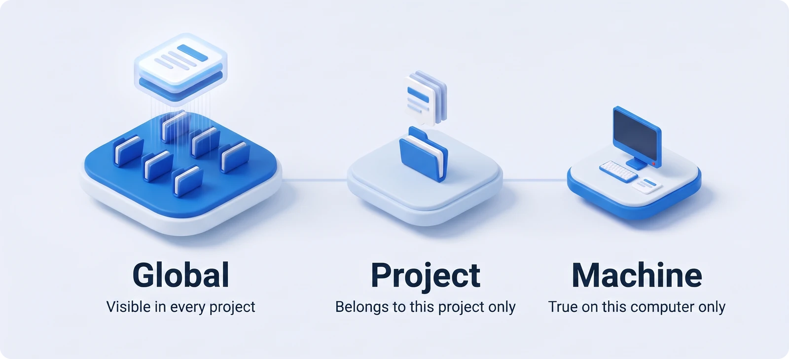

[繁體中文](../使用說明.md) · **English**

# User guide

Once installed, Engram needs almost no attention. This guide covers the features you'll use day to day, and what to do when Engram needs a decision from you. If you haven't installed it yet, start with the [Quick start](quick-start.md).

**Contents**: [How it works](#1-how-it-works) · [Everyday use](#2-everyday-use) · [Tidy with AI](#3-tidy-with-ai-in-claude-code) · [The dashboard](#4-the-dashboard) · [Inbox](#5-the-inbox-and-health-cards) · [Conflicts](#6-handling-conflicts) · [Colliding folders](#7-colliding-folders) · [Core rules](#8-core-rules) · [Pause, undo, and remove](#9-pause-undo-and-remove) · [Updating](#10-updating) · [Command cheat sheet](#11-command-cheat-sheet)

## 1. How it works

  

| Concept | Description |
| --- | --- |
| Vault | All memories are gathered in `%USERPROFILE%\.engram\vault`, a git repo that syncs to the private repo `engram-vault` on your GitHub |
| Three scopes | **Global**: true for every project, such as your preferences. **Project**: belongs to one project only, such as how it's deployed. **Machine**: true only on this computer, such as install paths and network settings |
| Project ID | Every project has a fixed ID. Git projects are recognized by their remote and other folders by a marker file, so moving, renaming, or switching computers is fine |
| Binding | Connects a project folder to its place in the vault. A git project is bound automatically the first time you open Claude Code on another computer |

Engram does not modify Claude Code itself. It only uses three official mechanisms: the memory folder, `CLAUDE.md` imports, and hooks.

How do you tell the three scopes apart? One rule of thumb: **would this still hold true on another computer?** If not, it goes in **Machine**. If so, ask next: **would it still hold true in a different project?** If so, it goes in **Global**; if not, it goes in **Project**.

  

## 2. Everyday use

You don't have to do anything. Claude remembers things as usual, and Engram handles the rest in the background:

| When | What Engram does |
| --- | --- |
| Conversation start | Brings in the status: Claude knows which computer and which project it's in, and where global and machine memories should be written |
| During the conversation | Project memories are written the official way. Global and machine memories are written by Claude with `engram remember`, and it tells you when it has |
| Conversation end | Tidies the index, checks for possible secrets, then saves to the vault |
| Every 10 minutes (default) | Exchanges changes with your other computers. While you're offline, changes stay on this computer and catch up automatically once you're back online. You can change the interval on the Settings page |
| Once a day (default 09:30) | Runs a health check; anything that needs your decision goes into the inbox |

When you want to tidy up on your own:

- In **Library** you can search and edit, or use **Change scope** to move a memory to global, machine, or another project. Duplicate memories show up in the inbox as **Identical memories** or **Possible duplicates** cards, where you can merge them.
- The **Projects** page shows how far each project's memory index (MEMORY.md) is from Claude Code's load limit.
- On **Overview**, **What the last conversation loaded** lists which files Claude actually read in and how big each one is.

## 3. Tidy with AI in Claude Code

Health checks use rules only, so they can only find candidates such as "same name" or "file too big". Whether something should be promoted to global, whether it's really a duplicate, and whether it's still useful all take reading the content. You hand those judgments to your own Claude Code:

| Command | What it does | Where it appears in the dashboard |
| --- | --- | --- |
| `/engram:inbox` | Reads through the inbox cards one by one, explains its reasoning and recommendations, and acts only after you approve. Add a card id to handle just that one; add `auto` to have it handle the items it's confident about directly. Sync conflicts, possible secrets, folder binding and renaming, mass deletions, archiving, and anything it isn't sure about are still left for you to decide | **Ask Claude to tidy up** at the top of the inbox, **Ask Claude** on a card, **Ask Claude to merge** on a conflict card |
| `/engram:tidy` | A deep tidy of one project, the global scope, the machine scope, the core rules, or a single memory: finds memories that are semantically duplicate, outdated, contradictory, misfiled, or unclear, and proposes a tidy-up plan | **Ask Claude to tidy up** on the Projects page, **Ask Claude to check** in Library, **Ask Claude to trim** on the Core rules page |
| `/engram:save` | Reviews this conversation and saves what's worth remembering long-term as memories: decides the scope, checks first whether a similar memory exists, and updates that one if so | Use it in a conversation |
| `/engram:recall` | Finds relevant experience in the memories of other projects, the global scope, and each computer, distills it into conclusions you can apply right away with sources attached; read-only | Use it in a conversation |

Safety by design:

- **Plan first, act only after you approve.** Every write comes with an `engram undo <version>` so you can undo each item individually.
- **Detected secrets are not handed to Claude.** When Claude reads memories, possible secrets have already been replaced on this computer with a marker such as `‹已遮蔽：…›` ("redacted"). Engram also refuses writes that contain possible secrets, so Claude records only where the secret is stored instead.
- **"Not a secret" is confirmed by you personally.** For a value that was flagged by mistake, run `engram not-secret` in your own terminal (it is refused if run inside Claude Code). Confirmed values are stored only as hashes and synced to all computers; if you marked one by mistake, view the list with `engram not-secret --list` and revoke it with `--remove`.
- **Nothing is overwritten if it changed after Claude read it.** If another computer has just synced a change, or you edited the memory in the dashboard, the write is refused, and Claude re-reads it and reconsiders.

> If you've just updated Engram and a conversation that's already open doesn't show these commands, run `/reload-plugins` or start a new conversation. The first time Claude Code asks whether to allow running `engram` commands, choose Allow. The instructions inside these commands are in Traditional Chinese for now; Claude normally replies in the language you write in.

## 4. The dashboard

Type `engram ui` in a terminal (inside Claude Code, type `! engram ui`), and your browser opens `http://127.0.0.1:4777`. The dashboard runs only on your computer and makes no outside connections. It's available in English and Traditional Chinese; switch languages in the top bar or in Settings.

| Page | What it's for |
| --- | --- |
| Overview | Items awaiting action, the sync trail across devices, the memory breakdown, and recently remembered things |
| Library | Browse by scope and project, search, edit, change scope, pin, and view history |
| Inbox | Things that need your decision: conflicts and health cards; duplicate memories are merged here |
| Projects | Each project's folders, how it's bound, memory count, and index load budget; rename, and merge into another project |
| Devices & sync | Each computer's last sync time, change history, and undo |
| Core rules | The rules loaded in every conversation (see section 8) |
| Schedule & logs | Schedules and run logs for background sync, health checks, and compatibility probes |
| Import memories | Brings Claude Code's original memories into the vault: generate a plan → review → sandbox rehearsal → apply → verify; after applying, you can optionally sync your working guidelines (see section 8) |
| Settings | Computer name, sync interval, automatic binding, colliding-folder handling, health check time, pause and remove |

## 5. The inbox and health cards

Engram checks the state of your memories once a day, and anything that needs your decision goes into the inbox. Most cards have one main button that fixes the problem in one click, or you can choose **Remind in 7 days** or **Dismiss**. Claude won't bring up the inbox unless you ask.

| Severity | Card | What it means | Recommendation |
| --- | --- | --- | --- |
| High | Index over the load limit | A project's memory index goes past 200 lines or 25 KB, and Claude never sees the rest | Merge or archive older memories |
| High | `"…" may contain a secret or password` | This memory won't be synced | Press **Remove secret**, then **Redact and resume sync**: after the secret in the memory is replaced on this computer with `‹已遮蔽：…›` ("redacted"), syncing resumes. If it isn't a secret, choose **Not a secret** |
| High | Conflict needs attention | Two computers changed the same section of the same memory | See section 6 |
| High | Mass deletion detected | Half or more of a project's memories (at least 3) were deleted at once; Engram held the change back and did not sync it | If you didn't mean to, press **Restore** |
| High / Medium | Broken memory link / Colliding folders | A project's memory isn't connected to the vault correctly, or two folders collide | Broken link: press **Recreate link**. Colliding folders: see section 7 |
| Medium | `N memories with identical content` / `Possible duplicate: …` | Two or more memories have identical content, or very similar names and descriptions | Press **Merge**, or **Compare side by side and merge** |
| Medium | Looks specific to this computer | The content mentions this computer's install locations or environment | Change it to a machine memory |
| Medium | May belong to another folder | A memory that was written to the wrong place while folders were colliding | Move it to the right folder |
| Suggestion | May apply to all projects | For example, your own preferences stored in just one project | Promote it to global |
| Suggestion | May be outdated | Not updated for a long time, and the project hasn't been opened in a long time | Archive it (it can be restored) |

Cards that take reading the content to judge have an **Ask Claude** button, which gives you a command to paste into any Claude Code conversation.

## 6. Handling conflicts

It's rare for one person to edit the same memory on two computers at the same time, so conflicts should be uncommon. When one does happen:

1. Engram merges automatically whatever it can, for example when the two sides changed different sections.
2. For what it can't merge, this computer keeps its own version, and the other computer's version goes into the conflict area. Both computers see the conflict card.
3. Press **Compare and decide** on the conflict card to see the two versions side by side along with their common original version. You can choose **Keep this computer's version**, **Use the version from the other computer**, or **Keep both** (the other computer's version is saved separately as `-2.md`), or edit directly in the left column and press **Save the merged result on the left**.
4. If both sides each added different content and you don't want to move it over section by section yourself, press **Ask Claude to merge**. Claude explains what each side changed and writes a merged version for you to confirm.

Conflict markers never appear in the files Claude reads.

## 7. Colliding folders

Claude Code converts a folder's path into an internal name, and Chinese characters, spaces, underscores, dots, and other symbols all become hyphens. So two Chinese-named folders at the same level with the same number of characters (for example 甲方專案 and 乙方專案, "Client A project" and "Client B project"), or English folders that differ only in symbols (for example `my_proj` and `my proj`), end up sharing one internal name, and their memories and conversation history get mixed together. This is a limitation of Claude Code itself.

How Engram handles it:

| Approach | Effect |
| --- | --- |
| Automatic collision detection | Colliding folders are never wrongly connected together |
| Using a project settings file to specify the memory location | Memories can be kept separate, but only when Claude Code is started from that folder itself; conversation history still gets mixed together |
| Collisions that only appear later | Warns Claude at the start of the conversation not to cite those memories and not to write any |
| **Rename by naming rule** (the real fix) | Appends a 4-character code to the original name, for example 照片優化 ("Photo Optimization") becomes `照片優化-66ca`. The Chinese name stays readable, and in Claude Code it no longer collides |

A rename also rebinds the folder and updates old paths in memories written on this computer. To avoid disturbing other programs, these folders are never renamed automatically: ones with a conversation or file change in the last 30 minutes, ones that contain other projects, ones with a Python virtual environment or git worktree, ones under OneDrive, and ones for which Claude Code has recorded MCP servers or allowed tools.

Choose how to handle it under **Settings › Colliding folders**:

| Option | What it does |
| --- | --- |
| **Ask in the inbox (default)** | The colliding-folders card lists a suggested new name, and the folder is renamed only when you press **Rename by naming rule** |
| **Rename automatically** | The agent checks every hour and sends a notification after it renames something |
| **Off** | No renaming; memories are still kept separate through the settings file, but conversation history stays mixed together |

To undo a rename: find the entry in the change history under **Devices & sync** and press **Undo**, or run `engram collisions undo <id>` (`engram collisions` lists the most recent id).

> **Before you rename**: Claude Code stores conversation history by internal name too. After a rename, if you open Claude Code in the new folder, the `/resume` list won't include conversations from before the rename (they're still kept under `~/.claude/projects/`). Memories are not affected. Finish any old conversation you still want to continue before renaming.

## 8. Core rules

The core rules (`CORE.md`) are one document that's loaded in every conversation, shared by all projects and all computers. They contain your identity and preferences, a list of your work environments, and the "memory write protocol" that teaches Claude how to write memories into the right scope.

- Edit them on the **Core rules** page of the dashboard, or press **Ask Claude to trim** to have `/engram:tidy` tidy them.
- The working guidelines already in `~/.claude/CLAUDE.md` are not moved away. If you want your working guidelines to be the same on every computer: after you apply an import on the **Import memories** page, **Optional: share your working guidelines across all computers** appears. Press **Sync working guidelines**: you first preview what the moved content will look like, and it moves into the vault only after you approve. Afterwards you can press **Switch back to each computer's own version** to restore it bit for bit.

## 9. Pause, undo, and remove

| What you want to do | How |
| --- | --- |
| Pause temporarily | **Pause Engram** on the Settings page. While paused, nothing syncs and new projects aren't connected automatically; Claude keeps remembering as usual, and everything is handled together when you resume |
| Undo a tidy-up action | Press **Undo** on the notification when the action finishes; later, find the entry in the change history under **Devices & sync** |
| Restore an import | **Restore to before the import** on the import page, or `engram import undo <restore point>`. Memories changed or added after the import keep their latest version, and the older versions they replaced are saved as `.pre-rollback` |
| Stop using Engram for one project | Run `engram unbind` in that folder. The memories are copied back to Claude Code's original folder |
| Ask me before connecting new projects | On the Settings page, change **Automatic project folder binding** to **Always ask** or **Off** |
| Remove everything | `engram uninstall`: lists the plan first, then, after you approve, reverts each item to how it was before installation. **The vault is kept by default**, and a later reinstall picks it right up; only adding `--purge` also deletes the local vault (the repo on GitHub isn't affected) |

## 10. Updating

1. Get the new version of the program:
   - Installed with git: run `git pull` in the Engram folder
   - Installed from a ZIP: download the new version's ZIP and unzip it over your existing Engram folder (ZIPs are told apart by version number, so unpacking the same version again doesn't update anything)
2. Run `engram update`. It deploys the new version and restarts the agent.
3. In a Claude Code conversation that's already open, run `/reload-plugins`; new conversations use the new version straight away.

If the new version has problems, `engram update --rollback` switches back to the previous one. If you've moved the Engram folder elsewhere, use `engram update --from "<new location>\app"`.

## 11. Command cheat sheet

| Command | What it does |
| --- | --- |
| `engram status` | This computer, plus the binding and sync state of the current folder |
| `engram ui` | Opens the dashboard |
| `engram sync` | Syncs right now |
| `engram doctor` | Checks the environment item by item; add `--probe` to also confirm that this version of Claude Code behaves the way Engram assumes (this uses your Claude quota) |
| `engram search <keyword>` | Searches memories in every scope |
| `engram projects` | Lists all projects |
| `engram bind` / `engram unbind` | Binds the current folder to a project / unbinds it |
| `engram import plan` | Generates an import plan (`apply --yes` applies it, `undo <restore point>` restores) |
| `engram collisions` | Lists colliding folders and their suggested new names (`apply` renames, `undo <id>` reverts the whole batch) |
| `engram undo <version>` | Undoes one write, move, archive, merge, or conflict resolution |
| `engram not-secret` | Records a value that was wrongly flagged as a secret in the "Not a secret" list (can only be run in your own terminal) |
| `engram update` | Deploys a new version (`--rollback` switches back to the previous one) |
| `engram uninstall` | Reverts to how things were before installation, from the installation record (`--dry-run` only lists the plan, `--purge` also deletes the local vault) |
| `engram help <command>` | Shows the full usage of a command |

The `/engram:inbox`, `/engram:tidy`, `/engram:save`, and `/engram:recall` commands in Claude Code are covered in section 3.
