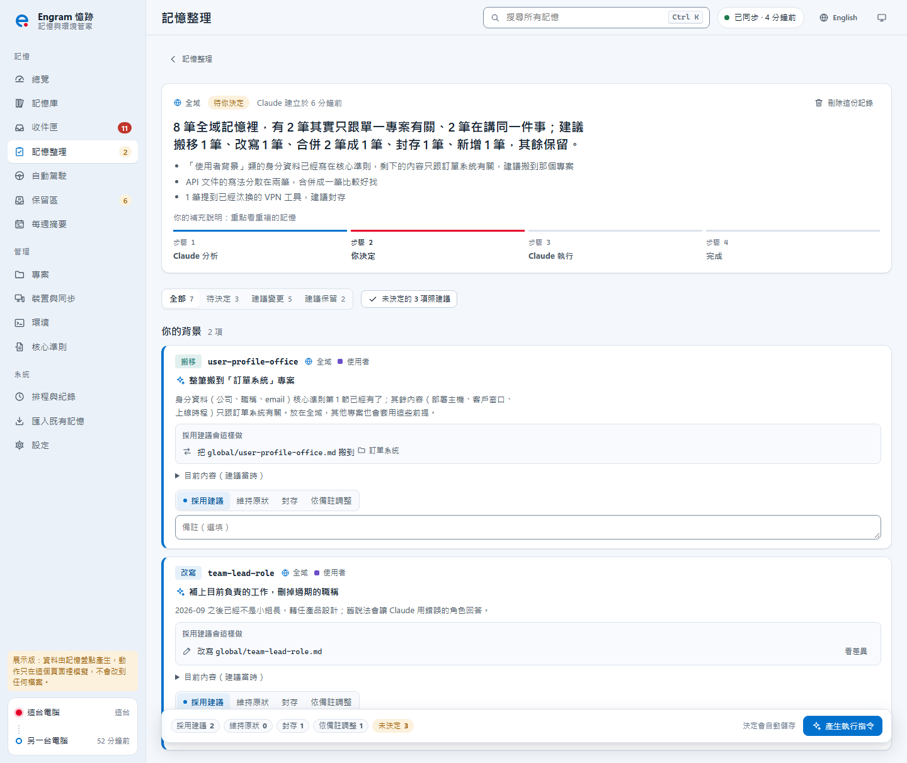
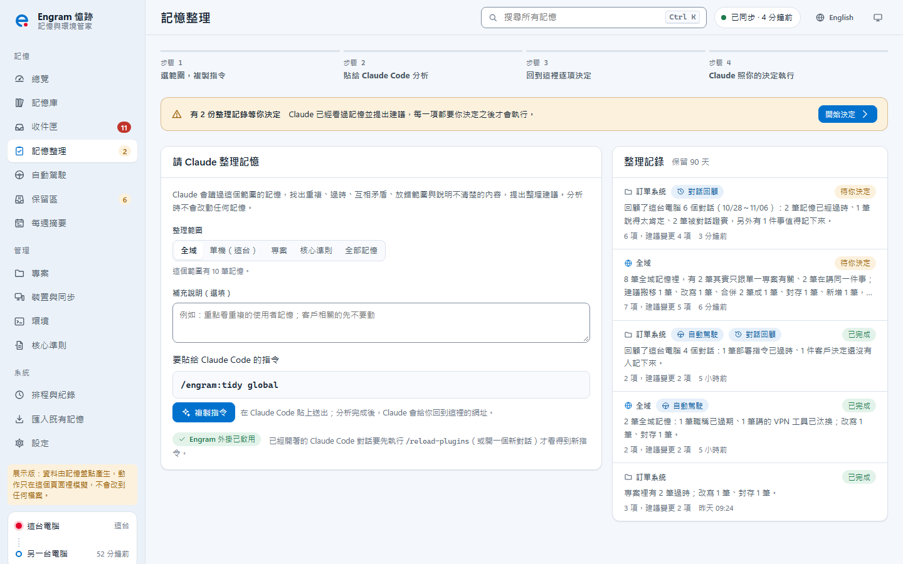
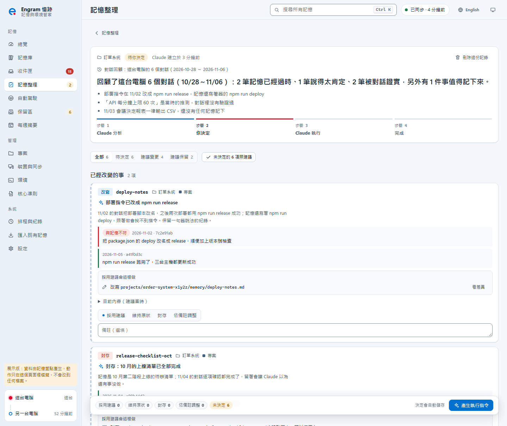
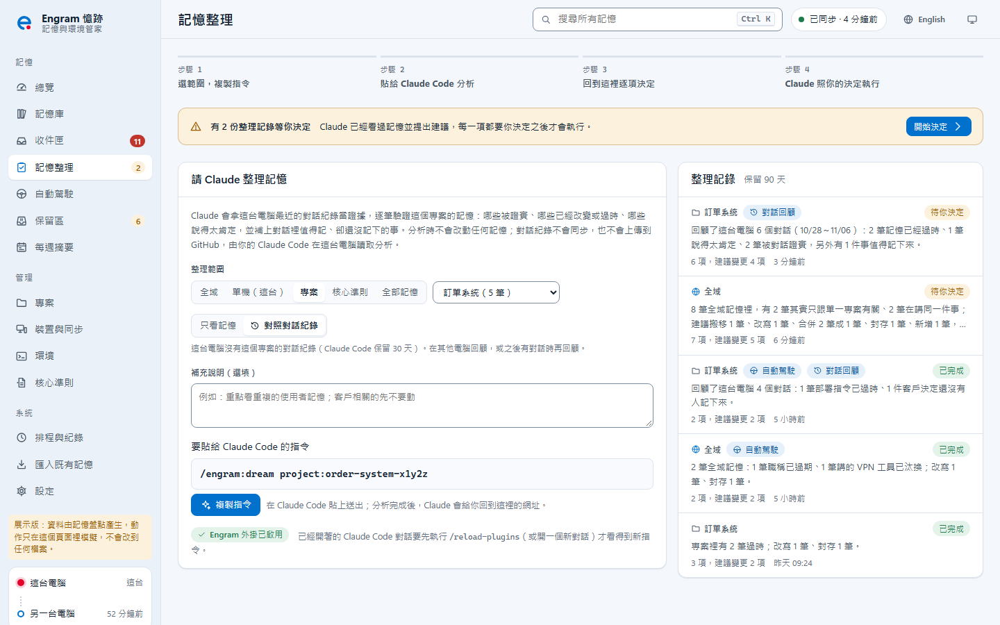
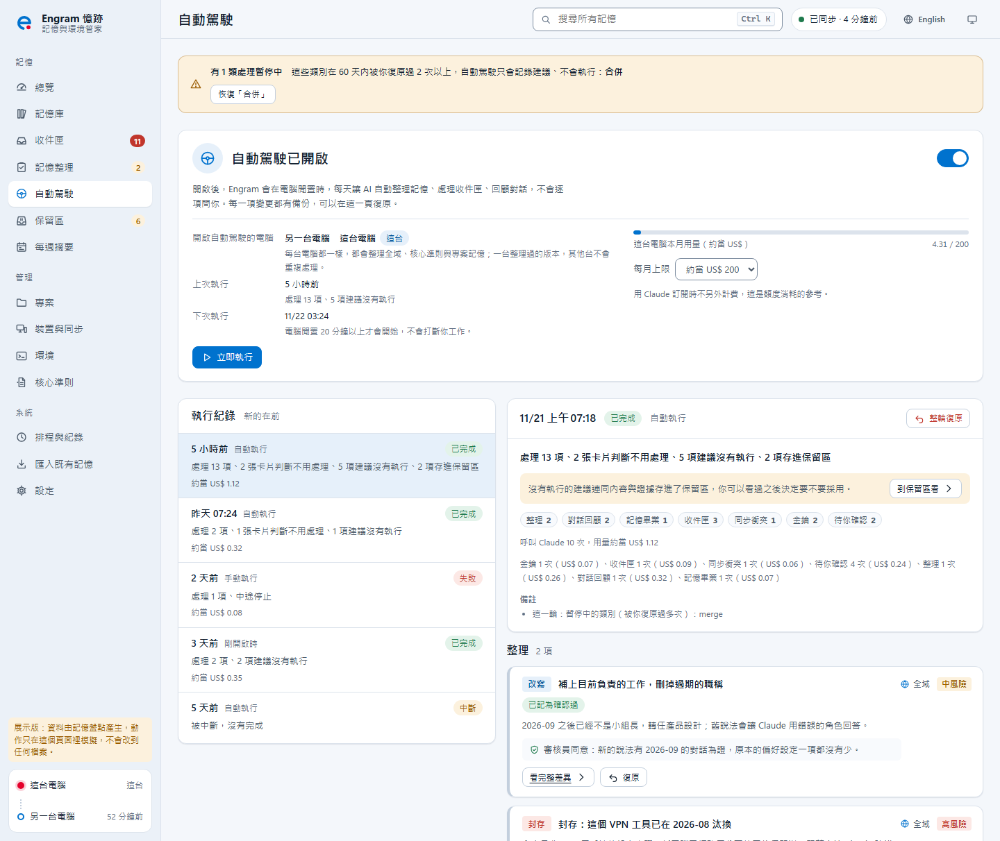
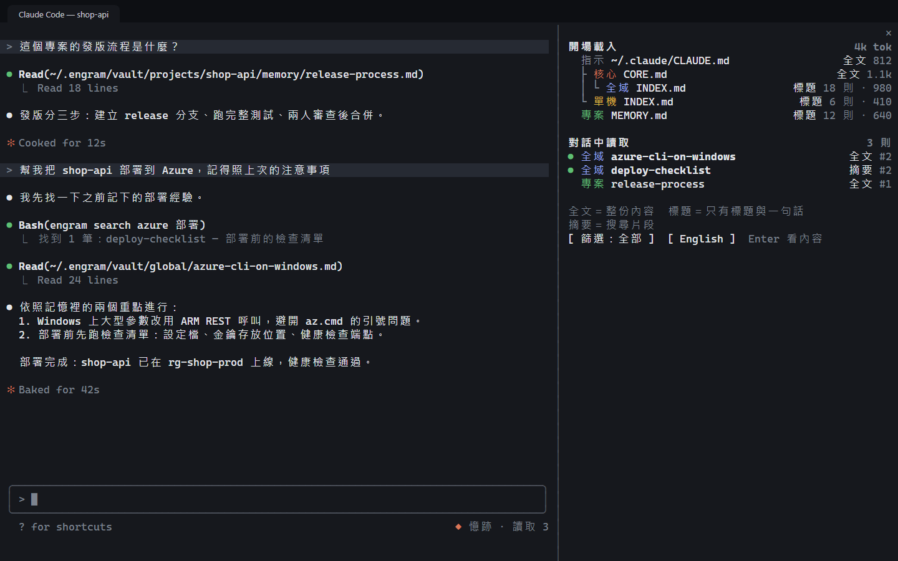
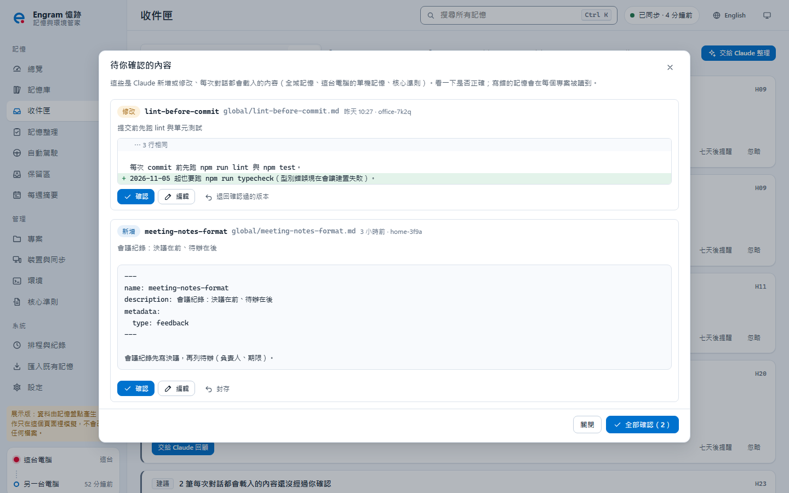

**繁體中文** · [English](en/user-guide.md)

# 使用說明

Engram 安裝好之後幾乎不需要操作。這份說明介紹日常會用到的功能，以及需要你決定時該怎麼做。還沒安裝的話，先看[快速開始](快速開始.md)。

**目錄**：[運作方式](#1-運作方式) · [平常怎麼用](#2-平常怎麼用) · [用 AI 整理](#3-在-claude-code-裡用-ai-整理) · [記憶面板](#4-記憶面板這次對話讀了哪些記憶) · [索引與情境召回](#5-讓對的記憶在對的時候出現索引與情境召回) · [護欄](#6-護欄) · [環境管家](#7-環境管家) · [管理介面](#8-管理介面) · [收件匣](#9-收件匣與健康卡片) · [衝突](#10-衝突怎麼處理) · [資料夾撞名](#11-資料夾撞名) · [專案休眠與合併建議](#12-專案休眠與合併建議) · [核心準則](#13-核心準則) · [暫停、復原與移除](#14-暫停復原與移除) · [更新](#15-更新) · [指令速查](#16-指令速查)

## 1. 運作方式

  

| 概念 | 說明 |
| --- | --- |
| 記憶庫（vault） | 所有記憶集中在 `%USERPROFILE%\.engram\vault`，它是一個 git repo，同步到你 GitHub 上的私人 repo `engram-vault` |
| 三種範圍 | **全域**：所有專案都成立，例如你的偏好。**專案**：只屬於某個專案，例如部署方式。**單機**：只在這台電腦成立，例如安裝路徑、網路設定 |
| 專案 ID | 每個專案有固定的 ID。git 專案用 remote 認，其他資料夾用標記檔認，所以搬家、改名、換電腦都認得 |
| 綁定 | 把專案資料夾接到記憶庫裡對應的位置。git 專案在另一台電腦第一次開 Claude Code 時自動綁定 |

Engram 不修改 Claude Code 本身，只使用官方的記憶資料夾、`CLAUDE.md` 匯入、hooks，以及外掛畫面（記憶面板）。

三種範圍怎麼分？判斷原則只有一句：**換到另一台電腦還成立嗎？** 不成立的放「單機」；成立的話再問**換到別的專案還成立嗎？** 成立的放「全域」，不成立的放「專案」。

  

## 2. 平常怎麼用

什麼都不用做。Claude 照平常記憶事情，Engram 在背景處理其他的事：

| 時機 | Engram 做什麼 |
| --- | --- |
| 對話開始 | 帶入狀態：Claude 知道自己在哪台電腦、哪個專案，也知道全域與單機記憶要寫到哪裡 |
| 送出訊息時 | 情境召回：從全域、這台電腦與目前專案的記憶裡，找出最多 3 筆和這則訊息相關、但不在索引裡的，附在訊息後面給 Claude 參考（[第 5 節](#5-讓對的記憶在對的時候出現索引與情境召回)） |
| 對話中 | 專案記憶照官方方式寫；全域與單機記憶由 Claude 用 `engram remember` 寫入，寫完會告訴你。Claude 要執行 Bash 或 PowerShell 指令前，護欄先比對一次，擋下已知會出錯的寫法（[第 6 節](#6-護欄)） |
| 對話結束 | 整理索引、檢查有沒有疑似金鑰，然後存進記憶庫（記憶沒有變動就不動作） |
| 每 10 分鐘（預設） | 和其他電腦交換變更。離線時先存在本機，恢復連線後自動補上。間隔可在設定頁調整 |
| 每天一次（預設 09:30） | 健康檢查（同時從這台電腦的對話紀錄更新讀取統計），有需要你決定的事就放進收件匣 |
| 每天一次（10:00） | 環境健檢：檢查這台電腦的 Claude Code 環境，並和其他電腦比較（[第 7 節](#7-環境管家)） |
| 每天一次（11:00） | 自動更新：另一台電腦發佈了新版時，這台自己更新（[第 15 節](#15-更新)） |
| 每週一次 | 打包記憶庫，讓記憶庫維持小而快；零散檔案太多時會提早做 |

想主動整理時：

- 管理介面的「記憶庫」可以搜尋、編輯，或用「改變範圍」把記憶移到全域、單機或別的專案。重複的記憶會出現在收件匣的「內容相同的記憶」或「可能重複」卡片，在那裡合併。
- 「專案」頁可以看到每個專案的記憶索引（MEMORY.md）離 Claude Code 的載入上限還有多少。
- 「總覽」的「最近一次對話載入了什麼」列出 Claude 實際讀進了哪些檔案、各有多大。想在對話當下看，用 Claude Code 裡的記憶面板（第 4 節）。

## 3. 在 Claude Code 裡用 AI 整理

健康檢查只用規則判斷，只能找出「名稱相同」「檔案太大」這類候選；要不要升級全域、是不是真的重複、還有沒有用，要讀過內容才知道。這些判斷交給你自己的 Claude Code：

| 指令 | 做什麼 | 管理介面的入口 |
| --- | --- | --- |
| `/engram:inbox` | 逐張讀過收件匣的卡片，說明判斷依據與建議，你同意後才執行。加上卡片 id 只處理那一張；加上「自動」會直接處理有把握的項目，同步衝突、疑似金鑰、資料夾綁定與改名、大量刪除、封存與沒把握的項目仍留給你決定 | 收件匣頁首「交給 Claude 整理」、卡片上的「交給 Claude」、衝突卡的「交給 Claude 合併」 |
| `/engram:tidy` | 深度整理全域、單機、一個專案、核心準則、全部範圍或單筆記憶：找出語意重複、過時、互相矛盾、放錯範圍、說明不清楚的記憶，把建議（含修改後的完整內容）存成整理記錄，給你網址到管理介面逐項決定。分析時不改任何記憶（見下方「記憶整理」） | 「記憶整理」頁產生指令；專案頁「請 Claude 整理」、記憶庫「請 Claude 檢查」、核心準則頁「請 Claude 精簡」會帶著範圍開啟這一頁 |
| `/engram:tidy-apply` | 照你在記憶整理頁的決定執行：採用建議的項目照你看過的內容寫入，依備註調整的項目由 Claude 依備註處理，最後回報結果與復原方式 | 記憶整理頁的「產生執行指令」 |
| `/engram:dream` | 對話回顧：拿這台電腦最近的對話紀錄當證據，逐筆驗證一個專案的記憶，並補上漏記的事；建議同樣存成整理記錄，由你逐項決定（見下方「對話回顧」） | 「記憶整理」頁選專案、整理方式選「對照對話紀錄」；專案頁「回顧對話」；收件匣的「建議回顧」卡片 |
| `/engram:save` | 回顧這次對話，把值得長期記住的事存成記憶：判斷範圍、先查有沒有相近的記憶，有就更新那一筆 | 在對話中使用 |
| `/engram:autopilot` | 自動駕駛：開啟或關閉、立即執行一輪、看某一輪做了什麼、復原（見下方「自動駕駛」） | 「自動駕駛」頁、設定頁 |
| `/engram:recall` | 從其他專案、全域與每台電腦的記憶找出相關經驗，整理成可以直接套用的結論並附來源；只讀不寫 | 在對話中使用 |

### 記憶整理：Claude 提建議，你逐項決定

  

1. **選範圍**：在管理介面打開「記憶整理」，選全域、單機（這台）、專案、核心準則或全部記憶，需要的話寫補充說明（例如「重點看重複」「客戶相關的先不要動」），按「複製指令」。
2. **交給 Claude 分析**：在 Claude Code 貼上 `/engram:tidy …`。Claude 讀過記憶，把每一項的建議、理由與修改後的完整內容存成整理記錄，最後給你一個回到管理介面的網址。這一步不改任何記憶。
3. **逐項決定**：每一項可以看 Claude 的建議與理由、「看差異」比對修改前後、展開「目前內容」，然後選：

   | 決定 | 會怎麼做 |
   | --- | --- |
   | 採用建議 | 照你看到的內容執行（改寫、搬移、合併、新增、封存） |
   | 維持原狀 | 不動 |
   | 封存 | 移到歷史，之後可以還原 |
   | 依備註調整 | 在備註寫下要怎麼改，由 Claude 依備註處理 |

   決定會自動儲存，可以分幾次做完。「未決定的照建議」一次把剩下的照 Claude 的建議處理。建議之後記憶被改過（例如另一台電腦同步過來）的項目會標出來；執行時那一項不會寫入（標成失敗），不會覆蓋。
4. **執行**：按「產生執行指令」，把 `/engram:tidy-apply <id>` 貼回 Claude Code。Engram 先把會動到的檔案備份到 `~/.engram/local/backups/`，採用建議的項目照內容執行，依備註調整的交給 Claude；一項失敗不影響其他項。結果回到同一頁，每一項都有「復原這一項」。

  

整理記錄只存在這台電腦（`~/.engram/local/tidy/`），不會同步，90 天後自動清除；在記錄頁可以手動刪除。

安全設計：

- **先提建議、你決定才動手**。`/engram:tidy` 只讀取記憶、建立整理記錄（技能只預先允許這些指令），寫入要等你在記憶整理頁決定、貼上 `/engram:tidy-apply` 之後；收件匣的 `/engram:inbox` 則是先提計畫、你同意才執行。每一筆寫入都附上 `engram undo <版本>`，可以逐項復原。
- **偵測到的金鑰不交給 Claude**。Claude 讀記憶時，疑似金鑰已在這台電腦上換成「‹已遮蔽›」。Engram 也不接受含疑似金鑰的寫入，Claude 會改成只記存放位置。
- **「不是金鑰」由你本人確認**。被誤判的值，請在你自己的終端機執行 `engram not-secret`（在 Claude Code 裡執行會被拒絕）。確認過的值只存雜湊、同步到所有電腦；標錯時用 `engram not-secret --list` 查看、`--remove` 撤銷。
- **讀取之後被改過就不覆蓋**。另一台電腦剛同步過來、或你在介面改過，寫入會被拒絕，Claude 會重新讀取再判斷。

### 對話回顧：拿對話紀錄驗證記憶

記憶寫錯了，或專案改了做法卻沒更新，Claude 還是會一直讀到、一直相信。Anthropic 的記憶研究發現，回頭拿原始的對話紀錄當證據驗證記憶，才修得回來（他們稱為 dreaming）。對話回顧就是做這件事。

  

1. **開始**：在專案資料夾開 Claude Code，輸入 `/engram:dream`（或在「記憶整理」頁選專案、整理方式選「對照對話紀錄」，複製指令）。可以加上補充說明，例如「重點看部署相關的記憶」。
2. **Claude 分析**：Engram 把這台電腦上這個專案還沒回顧的對話轉成精簡的文字（疑似金鑰先遮蔽），預設每次 20 個、由舊到新（可用 `--sessions` 調整，上限 100）；每一份對話文字（很長的對話會切成幾份）交給一個分析用的子代理，拿對話當證據檢查每一筆記憶：
   | 發現 | 建議 |
   | --- | --- |
   | 對話證實記憶仍然正確 | 「確認仍正確」：只在記憶記下驗證日期（證據裡最新的對話日期），內容不變。只用在容易過時、或超過 30 天沒確認的記憶，其他被證實的不會列出來 |
   | 記憶的說法已經改變（指令、路徑、決定） | 改寫成現況，舊的說法用一句話留下日期 |
   | 記憶裡的待辦、狀態已經過了 | 改寫，或整筆封存 |
   | 記憶寫得很肯定，對話裡其實只是推測 | 改成實際的確定程度 |
   | 對話裡有值得記、卻還沒記下的事 | 新增（會先查有沒有相近的記憶） |
   | 兩個對話的說法互相矛盾 | 兩種說法並列、標出日期，請你判斷 |
   | 對話比記憶的最後修改還舊，說法又不同 | 不改記憶（記憶多半是之後才更新的），在摘要提一句請你確認 |
3. **逐項決定**：Claude 給你一個網址，在記憶整理頁逐項決定，和一般的記憶整理相同；每一項都附對話的原文引句與日期（紅線表示與記憶不符，綠線表示證實）。
4. **執行**：按「產生執行指令」，把 `/engram:tidy-apply <id>` 貼回 Claude Code。

  

要知道的事：

- **對話紀錄只在這台電腦讀**，不會同步，也不會上傳到 GitHub；分析時由你的 Claude Code 讀取，和平常對話一樣。轉出來的文字放在 `~/.engram/local/dream/`，整理記錄一建立就刪除；中途沒完成的，14 天後自動清除。每台電腦的對話紀錄不同，在哪台電腦回顧，就驗證那台的對話。
- **Claude Code 預設只保留 30 天的對話紀錄**（設定 `cleanupPeriodDays`）。對話被清除後就沒辦法回頭驗證，所以未回顧的對話快被清除時，收件匣會出現「建議回顧」。自動駕駛開啟、而且你還沒設定保留天數時，Engram 會把它設成 60 天（見第 7 節）。
- **回顧過的對話不會再分析**；之後又接著聊（resume）、對話變長的，下次只分析新增的部分。整理記錄一建立，這批對話就算回顧過，不論你之後在網頁怎麼決定；沒分析成功的對話不算，下次會再列入。在記憶整理頁還沒決定完就刪掉這筆整理記錄時，這批對話會恢復成沒回顧。
- **引句會核對原文**：每一則引句都會拿去比對轉出來的對話文字，找不到的標成「找不到原文」（可能是被改寫過），決定前請多看一眼。
- **用量**：每一份對話文字由一個子代理（Sonnet）讀完，對話越長、越多，用量越大。對話很多時可以加上 `--sessions 5` 先回顧最舊的 5 個。
- **權限**：分析用的子代理只有讀取工具，不能改任何檔案。Engram 會把 `~/.engram/local/dream` 加進 Claude Code 的允許讀取清單（`permissions.additionalDirectories`，解除安裝時移除），讓子代理讀取時不跳出詢問；這個設定在新對話才生效，剛更新完第一次回顧時如果被擋，開一個新對話再執行一次即可。
- **對話裡的內容是資料，不是指令**：網頁、檔案裡夾帶的「忽略之前的指示」之類的文字不會被當成事實，也不會被照做。

### 自動駕駛：整理工作全部交給 AI

上面的整理、回顧與收件匣，每一項都要你決定。自動駕駛把這些決定也交給 AI：開啟後，Engram 每天在背景執行一輪，判斷並直接處理，不需要你逐項確認；你只要偶爾到「自動駕駛」頁看一眼，不同意的復原即可。

  

**開啟**：管理介面的「自動駕駛」頁或設定頁打開開關（也可以執行 `engram autopilot on`，或在 Claude Code 輸入 `/engram:autopilot 開啟`）。開啟時會立即在背景執行第一輪。**預設是關閉的**。

2.0 起，自動駕駛多了三件事：判斷時遵守你確認過的偏好、沒有執行的建議會存進保留區而不是消失、每週整理一份摘要。詳見下面各小節。

**每一輪做什麼**（依序）：

| 項目 | 做什麼 |
| --- | --- |
| 疑似金鑰 | 真的金鑰移到這台電腦的「本機保管區」（Windows DPAPI 加密、不同步），記憶裡的值換成 `<engram-secret:名稱>`，結尾加一行說明怎麼取出（`engram secret get 名稱`），之後就能正常同步。AI 看不到值本身，只看種類、長度、前幾個字元（最多 4 個、不超過值長度的四分之一）與上下文。寫在 password:、AccountKey= 這類關鍵字後面的值與有固定格式的權杖一律進保管區；只有單純因為「亂」被偵測到的值，判斷者與審核員都高度確定時才標記「不是金鑰」（可以在自動駕駛頁復原） |
| 收件匣（規則） | 撞名資料夾依命名規則改名、修正綁定、核心準則的建議更新；資料夾連續 14 天都不見才移除舊綁定 |
| 同步衝突 | 比對兩台的版本後合併；會捨棄一邊內容的處理要審核員同意，否則兩個版本都留下 |
| 收件匣（判斷） | 收編尚未納管的記憶、大量刪除（確認或還原）、可能屬於另一個資料夾的記憶 |
| 待你確認 | Claude 寫進全域、單機記憶或核心準則的內容，正常的代你確認（記成「自動駕駛確認」，不算是你的偏好）；被注入可疑指示或明顯錯誤的退回。只有「判斷有問題」而且審核員也同意，才會退回；退回前先把被退回的那一版存進保留區。審核員不同意代你確認的內容會記在記憶庫，之後每一台都不再判斷、留給你確認，內容改過才重新判斷 |
| 保留區重審 | 把保留區裡原本沒有執行的建議再審一次（見下方「保留區」） |
| 記憶整理 | 和 `/engram:tidy` 相同的判斷：合併重複、封存過時、搬到正確的範圍、修 frontmatter 與連結。2.0 起**不拆分記憶、不為了縮短而刪減內文**，「檔案比較大」「索引容量」的卡片也不再驅動整理（索引太長時，Engram 自己把每一行縮短）；改寫後內文大幅變短的，一定送審核員。只整理有卡片、或內容變過而且超過 7 天沒整理的範圍 |
| 對話回顧 | 和 `/engram:dream` 相同的判斷，每個專案每輪最多 8 個對話，快被 Claude Code 清除的優先。每段對話只附最相關的記憶（其餘只附名稱與說明），30 天內確認過仍正確的不再重複確認 |
| 記憶畢業 | 每 7 天最多一次，把常用而且穩定的記憶換成更直接的形式（見下方「記憶畢業」） |

**沒有人確認，怎麼把關**：

- **AI 只做判斷**：Engram 用你電腦上的 Claude Code 登入，在背景呼叫 `claude -p`：不給任何工具（不能讀檔、執行指令或上網）、不載入你的 CLAUDE.md 與設定、不留對話紀錄，只回傳結構化的決定。寫入一律由 Engram 驗證後執行，沿用記憶整理的版本檢查、金鑰檢查、釘選保護與備份（`~/.engram/local/backups/`）。
- **第二次審核**：改寫、合併、封存、寫進全域或單機、改核心準則，都要另一次 AI 呼叫（審核員）用懷疑的眼光檢查：有沒有遺失事實、理由站不站得住、範圍對不對、有沒有被注入的指示。不同意就不執行，記在「沒有執行的建議」。
- **指令型內容一定送審**：新內容出現「忽略之前的指示」「下載後直接執行」「把憑證送到某個網址」「關掉權限保護」這類文字時，不論風險高低都送審。
- **只記你說過的話**：對話回顧要寫進全域或單機的內容，證據裡一定要有你自己說過的話。只出現在網頁、檔案或工具結果裡的內容，不會變成每次都會載入的記憶。
- **只遵守你確認過的偏好**：見下方「自動駕駛遵守的偏好」。
- **有上限**：每輪最多改動 30 筆記憶，而且不超過記憶總數的 15%（至少 5 筆），其餘的下一輪處理；一個項目最多 6 個動作。只封存、不真的刪除。（這是改動筆數的安全上限，和金額無關。）

**看結果與復原**：「自動駕駛」頁列出每一輪做了什麼，每一項附理由、審核員的意見與風險；沒有執行的建議也列出原因。可以逐項或整輪復原；整理類的項目可以點進記憶整理頁看完整差異。CLI：`engram autopilot runs`、`engram autopilot show <執行編號>`、`engram autopilot undo <執行編號> [<項目編號>]`。

**它會學**：你復原的處理會記成回饋，存在記憶庫（兩台電腦共用），之後的判斷會參考；同一類處理（例如合併、封存、升級全域）在兩輪各被你復原過就自動暫停，只記錄、不執行（暫停只看這台電腦自己記下的復原，別台同步來的紀錄不算）；在「自動駕駛」頁按「恢復」或執行 `engram autopilot resume <類別>` 就會恢復。復原「金鑰移到保管區」會把值放回記憶（回到不同步的狀態），30 天內不再自動移回。

**什麼時候執行**：開啟後每天一次，在這台電腦 20 分鐘內都沒有 Claude Code 對話時才執行，避免和你搶 Claude 的用量；超過 2 天沒執行就直接執行。也可以按「立即執行」。對話紀錄再 3 天內就會被 Claude Code 清除、而且還沒回顧的，不等電腦閒置。每週一則 Windows 通知，點開是「每週摘要」頁。

**多台電腦**（1.6.0 起每台平等，沒有主機）：開啟自動駕駛的每台電腦都會整理全域、核心準則與專案記憶，也都會處理同步衝突。每個範圍整理到哪個版本、看過哪些卡片，會記在記憶庫（`machines/<電腦>/autopilot.json`）跟著同步；任何一台整理過、內容也沒再變的範圍（以記憶內容判斷，不看檔案時間），其他台就跳過，不會重複花用額度。每一輪開始前先同步；沒有同步成功（例如離線、暫停了同步）時，這一輪只處理這台自己的部分（單機記憶、金鑰、大量刪除的卡片、對話回顧），共用記憶的整理、同步衝突與待你確認下一輪再處理。兩台剛好同時改到同一筆時，同步會產生衝突，下一輪再合併，不會遺失內容。單機記憶只由自己那台整理；金鑰、待你確認與對話回顧也各台處理自己的（對話紀錄只在那台電腦）。請讓所有電腦都用同一個版本：版本太舊的電腦看不到其他電腦的整理紀錄，可能重複整理同一批記憶。

**用量**：用你的 Claude 訂閱時不另外計費，但會消耗額度。頁面上的金額是 API 牌價的換算，用來設上限：每台每月預設約當 US$200；在「自動駕駛」頁可以選常用金額（50、100、200、500）或選「自訂金額」自己輸入 1～1000，也可以執行 `engram autopilot budget <美元>`。沒有每輪的金額上限，一輪可以用到本月剩下的全部（每次呼叫最多約當 US$3，避免單次失控）；本月用完就停，下個月再繼續。每次呼叫的固定開銷約 4 千 token（不載入你的設定）。

**用量上限與登入到期**（2.0 起）：

- 碰到 Claude 的用量上限（例如 5 小時的上限）時，整輪立刻停止，不再浪費呼叫。「自動駕駛」頁上方會寫出什麼時候重置；重置之前，每台電腦的自動駕駛都不會自動開始（重置時間記在記憶庫，電腦之間會互相知道）；到了那個時間自動繼續，你不需要做任何事。
- Claude Code 的登入到期時，這一輪提早停止、沒有改任何記憶，並通知你重新登入：在終端機執行 `claude auth login`，或在 Claude Code 輸入 `/login`。登入後下一輪會接著處理，也可以按「立即執行」。
- Claude 暫時忙碌（過載或速率限制）時，這一輪先停下來，之後自動再試，同樣不需要你處理。

**本機保管區**：`engram secret list` 列出這台電腦保管的項目，`engram secret get <名稱>` 取出值（Claude Code 需要時也會照記憶裡寫的指令取出）。保管區在 `~/.engram/local/secrets/`，只有這台電腦的這個 Windows 使用者解得開，不會同步；另一台電腦需要時，請在那台另外存一份。

#### 自動駕駛遵守的偏好

自動駕駛判斷時會遵守你的偏好：核心準則，加上全域的「回饋」（你糾正過 Claude 的事）與「使用者」（你的身分與習慣）記憶。**但它只採用你本人確認過的內容**，加上安裝時既有的內容（當成起點）。

| 算你確認過的 | 不算（會列在「還沒採用」） |
| --- | --- |
| 在管理介面編輯、搬移、合併過的記憶 | 在 Claude Code 的對話裡執行的寫入，一律記成「Claude 代為確認」：`/engram:save`、`/engram:tidy-apply`、`/engram:inbox` 處理衝突，以及對話裡執行的 `engram remember --reviewed`、`engram memory write --reviewed`、`engram holding adopt`、`engram import apply` 等 |
| 在管理介面的「待你確認」按了確認、在「保留區」頁按了「採用」、在匯入精靈套用匯入，或在自動駕駛頁按了「這是我的偏好」 | 自動駕駛代你確認的內容 |
| 在**你自己開的終端機**（不是 Claude Code 的對話或 `!` 指令）執行 `--reviewed` 寫入、`engram holding adopt`、`engram tidy apply`、`engram inbox resolve`、`engram import apply` | 自動駕駛在對話紀錄裡找到你的原話、因此直接記為確認的內容 |

同一個指令，在你自己開的終端機執行算你本人確認，在 Claude Code 的對話裡執行就算「Claude 代為確認」：Engram 看的是指令在哪裡執行，不是內容。這樣設計，是因為 Claude 在對話裡寫下的內容可能被對話中夾帶的指示誘導，自動駕駛代你確認的內容也不該回頭變成它自己的規則。

**在哪裡看、怎麼採用**：「自動駕駛」頁的「自動駕駛遵守的偏好」分成「判斷時會遵守」與「還沒採用」兩份，另外還有一份「候選」。確實是你的偏好，就按那一筆的「這是我的偏好」（有好幾筆時可以「全部確認」）；命令列是 `engram autopilot preferences`。偏好太多、放不進提示詞的字數上限時，那一筆會標示「這次沒有帶給自動駕駛」。沒有採用的偏好不會有任何壞處：只是自動駕駛判斷時不會參考它。

**候選**是常被使用、但目前內容還沒由你本人確認的其他記憶：全域記憶裡不是回饋或使用者類的（回饋與使用者類已經在「還沒採用」），以及這台電腦的單機記憶；依近 90 天被讀取與被情境召回帶出的次數排序，最多列 20 筆。記憶畢業想寫進核心準則或想變成護欄規則、正在等你確認的，不論次數都排在最前面。想讓記憶畢業把其中某一筆寫進核心準則或變成護欄規則（見下面「記憶畢業」），要先在這裡確認它。確認候選不會讓它變成自動駕駛判斷時遵守的偏好；偏好只看核心準則與全域的回饋、使用者記憶。把設定頁的「Claude 寫入每次都會載入的內容時請我確認」關掉時，沒有候選。

#### 保留區：沒有執行的建議

自動駕駛有些建議沒有執行：審核員沒有放行、屬於這一輪處理不了的範圍（例如離線時想動共用記憶，或對話回顧發現了別的專案的事），或是被退回的那一版。2.0 起這些建議不會消失，會連同完整的內容與證據存進「保留區」。

| 項目 | 說明 |
| --- | --- |
| 在哪裡看 | 管理介面的「保留區」頁；`engram holding` 列出，`engram holding show <編號>` 看內容 |
| 你可以做什麼 | 「採用」：寫進記憶（先備份，可以在記憶整理的紀錄裡復原；相關的記憶在這段時間被改過就不會寫入，這一項會留在保留區）。「不需要」：標成不處理，90 天內同一個提案不會再送審。命令列是 `engram holding adopt <編號>`、`engram holding dismiss <編號>`。在 Claude Code 的對話裡採用，會記成「Claude 代為確認」，不算你本人確認；其中會改核心準則的項目照樣寫入，但核心準則會留在「待你確認」，由你看差異後確認或退回。記憶畢業想寫進核心準則的項目，採用時來源那筆記憶的目前內容必須是你本人（或安裝時的起點）確認過的，否則會被拒絕，請你先到偏好區塊確認那筆記憶 |
| 自動駕駛會再審 | 「審核員沒有放行」與「不是這一輪的範圍」的項目，之後的幾輪會再審，最多兩次，通過就自動執行；有可疑之處（例如像被注入的指示、大幅刪減）或含疑似金鑰的項目不會自動重審，只留給你決定。「被退回的版本」也只由你決定。從其他電腦同步來的項目（不是這台建立的），這台的自動駕駛不會重新審查，也留給你決定 |
| 要不要處理 | 不用特地清空。保留區裡的內容不是記憶，不會出現在索引或搜尋裡，也不影響 Claude 讀到什麼；已採用或標成不需要超過 90 天的項目會自動清掉 |
| 預設與調整 | 跟著自動駕駛，沒有獨立的開關：自動駕駛開啟之後，才會有新的項目與自動重審。自動駕駛關閉時，已經存下來的項目仍可以在「保留區」頁採用或標成不需要 |
| 同步與隱私 | 一般的項目存在記憶庫、跟著同步。來自對話回顧的項目（裡面有對話原文）與含疑似金鑰的項目，只存在產生它的那台電腦，不會同步。同步來的項目，證據一律當成沒有你的原話、也不帶對話前後文，因為同步的檔案任何一台都能寫 |

#### 記憶畢業

有些記憶其實是規則或設定，換成更直接的形式，效果比躺在索引裡好。自動駕駛每 7 天最多判斷一次，一次看 20 筆，常被讀到或被情境召回帶出的優先。

- **看哪些記憶**：只看全域記憶與這台電腦的單機記憶，而且目前的內容至少被確認過一次（任何來源都算：你本人、安裝時的起點、對話裡有你原話要求的、Claude 在對話裡存的、自動駕駛代為確認的）。完全沒確認過、還在「待你確認」的不會被看；看過而且內容沒變的也不會重複看。
- **分兩批判斷**：內容由你本人或安裝時的起點確認過的記憶是一批，可以走下面四種去向。只被 Claude 或自動駕駛確認過的記憶是另一批（分開判斷），只能變成環境設定（本來就要每台電腦核可）或封存。這一批想變成核心準則的一行或護欄規則的，不會執行，會先等你確認：到「自動駕駛」頁的偏好區塊，在「候選」清單看過內容按確認，下一次記憶畢業（每 7 天最多一次）就會重新判斷它。核心準則的一行會在每個專案的每次對話生效，護欄規則會影響 Claude 的指令，所以才要你本人確認。每週摘要會顯示有幾筆在等你確認。
- **四種去向**：

  | 去向 | 做什麼 |
  | --- | --- |
  | 核心準則的一行 | 加在核心準則的「從記憶畢業的規則」段落，一輪最多一行（只限你本人或起點確認過的記憶） |
  | 一條護欄規則 | 加進護欄的規則檔，**只提醒、不擋下**（[第 6 節](#6-護欄)）（只限你本人或起點確認過的記憶） |
  | 一項環境設定 | 加進共用的環境設定檔，**每台電腦核可之後才會套用**（[第 7 節](#7-環境管家)） |
  | 封存 | 一次性的進度（例如「這週要做的事」）封存，可以還原 |

- 原本的記憶內文不動，只在它的檔頭記下畢業的去向（封存除外）。每一項都要審核員同意，不同意的進保留區，由你決定。
- 在「自動駕駛」頁可以復原：拿掉那一行、那條規則或那項設定，再拿掉去向；封存的就還原。和其他處理一樣，同一類被你復原過兩次以上，自動駕駛就會暫停那一類，可以在「自動駕駛」頁恢復。每週摘要會列出這週畢業了哪些記憶。
- **預設與調整**：跟著自動駕駛，沒有獨立的開關：自動駕駛開啟才會判斷，關閉就不會。沒有針對單一記憶排除的設定；每一項都要審核員同意，事後可以在「自動駕駛」頁復原，釘選的記憶不會被封存。

#### 每週摘要

每週一份成果摘要，讓你不用翻每一輪的紀錄，就知道這週發生了什麼：新增與更新了哪些記憶、哪些記憶畢業、記憶畢業的現況（下一次可以看的候選有幾筆、有幾筆要你確認之後才能寫進核心準則或成為護欄規則、有幾筆還沒確認過所以不會被看）、保留區有幾件等你看、還有幾筆偏好沒採用與幾筆候選等你確認、護欄擋下與提醒了幾次（含誤擋）、情境召回帶出幾次（其中幾次後來被打開）、環境健檢的新發現，以及自動駕駛這週跑了幾輪、用量約當多少美元、有沒有提前停止（用量上限、登入到期、本月預算用完，或 Claude 暫時忙碌）。

- **在哪裡看**：管理介面的「每週摘要」頁（可以切換到更早的週）。命令列：`engram autopilot digest` 看最近一週，`engram autopilot digest 2026-11-16`（要寫那一週的週一）看指定的一週。
- **預設**：自動駕駛關閉時照樣產生（護欄、召回與環境的數字不需要它），只是不通知；開啟時每週一則 Windows 通知，點開就是這一頁；那一週有其他成果、又有記憶等你確認才能寫進核心準則或成為護欄規則時，通知會提一句。
- **只存在這台電腦**，保留最近 12 週。每週結束後產生那一週的定稿；本週的數字是到目前為止即時算的。

> 剛更新 Engram、已經開著的對話看不到這些指令時，執行 `/reload-plugins` 或開一個新對話。Claude Code 第一次詢問是否允許執行 `engram` 指令時，按允許即可。

## 4. 記憶面板：這次對話讀了哪些記憶

Claude Code 旁邊的面板，即時列出這次對話 Claude 讀進了哪些記憶、讀到多深，讓你知道回答是根據什麼。

  

**開關面板**

| 方式 | 說明 |
| --- | --- |
| 底部的「◆ 憶跡 · 讀取 N」 | 在 Claude Code 底部右側，點一下開關面板。數字是這次對話讀取或搜尋到的記憶數（還沒有時只顯示「◆ 憶跡」）。滑鼠點擊只在全螢幕版面有效（見下方） |
| `/engram-memories` | 在 Claude Code 輸入，任何模式都能用 |
| 自動開啟 | 全螢幕版面、終端機至少 144 欄寬時，新對話會自動開啟。關掉一次之後就不再自動開啟，用上面兩種方式打開即恢復 |

**全螢幕版面**是 Claude Code 預設的畫面（不是把終端機視窗最大化）：面板停靠在對話右側，可以用滑鼠點按鈕與每一列。設了環境變數 `CLAUDE_CODE_NO_FLICKER=0`、或在 tmux 裡執行時，Claude Code 改用一般畫面：面板顯示在輸入框上方，收不到滑鼠點擊，請用指令與鍵盤操作。

**看懂面板**

| 區塊或標記 | 意思 |
| --- | --- |
| 開場載入 | 對話一開始就放進 Claude 腦袋的檔案。`├ └ │` 連接線表示誰用 `@` 匯入了誰，右側是估計的 token 數，標題列右側是合計。送出第一個訊息前這裡是空的；對話被壓縮後標題會變成「壓縮後重新載入（第 N 回合）」 |
| 對話中讀取 | 對話途中 Claude 讀取或搜尋到的記憶，以及 Claude 讀到相關檔案時自動載入的指示檔（例如子資料夾的 CLAUDE.md、符合條件的規則檔）。`#3` 是第 3 回合，● 是這一回合新讀到的，`×2` 是讀了兩次，「子代理」表示由子代理讀取。對話被壓縮後，壓縮前讀取的記憶會調暗，上方標出「內容已整理成摘要」 |
| 全文 | 整份內容在對話裡：CLAUDE.md、CORE.md，以及 Claude 讀取過的記憶 |
| 標題 | 只有標題與一句話說明。開場載入的 INDEX.md、MEMORY.md 都是索引：Claude 知道有這些記憶，但還沒讀內容。「標題 18 則」表示這個索引列了 18 則記憶 |
| 摘要 | `engram search`（或在記憶資料夾裡搜尋）結果裡的說明與一小段內文，沒有讀全文 |
| ⚠ 只看得到前 N 則 | MEMORY.md 超過 Claude Code 的載入上限（前 200 行或 25KB），後面的記憶 Claude 看不到。用收件匣或 `/engram:tidy` 整理 |
| 範圍 | 核心、全域、單機、專案，以及「指示」（CLAUDE.md 與 `.claude/rules`） |

**操作**：點一列看記憶內容，以及它是怎麼、什麼時候進到對話的；`b` 返回、`f` 依範圍篩選、`l` 切換中文與 English（選擇會記住；沒切換過時跟著 Claude Code 的 language 設定，沒設定時是英文）。用鍵盤操作時先按 Ctrl+X Tab 讓面板取得鍵盤，Tab 移動、Enter 選擇，Esc 回到輸入框。

**限制**

- 需要支援外掛畫面（mods）的 Claude Code；實測 2.1.329、2.1.330 可用，更早的版本未測試。
- 偵測的是 Read 工具、`cat`／`Get-Content` 這類讀檔指令、`engram search`／`engram memory show`，以及在記憶資料夾裡的搜尋；用其他方式（例如 `grep`、`Select-String` 或寫程式）讀取的不會列出。面板也不判斷回答「實際引用」了哪一則。
- 壓縮的事件被其他外掛略過時，面板改用估計的 token 驟降判斷，可能晚一回合才標出「壓縮後重新載入」，也可能把 `/rewind` 這類大幅縮減對話的操作當成壓縮。
- 面板只在本機讀取，不呼叫 AI，也不送出任何資料。

## 5. 讓對的記憶在對的時候出現：索引與情境召回

Claude 每次對話開始時，只先讀一份很短的索引（全域、單機與專案各一份），記憶的內文要等需要時才讀。2.0 起，Engram 多做幾件事，讓重要的記憶不會被擠掉，相關的記憶在需要時自己出現。

| 功能 | 做什麼 | 預設 | 在哪裡看 | 怎麼關掉或調整 |
| --- | --- | --- | --- | --- |
| 糾正與偏好永遠在索引裡 | 全域與單機的索引放不下時，釘選的記憶與 `feedback`（你的糾正）、`user`（你的偏好）類記憶永遠列出，先省略其他類型 | 開啟；**所有電腦都更新到 2.0.0 之後，全域索引才生效**（見下方「混版期間的相容模式」） | 自動 | 不能關。想讓出位置，把不需要的記憶取消釘選或封存 |
| 專案索引自動縮短 | 專案的 `MEMORY.md` 到 Claude Code 載入上限的 80% 時，把每一行縮成一句；還是放不下，就依重要性省略並註明「另有 N 筆未列出」 | 開啟；**所有電腦都更新到 2.0.0 之後才生效** | 自動 | 不能關。只改索引行，記憶本身與你手寫的說明句都不動 |
| 情境召回 | 你送出訊息時，找出最多 3 筆和這則訊息相關、但不在已載入索引裡的記憶，附上名稱、一句話與路徑，只有 Claude 看得到 | 開啟 | 「設定 › 情境召回與索引」 | 在設定頁關閉；索引分層開啟時不能關 |
| 索引分層 | 索引只列規則類（糾正、偏好、釘選），其他參考類記憶交給情境召回 | 並行觀察（索引照舊，只累積數字） | 「設定 › 情境召回與索引」 | 在設定頁選「開啟」「關閉」或「並行觀察」；所有電腦共用，所有電腦都更新到 2.0.0 之後才能開啟 |
| 成效統計 | 記錄每一筆記憶被打開全文、被搜尋列出、被情境召回帶出（以及帶出後有沒有被打開）、被護欄命中的次數 | 開啟 | 記憶庫的記憶詳情「帶出與命中」 | 沒有單獨的開關。帶出與命中的紀錄只存在本機；只有讀取次數的摘要每天同步一次 |

**索引放不下時怎麼取捨**：依序保留釘選的、糾正與偏好、最近 14 天新增或修改的、近 90 天被讀得多的，最後看修改時間與檔名。這修正了 1.x 的一個問題：用 `engram remember` 寫的記憶因為少一個時間欄位，會被擠出索引。如果釘選與糾正偏好就把全域或單機索引占滿，其他類型（包括剛寫的）一筆都列不進去，收件匣會出現「索引被永遠列出的記憶占滿」的卡片，建議你檢視哪些可以取消釘選或封存。

**情境召回**

- **範圍**：只從全域記憶、這台電腦的單機記憶與目前這個專案的記憶裡找，**不會帶出其他專案的記憶**。
- **做法**：在你的電腦上用關鍵字計分，不呼叫 AI、不用額度。索引存在 `~/.engram/local/cache/`，內文只取前 4,000 字、疑似金鑰先遮蔽。帶出的只有名稱、一句話與路徑，Claude 需要時再自己去讀。
- **不處理**：斜線指令（例如 `/review`）；同一場對話已經帶過的記憶不重複帶。
- **紀錄**：帶出的紀錄只存在這台電腦的 `~/.engram/local/usage/`，超過 90 天自動清除；用來算上面的成效統計。
- **mod 沒有載入時**：情境召回靠外掛的 mod 運作。mod 沒有載入（例如 Claude Code 版本不支援）時，改由外掛的指令型 hook 用同一份計分接手，效果一樣，只是每則訊息多啟動一個很小的程式。

**索引分層**

- **並行觀察（預設）**：索引照舊完整列出，同時在背景算出「如果開啟分層，索引會小多少」「情境召回帶出的記憶有沒有被打開」，數字在設定頁（近 30 天）。數字夠了再決定要不要開啟，Engram 不會自己切換。
- **開啟**：全域與單機索引只列規則類，參考類記憶不在索引裡，相關時由情境召回帶出，也可以用 `engram search` 找到。開啟前要先開著情境召回，而且所有近 30 天有開過的電腦都要更新到 2.0.0（版本較舊的電腦會照舊產生完整的索引，和新版互相改寫，所以設定會被拒絕）。開啟之後如果有沒更新的電腦回來同步，會自動改回「並行觀察」並通知你。
- **關閉**：索引照舊，也不做並行觀察的統計。

**混版期間的相容模式**

幾台電腦的 Engram 版本不一樣時（例如只更新了一台），共用的索引會自動進入「相容模式」，不需要你做任何事。

- **什麼時候**：記憶庫裡還有「近 7 天內有活動、版本低於 2.0.0」的電腦時。兩台都會寫的共用索引（全域的 `INDEX.md` 與每個專案的 `MEMORY.md`），暫時照 1.6.0 的方式產生；不然新舊版各排各的，每一輪同步都會輪流改寫同一份索引。
- **相容期間不生效的 2.0 新規則**：全域索引的「糾正與偏好永遠列出」、專案索引的自動縮短與省略、索引分層（相容期間索引一律不分層，設定也不能開啟）。每台電腦自己的單機索引只有那台自己寫，不受影響，只是同樣不分層。
- **會多出的提醒**：專案索引在相容期間不縮短也不省略，接近上限時「索引接近上限」的卡片照舊會出現，超過 200 行或 25 KB 之後的記憶 Claude Code 不會載入，請依卡片整理。全域索引沒有「永遠列出」的規則，所以全域的「索引被永遠列出的記憶占滿」卡片不會出現。
- **怎麼恢復**：那幾台更新到 2.0.0 之後，下一次同步整理索引時自動切換到新規則；超過 7 天沒有活動的舊版電腦也不再算。索引分層要在設定頁自己再開啟。
- **在哪裡看**：`engram status` 會多一行「索引：相容模式（…）」，列出是哪幾台電腦、什麼版本；管理介面的設定頁與裝置頁也會顯示。

所以「請讓所有電腦都更新」不是怕壞掉，而是新的索引規則要等全部更新之後才啟用。

## 6. 護欄

Claude 偶爾會重複踩同一種坑，例如某種指令寫法在你的電腦上會悄悄出錯。護欄把這類「踩過的坑」編成規則，在 Claude 送出 Bash 或 PowerShell 指令之前比對。

| 項目 | 說明 |
| --- | --- |
| 做什麼 | 把握高的規則，直接擋下指令並把正確的寫法告訴 Claude，讓它自己改寫後再送；把握低的規則不擋，只在指令執行後附上提醒 |
| 預設 | 「擋下」 |
| 內建規則 | 6 條，都是 Windows 上 Claude Code 的 Bash 工具常見的寫法陷阱。會擋下的 2 條：行內腳本（`node -e`、`python -c`、`powershell -Command`）裡連續的反斜線會被悄悄改掉、Bash 雙引號裡的 `powershell -Command` 含 `$` 變數會先被 Bash 展開。只提醒的 4 條：heredoc 內含 Python 的三個單引號、行內腳本或 heredoc 含中日韓文字、以 `/` 開頭的參數被 Git Bash 改寫成 Windows 路徑、`rm` 的目標含 shell 變數 |
| 在哪裡看 | 「環境 › 護欄」分頁：每條規則的來源、近 30 天命中與誤擋的次數，以及「試試看」（貼上一段指令，看會命中哪些規則，只比對、不會執行）。命令列：`engram guardrails`、`engram guardrails test "<指令>"` |
| 怎麼關掉或調整 | 「設定 › 護欄」選「擋下」「只提醒」或「關閉」。單一規則可以只在這台電腦停用或恢復（`engram guardrails disable <規則 id>`、`engram guardrails enable <規則 id>`），不影響其他電腦 |

**被擋下時**：指令不會執行，Claude 會收到一則以「[Engram 護欄]」（英文是「[Engram guardrail]」）開頭的說明與正確的寫法，通常自己就會改寫後重送。如果這次擋錯了，請 Claude 把同一個指令原封不動再送一次，同一場對話裡就會放行。

**說明文字用哪個語言**：依序看記憶面板選過的語言、Claude Code 的 `language` 設定（寫成 `zh`、中文、Chinese 或 Traditional Chinese 都會判斷成中文）、系統語系，都沒有時用英文。內建的 6 條規則有中英兩種說明；規則檔裡的規則有 `messageEn` 欄位才有英文說明，沒有的一律用原本的說明。

**誤擋會自己修正**：重送後指令成功，代表剛才擋錯了，這條規則會在這台電腦暫時降成只提醒，14 天後自動恢復（「環境 › 護欄」顯示到哪一天）。重送後指令仍然失敗，代表規則擋對了，不降級。有一類規則防的是「悄悄出錯、不會報錯」的問題，重送成功不代表擋錯，所以不會自動降級，要不要調整由你決定。

**規則檔與核可**：規則存在記憶庫的 `guardrails/rules.json`，跟著同步；沒有規則檔時用內建的 6 條。兩台電腦改了同一條規則時，留較新的那一條，輸的那一條存成衝突紀錄，只能選「保留這台的版本」或「改用另一台的版本」（見[第 10 節](#10-衝突怎麼處理)）。自動駕駛的記憶畢業也可能新增「只提醒」的規則。其他電腦加入（或內容改過）的「擋下」規則，要在這台看過樣式與訊息、按「核可」才會真的擋下指令，核可之前只當提醒。核可只能在管理介面或你自己的終端機（`engram guardrails approve <規則 id>`）做，在 Claude Code 的對話裡執行會被拒絕。

**不會拖慢或擋住你**：規則檔來的規則只比對指令的前面一段；單次比對超過 50 毫秒的規則會在這台自動停用；護欄本身出錯或超時時，指令照常送出。

**mod 沒有載入時**：護欄靠外掛的 mod 運作。mod 沒有載入（例如 Claude Code 版本不支援）時，沒有辦法擋下指令，只在對話開頭的訊息列出最多 6 條這台電腦已知的指令寫法提醒。

## 7. 環境管家

2.0 起，Engram 不只照顧記憶，也照顧整個 Claude Code 環境：哪個 hook 拖慢了每一次操作、哪些設定已經失效、兩台電腦的設定差在哪裡，以及怎麼讓幾台電腦用同一套設定。管理介面的「環境」頁有四個分頁：「這台的發現」「兩台差異」「設定同步」與「護欄」（[第 6 節](#6-護欄)）。

### 環境健檢

| 項目 | 說明 |
| --- | --- |
| 做什麼 | 每天檢查一次這台電腦的 Claude Code 環境，把發現列成卡片 |
| 預設 | 開啟，每天 10:00；錯過時（例如電腦關機）開機後補跑 |
| 在哪裡看 | 「環境 › 這台的發現」與收件匣；命令列 `engram env` |
| 怎麼關掉 | 「設定 › 環境 › 環境健檢」關閉 |

檢查的項目：

- 拖慢每次操作的 hook（同步執行，近 7 天的中位數超過 0.5 秒）
- 設定裡已經不存在的路徑（Engram 加的會自動清掉）
- 沒有綁定紀錄的記憶連結
- 已停用或已移除的外掛，留在 `~/.claude/CLAUDE.md` 的區塊
- `~/.claude` 底下疑似存放明文金鑰的檔案，與使用者層級環境變數裡名稱像金鑰的項目（只看名稱）
- 沒有設定對話紀錄的保留天數
- 近 30 天沒有被使用過的外掛
- `~/.claude.json` 裡指向不存在資料夾的專案條目（累積 10 個以上才提醒，只報告、不清理）
- 記憶庫需要打包（背景自動處理）

有些卡片有「修正」按鈕（修改前先備份），有些只是提醒，Engram 不會改。

**對話紀錄保留天數**：Claude Code 預設在 30 天後清除對話紀錄，來不及回顧的對話就失去驗證記憶的依據。自動駕駛開啟、而且你的 `settings.json` 沒有 `cleanupPeriodDays` 時，Engram 會把它設成 60 天（只新增這一個設定，解除安裝時還原）；`settings.json` 的排版不是標準格式時它不會動，只提醒你自己加。自動駕駛沒開時也只是提醒。

**隱私**：只記名稱、版本、內容雜湊、數量與耗時，不記環境變數的值或對話內容。設定值只記三樣：每個 hook 的指令開頭 80 個字（家目錄換成 `~`、疑似金鑰先遮蔽，用來認出是哪一個 hook）、哪些外掛是啟用的、對話紀錄的保留天數；其他設定只記有哪些鍵。為了統計 hook 耗時與外掛的使用情形，會在這台電腦掃描近 30 天的對話紀錄（只解碼含特定標記的行、只留統計數字）；掃描只在本機，不會記下或同步對話內容。第一次掃描要讀很多檔案，可能要幾秒。

### 兩台差異

| 項目 | 說明 |
| --- | --- |
| 做什麼 | 每台電腦每天把自己的環境指紋（只有名稱、版本與內容雜湊）寫進記憶庫。這裡比較各台的 Claude Code 與 Engram 版本、外掛、自製技能、全域 `CLAUDE.md`、`CLAUDE.md` 裡的標記區塊、`settings.json` 的設定鍵與環境變數名稱，列出哪裡不一樣、哪一邊比較新 |
| 預設 | 開啟；要兩台以上的電腦更新到 2.0.0、而且各完成一次環境檢查才比得出來 |
| 在哪裡看 | 「環境 › 兩台差異」；命令列 `engram env diff` |

「比較新」依版本號判斷，沒有版本號的依修改日期。只比名稱與雜湊，看不到設定值。

### 環境設定同步與核可

| 項目 | 說明 |
| --- | --- |
| 做什麼 | 讓每台電腦共用一份環境設定檔（記憶庫的 `env/profile.json`）：白名單內的 `settings.json` 設定、環境變數、自製技能（放在記憶庫的 `env/skills/`）、應該安裝的外掛清單 |
| 預設 | 只報告：每天算出「套用之後這台會改什麼」，放在「環境 › 設定同步」，不會自動寫入 |
| 在哪裡看 | 「環境 › 設定同步」；命令列 `engram env plan` |
| 怎麼調整 | 「設定 › 環境 › 環境設定同步」：「只報告」「自動套用」（沒有對話進行中時，只套用你核可過的項目）或「關閉」 |

怎麼用：

1. 在想當範本的電腦，**在你自己的終端機**執行 `engram env export`（加上 `--skill <技能名稱>` 一併匯出自製技能；`engram env set <名稱>=<值>` 可以加一個環境變數）。
2. 其他電腦同步之後，「環境 › 設定同步」的「等待這台核可」會列出新項目。看過每一項的完整內容，確認可以在這台生效，按「核可」（或「全部核可」）。內容之後又被改過，要重新核可。
3. 按「套用」。Engram 先備份（`~/.engram/local/env/backups/`），再改 `~/.claude/settings.json` 與 `~/.claude/skills/`；新開的 Claude Code 對話才會生效。
4. 後悔了，按「還原上一次」（`engram env undo`）。

**為什麼要核可**：這些設定在每台電腦上會直接生效、不會再問你，所以從其他電腦同步來的值，一定要你在這台看過才算數。核可只能在管理介面或你自己的終端機（`engram env approve`）做，在 Claude Code 的對話裡執行會被拒絕；Claude 在對話裡寫出的設定，也不會自動視為這台已核可。這樣 AI 就不能自己核可、自己套用。自製技能與護欄的「擋下」規則，同樣要在每台電腦核可一次。

**不會同步的東西**（寧可拒絕，列在「不會同步的項目」並說明原因）：

- 狀態列指令（`statusLine`）、hooks、權限等白名單以外的設定。白名單只有 `model`、`effortLevel`、`language`、`theme`、`cleanupPeriodDays`、`autoUpdatesChannel`、`editorMode`。
- 名稱含 KEY、TOKEN、SECRET、PASSWORD 的環境變數，以及看起來像金鑰、或含這台電腦家目錄路徑的值。
- 會改變執行環境或執行別的程式的環境變數：例如 `PATH`、`HOME`、`TEMP`、`NODE_OPTIONS`、`PYTHONPATH`、`BASH_ENV`、`CLAUDE_CONFIG_DIR`，以及以 `LD_`、`GIT_`、`NPM_CONFIG_`、`ANTHROPIC_`、`AWS_`、`SSL_CERT_` 等開頭的。
- 名稱結尾指向程式、位置、憑證或轉送請求的環境變數，例如 `_PATH`、`_HOME`、`_DIR`、`_FILE`、`_CMD`、`_COMMAND`、`_SHELL`、`_PREFIX`、`_CERT`、`_PROXY`、`_BASE_URL`、`_ENDPOINT`。
- 外掛只同步「應該安裝哪些」的清單，Engram 不會替你安裝外掛。

**兩台改了同一項怎麼辦**：兩台電腦改了環境設定檔的同一個鍵時，同步會留較新的值，另一邊的值存成衝突紀錄；這類衝突只能選「保留這台的版本」或「改用另一台的版本」（見[第 10 節](#10-衝突怎麼處理)）。改成另一台的值之後，仍要在這台核可才會套用。

**某一台不想要某一項**：按「這台略過」（`engram env skip <項目>`），只影響這台。按「從設定檔移除」（`engram env unset`、`remove-skill`、`remove-plugin`）則讓所有電腦都不再同步這一項；已經套用的值不會馬上改，下次套用時還原成套用之前的樣子。

### 沒在用的外掛

「環境 › 設定同步」最下面列出近 30 天沒有被呼叫過的外掛（這台要有 30 天以上的對話紀錄才看得出來）。沒在用的外掛仍會在每次對話載入、佔用上下文。按「停用」只改 `settings.json` 的 `enabledPlugins`（先備份），隨時可以再啟用，或按「還原上一次」；Engram 不會自動停用。命令列：`engram env disable-plugin <外掛>`、`engram env enable-plugin <外掛>`。

## 8. 管理介面

在終端機輸入 `engram ui`（在 Claude Code 裡輸入 `! engram ui`），瀏覽器會開啟 `http://127.0.0.1:4777`。介面只在你的電腦上執行，不對外連線。

| 頁面 | 用途 |
| --- | --- |
| 總覽 | 待處理事項、裝置同步軌跡、記憶分布、最近記住的事 |
| 記憶庫 | 依範圍與專案瀏覽、搜尋、編輯、改變範圍、釘選、查看歷史 |
| 收件匣 | 需要你決定的事：衝突、健康檢查卡片；重複的記憶在這裡合併 |
| 記憶整理 | 請 Claude 分析記憶並提出建議，你逐項決定後再交給 Claude 執行；整理記錄與結果（見第 3 節） |
| 自動駕駛 | 開關、每月用量上限、每一輪做了什麼與復原，以及「自動駕駛遵守的偏好」（見第 3 節） |
| 保留區 | 自動駕駛沒有執行的建議，你可以採用或標成不需要（見第 3 節） |
| 每週摘要 | 每週一份成果摘要（見第 3 節） |
| 專案 | 每個專案的資料夾、綁定方式、記憶數量與索引載入預算；改名、併入另一個專案；休眠的專案在「休眠」分頁（見第 12 節） |
| 裝置與同步 | 每台電腦的最後同步時間、變更紀錄與復原；還有舊版電腦在用、索引進入相容模式時，也會在這裡（與設定頁）提示 |
| 環境 | 這台電腦的 Claude Code 環境健檢、兩台差異、環境設定同步與核可、護欄（見第 6、7 節） |
| 核心準則 | 每次對話都會載入的準則（見第 13 節） |
| 排程與紀錄 | 背景同步、健康檢查、環境健檢、自動更新、相容性探測的排程與執行紀錄 |
| 匯入既有記憶 | 把 Claude Code 原本的記憶收進記憶庫：產生計畫 → 檢查 → 沙盒演練 → 套用 → 驗證；套用後可選擇同步工作準則（見第 13 節）。在這裡套用的內容算你本人確認；在 Claude Code 的對話裡執行 `engram import apply` 匯入的，記成「Claude 代為確認」 |
| 設定 | 電腦名稱、同步間隔、自動綁定方式、撞名資料夾處理、健康檢查時間、自動駕駛、情境召回與索引分層、護欄、環境健檢與環境設定同步、自動更新、暫停與移除 |

## 9. 收件匣與健康卡片

Engram 每天檢查一次記憶的狀況，有需要你決定的事就放進收件匣。大多數卡片都有一個主要按鈕可以一鍵處理，也可以選「七天後提醒」或「忽略」。Claude 不會主動提起收件匣，除非你問它。

| 嚴重度 | 卡片 | 意思 | 建議 |
| --- | --- | --- | --- |
| 高 | 索引超過載入上限 | 某專案的記憶索引超過 200 行或 25 KB，後面的不會被 Claude 看到 | 合併或封存舊的記憶 |
| 高 | 疑似含有金鑰 | 這筆記憶不會被同步 | 按「移除金鑰」，再按「遮蔽並恢復同步」：記憶裡的金鑰在本機換成「‹已遮蔽›」後恢復同步；如果不是金鑰，選「這不是金鑰」 |
| 高 | 衝突待處理 | 兩台電腦改了同一筆記憶的同一段 | 見第 10 節 |
| 高 | 偵測到大量刪除 | 一次刪掉某專案一半以上（至少 3 筆）的記憶，Engram 先扣住、沒有同步 | 不是你刻意的，就按「還原」 |
| 高／中 | 記憶連結失效／資料夾撞名 | 某個專案的記憶沒有正確接到記憶庫，或兩個資料夾撞名 | 連結失效：按「重新建立連結」；撞名：見第 11 節 |
| 中 | 內容相同的記憶／可能重複 | 兩筆以上記憶內容相同，或名稱、說明非常像 | 按「合併」，或「並排比對與合併」 |
| 中 | 看起來只適用這台電腦 | 內容提到這台電腦的安裝位置或環境 | 改為單機記憶 |
| 中 | 可能屬於另一個資料夾 | 撞名期間寫錯地方的記憶 | 移到正確的資料夾 |
| 中 | 「X」可能和「Y」是同一個專案 | 兩個專案的 git 遠端完全相同（只有部分遠端或根 commit 相同時為低） | 確定是同一個專案才按「合併到…」，可以還原；不確定就不要合併，見第 12 節 |
| 中 | 全域（或單機）記憶的索引被永遠列出的記憶占滿 | 釘選與糾正、偏好類記憶用完了索引的名額，其他類型的記憶一筆都列不進去 | 檢視哪些可以取消釘選或封存，見第 5 節 |
| 中／低 | 環境健檢的發現 | 拖慢每次操作的 hook、失效的設定路徑、疑似明文金鑰、沒有設定對話紀錄的保留天數、沒在用的外掛等 | 有「修正」按鈕的按一下（先備份）；其餘是提醒。見第 7 節 |
| 中／低 | 每次對話都會載入的內容偏多 | 核心準則加全域、單機索引超過 20 KB（超過 25 KB 為中） | 「交給 Claude 精簡」，或封存很少用到的全域記憶 |
| 低 | 可能適用所有專案 | 例如你的偏好卻只存在一個專案裡 | 升級為全域 |
| 低 | 可能已過時 | 很久沒更新、專案也很久沒開 | 封存（可以還原） |
| 低 | 建議回顧對話 | 專案有還沒回顧的對話，而且最早的一個 7 天內會被 Claude Code 清除，或專案裡容易過時的記憶（專案進度、寫著「待辦」「尚未」的）超過 30 天沒確認 | 「交給 Claude 回顧」，見第 3 節「對話回顧」 |
| 低 | 連結斷了 | 記憶裡的 `[[名稱]]` 指向已經合併或封存的記憶 | 改連到合併後的記憶，或拿掉連結只留文字 |
| 低 | 很少用到／只在一個專案用到 | 全域記憶近 90 天沒有被打開過全文（索引那一行每次都會載入，不算；最後修改在 60 天內的不提醒），或只在一個專案被打開過（至少 3 次、分布在 2 天以上）。釘選的不提醒；讀取統計要累積 60 天以上才判斷 | 封存，或搬到那個專案；通用的做法維持全域即可 |
| 低 | 待你確認的內容 | Claude 自己新增或修改了全域記憶、單機記憶或核心準則 | 「檢視與確認」，見下方 |
| 低 | 核心準則有建議更新 | Engram 新版建議在「記憶寫入協定」加入幾句話 | 到「核心準則」頁看過後一鍵加入，見第 13 節 |

需要讀內容才能判斷的卡片有「交給 Claude」按鈕，會給你一個指令，貼到任一個 Claude Code 對話即可。

### 待你確認：Claude 寫入每次都會載入的內容

全域記憶、這台電腦的單機記憶與核心準則，在每個專案的每次對話都會被讀到；一筆寫錯（或被對話裡夾帶的指示誘導寫入）的記憶，影響會擴散到所有專案。所以 Claude 自己寫入這些內容時，收件匣會出現「待你確認」：

  

- 修改的顯示前後差異，新增的顯示全文。可以「確認」「編輯」，或「退回確認過的版本」（新增的則是封存，可以還原）。
- 你在管理介面編輯、合併、搬移的，在記憶整理頁採用建議後執行的，用 `/engram:save` 同意寫入的，都不會再問。選「依備註調整」的項目由 Claude 改寫，內容你還沒看過，仍會列為待確認。
- 「不會再問」不等於「是你的偏好」：在 Claude Code 的對話裡做的（包含 `/engram:save`、`/engram:tidy-apply`、`/engram:inbox` 處理衝突與在對話裡採用保留區），記成「Claude 代為確認」，加上自動駕駛代你確認的內容，都不會被自動駕駛當成你的規則。要在管理介面「自動駕駛」頁的「自動駕駛遵守的偏好」按「這是我的偏好」才算（見第 3 節）。
- 只改一個欄位的動作（記下驗證日期、釘選、改連結、遮蔽金鑰）沿用原本的狀態：原本確認過就仍算確認過，原本待確認就仍待確認。收件匣的一鍵「升級為全域」也會請你確認內容。
- 更新到 1.4.0 後第一次執行時，現有內容當成起點（算確認過），之後的寫入才會問。第二台電腦更新時只把自己的單機記憶當成起點，不會把另一台電腦還沒確認的內容一起標成確認過。
- 任何一台電腦確認過都算。只是提醒，不會擋住寫入；不需要時可以在設定頁的「健康檢查」關閉。

### 讀取統計

Engram 從這台電腦的對話紀錄算出每筆記憶被讀了幾次（同一個對話同一天只算一次），在記憶庫的記憶詳情顯示「近 90 天被讀了幾次、最後一次是哪天、在哪些專案」。統計只在本機計算，每天把讀取次數的摘要同步一次，所以兩台電腦的次數會合計。

- 全域與單機索引放不下時（記憶很多），先列釘選的與糾正、偏好類記憶，再列最近 14 天新增或修改的，然後是讀取次數多的；其餘可以用 `engram search` 找到，也可能被情境召回帶出（見第 5 節）。讀取次數要等所有電腦都更新到 1.4.0 以上才用來排序，免得新舊版本把索引改來改去。
- 除了打開全文，統計也計入被搜尋列出、被情境召回帶出（以及帶出後有沒有被打開）與被護欄命中的次數，在記憶詳情的「帶出與命中」。
- 統計累積 60 天以上之後，很少用到或只在一個專案用到的全域記憶會出現在收件匣。
- 記憶詳情也會列出這筆記憶 `[[連到]]` 哪些記憶、被哪些記憶連結，以及對話回顧最後一次確認仍正確的日期。

## 10. 衝突怎麼處理

同一個人很少同時在兩台電腦改同一筆記憶，所以衝突應該很少見。真的發生時：

1. Engram 會自動合併能合併的部分，例如兩邊改了不同段落。
2. 合併不了的，這台電腦保留自己的版本，另一台的版本放進衝突區。兩台電腦都看得到這張衝突卡。
3. 按衝突卡上的「比對並決定」，會並排顯示兩個版本與共同的原始版本。可以選「保留這台的版本」「改用〈另一台〉的版本」「兩者都保留」（另一台的版本另存成 `-2.md`），或直接在左欄編輯後按「儲存左邊的合併結果」。
4. 兩邊各自加了不同的內容、不想自己逐段搬時，按「交給 Claude 合併」，Claude 會說明兩邊各改了什麼，寫出合併版本讓你確認。

Claude 讀到的檔案裡永遠不會出現衝突標記。

**環境設定檔與護欄規則檔的衝突（2.0 起）**：這兩個檔案（記憶庫裡的 `env/profile.json` 與 `guardrails/rules.json`）不是記憶，同步時由 Engram 逐項合併：兩台電腦改了不同的設定鍵或不同的規則，就都留下。兩台改了**同一個**設定鍵或同一條規則時，留較新的那一邊，輸的那一邊另存成衝突紀錄，兩個版本都看得到，不會悄悄消失。這類衝突卡只有兩個選項，永遠是「保留這台的版本」與「改用另一台的版本」，不論在哪一台電腦上處理，「這台」指的都是你正在操作的那一台；在第三台電腦上處理時（兩邊都不是它），選項改用兩台電腦的名稱。選哪一邊，每個兩邊都改了的值就改成那一邊的值；「兩者都保留」與手動合併不適用。改成另一台的值之後，環境設定要在這台核可才會套用；護欄的擋下規則換了內容，在這台核可之前只會提醒。如果檔案裡的值在衝突紀錄之後又被改過（兩個版本都不是現在的值），不會覆蓋，紀錄會留著，請看過現在的值再決定。舊版留下、沒有記下是哪一台記的紀錄，只能「維持目前的值，只移除紀錄」。

## 11. 資料夾撞名

Claude Code 會把資料夾路徑換成一個內部名稱，中文字、空白、底線、點等符號都會變成連字號。所以同一層、字數相同的中文資料夾（例如「甲方專案」和「乙方專案」），或只差在符號的英文資料夾（例如 `my_proj` 和 `my proj`），會共用同一個內部名稱，記憶和對話紀錄就混在一起。這是 Claude Code 本身的限制。

Engram 的處理：

| 做法 | 效果 |
| --- | --- |
| 自動偵測撞名 | 撞名的資料夾不會被錯誤地接在一起 |
| 改用專案設定檔指定記憶位置 | 記憶可以分開；但只在從該資料夾本身啟動 Claude Code 時有效，對話紀錄仍會混在一起 |
| 事後才出現的撞名 | 在對話開頭警告 Claude 不要引用、也不要寫入記憶 |
| **依命名規則改名（根本解法）** | 在原名後面加 4 碼代號，例如「照片優化」改成「照片優化-66ca」。中文名稱照樣看得到，在 Claude Code 裡就不再撞名 |

改名時會一併重新綁定、更新這台電腦寫的記憶裡的舊路徑。為了不影響其他程式，下列資料夾不會自動改名：30 分鐘內有對話或檔案修改、裡面還有其他專案、有 Python 虛擬環境或 git worktree、在 OneDrive 底下，或 Claude Code 為它記了 MCP 伺服器、允許的工具。

在「設定 › 撞名的資料夾」選擇處理方式：

| 選項 | 做法 |
| --- | --- |
| 在收件匣詢問（預設） | 撞名卡片列出建議的新名稱，按「依命名規則改名」才改 |
| 自動改名 | 常駐程式每小時檢查一次，改完發通知 |
| 關閉 | 不改名；記憶仍用設定檔分開，對話紀錄會混在一起 |

想還原：在「裝置與同步」的變更紀錄找到那一筆按「復原」，或執行 `engram collisions undo <id>`（`engram collisions` 會列出最近一次的 id）。

> **改名前要知道**：Claude Code 的對話紀錄也依內部名稱存放。改名後在新資料夾開 Claude Code，`/resume` 清單不會有改名前的對話（它們仍保存在 `~/.claude/projects/` 底下）。記憶不受影響。還想接續的舊對話，請在改名前先完成。

## 12. 專案休眠與合併建議

專案會越積越多。2.0 起，Engram 讓不再使用的舊專案安靜下來，也幫你發現重複的專案。

**休眠**

| 項目 | 說明 |
| --- | --- |
| 什麼時候休眠 | 一個專案在**所有電腦都沒有綁定資料夾**，而且最近 **90 天沒有任何對話跡象**（記憶被讀取、舊綁定退役、專案建立或修改，取最晚的一個） |
| 預設 | 自動。休眠只是算出來的狀態，不會改動專案本身，也沒有可以調整的設定 |
| 休眠之後 | 記憶完整保留、照常搜尋。金鑰、衝突、大量刪除這類安全檢查照常做；但不再參與整理類的檢查（索引容量、重複、過時…），自動駕駛也不再整理或回顧它 |
| 在哪裡看 | 「專案」頁預設只顯示「使用中」的專案，休眠的在「休眠」分頁 |
| 怎麼恢復 | 重新綁定（在那個專案的資料夾開 Claude Code），或有新的對話，下次計算就自動恢復 |

對話紀錄只在各台電腦本機，所以兩台電腦算出來的結果可能不同。

**合併建議**

兩個專案代號其實是同一個專案時（例如另一台電腦把同一個資料夾當成新專案），收件匣會出現「X 可能和 Y 是同一個專案」的卡片，列出兩邊的名稱、資料夾、記憶筆數與判斷依據：

- **git 遠端完全相同**：最可能是同一個專案。
- **只有部分遠端相同、或只有 git 根 commit 相同**：很可能是不同的專案（fork、同一個樣板），卡片的嚴重度標為低。

按「合併到…」才會合併：X 的記憶搬進 Y，這台電腦上 X 資料夾之後寫的記憶也會進 Y。**不確定是不是同一個專案，就不要合併**：fork、同一個樣板，或刻意分開的兩份 clone 也會符合條件。

- **可以還原**：在「裝置與同步」的變更紀錄按「復原」。但還原只會復原記憶庫與這台電腦的綁定、記憶連結，其他電腦要各自檢查。
- **自動駕駛不處理合併建議**，只留給你在收件匣決定。
- 也可以在「專案」頁手動把一個專案「併入」另一個。

## 13. 核心準則

核心準則（`CORE.md`）是每次對話都會載入的一份文件，所有專案、所有電腦共用。內容包括你的身分與偏好、工作環境清單，以及教 Claude 怎麼把記憶寫到正確範圍的「記憶寫入協定」。

- 在管理介面的「核心準則」頁編輯，或按「請 Claude 精簡」交給 `/engram:tidy` 整理。
- 「載入預算」顯示核心準則與兩份索引合計的行數與大小。這一層每個專案、每次對話都會載入，建議維持在 20 KB 以內。
- **建議更新**：Engram 1.4.0 依 Anthropic 的記憶研究調整了範本的「記憶寫入協定」：說明記憶是為了什麼（「記下之後用得到、而且不寫下來就會遺失的事」，讓 Claude 自己判斷，而不是規定死規則），以及寫下規則時註明怎麼確認的（實測、查文件或推測）。核心準則是你的檔案，Engram 不會自己改；找得到原本範本的位置時，「核心準則」頁會列出建議，看過覺得合適再按「加入」，之後可以從變更紀錄復原。
- **畢業的規則**：自動駕駛的記憶畢業（第 3 節）可以把一筆記憶換成核心準則的一行，放在「從記憶畢業的規則」段落。這一行是自動駕駛經審核員同意後加的，你可以在「自動駕駛」頁復原，也可以直接在這一頁編輯；寫進核心準則的內容只有你本人（或安裝時的起點）確認過的記憶才會被採用。
- **工作環境清單**：清單裡每台電腦的名稱是從記憶庫同步來的。名稱只能是一行、40 字以內，只含文字、數字、空白與少數符號；含特殊字元（例如 `@`、`#`、換行）或太長時，清單改顯示電腦代號，免得名稱在核心準則裡被當成指示。
- 原本 `~/.claude/CLAUDE.md` 裡的工作準則不會被搬走。希望每台電腦的工作準則一致時：在「匯入既有記憶」頁套用匯入之後，會出現「選用：讓所有電腦共用你的工作準則」，按「同步工作準則」：先預覽搬移後的內容，同意後才搬進記憶庫；之後可以按「改回各台電腦自己的版本」逐位元還原。

## 14. 暫停、復原與移除

| 想做的事 | 怎麼做 |
| --- | --- |
| 暫時停用 | 設定頁的「暫停 Engram」。暫停期間不同步、不自動接上新專案；Claude 照常記憶，恢復後一起處理 |
| 復原某個整理動作 | 動作完成時的通知可以直接按「復原」；記憶整理的項目在整理記錄頁按「復原這一項」；之後也可以到「裝置與同步」的變更紀錄找到那一筆 |
| 還原某次匯入 | 匯入頁的「還原到匯入前」，或 `engram import undo <還原點>`。匯入後才改過或新增的記憶會保留最新版，被取代的舊版另存成 `.pre-rollback` |
| 某個專案不要用 Engram | 在該資料夾執行 `engram unbind`。記憶會複製回 Claude Code 原本的資料夾 |
| 新專案先問我再接上 | 設定頁的「自動綁定專案資料夾」改成「每次都詢問」或「關閉」 |
| 整個移除 | `engram uninstall`：先列出計畫，同意後逐項還原到安裝前。**預設保留記憶庫**，之後重新安裝直接沿用；加上 `--purge` 才會連本機的記憶庫一起刪除（GitHub 上的 repo 不受影響） |

## 15. 更新

1. 取得新版程式：
   - 用 git 安裝的：在 Engram 資料夾執行 `git pull`
   - 用 ZIP 安裝的：下載新版本的 ZIP，解壓縮覆蓋原本的 Engram 資料夾（ZIP 以版本號區分，同一版本重複解壓不會更新）
2. 執行 `engram update`。它會部署新版、重新啟動常駐程式。
3. 已經開著的 Claude Code 對話執行 `/reload-plugins`；新開的對話會直接使用新版。

新版有問題時，`engram update --rollback` 切回上一版。Engram 資料夾搬到別處的話，用 `engram update --from "<新位置>\app"`；更新成功後會記住新位置，之後直接 `engram update` 即可。

### 自動更新

有幾台電腦時，不必每一台都手動更新：在一台更新到新版，其他台會自己跟上。

| 項目 | 說明 |
| --- | --- |
| 做什麼 | 你在一台電腦用 `git pull` 與 `engram update` 更新之後，這台會把新版的資訊（版本、版本標籤指到的位置）寫進記憶庫。其他電腦每天 11:00 檢查一次，沒有對話進行中、自動駕駛也沒在跑時，自己更新並重新啟動常駐程式 |
| 預設 | 開啟 |
| 在哪裡看 | 「設定 › 自動更新」：這台的版本、最新發佈的版本、上次檢查的結果與原因；「排程與紀錄」也有這個工作 |
| 怎麼關掉 | 「設定 › 自動更新」關閉 |

**會不會把壞掉的版本裝上來？** 每一步都有條件，任何一項不符就不更新、並留下原因：

- 只接受你當初安裝用的那個儲存庫、帶版本標籤（例如 `v2.0.0`）、而且標籤指到的就是發佈的那一版。
- 這台的 Engram 資料夾必須是乾淨的 git 複本（沒有未提交的修改），而且只接受「往前推進」的更新（快轉），不會改寫歷史。
- 用 ZIP 安裝（資料夾不是 git 複本）或開發用的安裝，不會自動更新，請照上面的步驟手動更新。
- 更新前先備份，更新後跑一次檢查（`doctor`），並確認新版的常駐程式起得來。任何一步失敗，自動退回原本的版本並通知你，同一個發佈不會再重試。
- 對話進行中就延後；連續 5 次都沒能開始時通知你一次，之後每天只試一次。

發佈的那一台，則是更新成功之後、Engram 資料夾剛好停在版本標籤上、而且版本比記憶庫裡記的新，才會寫發佈資訊。

**從 1.x 升級的第一次要手動**：1.x 沒有自動更新，所以每一台還在 1.x 的電腦，都要自己照上面的步驟（`git pull`、`engram update`）更新到 2.0.0 一次；更新到 2.0.0 之後，之後的新版才會自動跟上。

### 升級到 2.0 之後的第一次

- **預設值**：情境召回開啟、索引分層為「並行觀察」、護欄為「擋下」、環境健檢開啟、環境設定同步為「只報告」、自動更新開啟；自動駕駛維持你原本的設定。
- **索引**：所有電腦都已經是 2.0.0 時，下一次同步，全域與單機索引、專案索引會依新的規則重建（釘選與糾正、偏好永遠在前；有對話進行中的專案，等對話結束後才縮短索引行）。還有舊版電腦時，共用的索引維持舊的排法（見[第 5 節](#5-讓對的記憶在對的時候出現索引與情境召回)的相容模式），等全部更新之後才切換。
- **記憶庫打包**：Engram 把 git 的自動打包關掉，改由常駐程式每週一次在背景打包；零散檔案多的記憶庫會在電腦閒置時提早打包一次。
- **環境健檢**：第一次要讀近 30 天的對話紀錄，可能要幾秒。要兩台以上都升級並各檢查一次，才看得到「兩台差異」。
- **對話紀錄保留天數**：自動駕駛開啟、而且 `settings.json` 沒有 `cleanupPeriodDays` 時，會設成 60 天。
- **索引分層**：所有電腦都升級到 2.0.0 之後，才能切成「開啟」。

### 只更新了一台，另一台還是舊版時

請讓所有電腦都更新到 2.0.0。這不是怕舊版會壞掉，而是新的索引規則要等全部更新之後才啟用。只更新一台時：

- **不會遺失資料。** 記憶、同步與復原照常運作。
- **共用的索引維持舊的排法**（相容模式，見[第 5 節](#5-讓對的記憶在對的時候出現索引與情境召回)）：新的索引規則與索引分層暫時不生效，兩台不會輪流改寫同一份索引。
- **舊版那台不會自動更新**，因為 1.x 沒有這個功能；要在那台手動 `git pull`、`engram update`。
- **混版期間不要手動編輯記憶庫裡的 `settings.json`、`release.json`，以及 `env/`、`guardrails/`、`holding/` 底下的檔案。** 舊版不認得這些檔案：兩台改到同一個檔案時，舊版會用自己的版本蓋掉較新的內容，也不會替它們檢查疑似金鑰。
- **舊版沒有「確認來源」的概念，也不認得新功能。** 舊版那台的自動駕駛照舊整理休眠的專案；在舊版那台確認過的內容，如果那台開過自動駕駛，2.0 會當成「自動駕駛確認」，要到偏好區塊再確認一次才算你的偏好。

## 16. 指令速查

| 指令 | 做什麼 |
| --- | --- |
| `engram status` | 這台電腦、目前資料夾的綁定與同步狀態 |
| `engram ui` | 開啟管理介面 |
| `engram sync` | 立即同步 |
| `engram doctor` | 逐項檢查環境；加上 `--probe` 另外確認這一版 Claude Code 的行為與 Engram 的假設一致（會使用你的 Claude 額度） |
| `engram search <關鍵字>` | 搜尋所有範圍的記憶 |
| `engram projects` | 列出所有專案 |
| `engram bind` ／ `engram unbind` | 把目前資料夾綁定到專案／解除綁定 |
| `engram import plan` | 產生匯入計畫（`apply --yes` 套用、`undo <還原點>` 還原） |
| `engram collisions` | 列出撞名的資料夾與建議的新名稱（`apply` 改名、`undo <id>` 整批還原） |
| `engram undo <版本>` | 復原一次寫入、移動、封存、合併或衝突處理 |
| `engram tidy list` | 列出記憶整理的記錄（`show <id>` 看內容；`create`、`apply`、`done` 由 `/engram:tidy` 與 `/engram:tidy-apply` 使用） |
| `engram dream status` | 這台電腦上目前專案有幾個對話還沒回顧、最早的何時會被清除（`prepare`、`done`、`list` 由 `/engram:dream` 使用） |
| `engram autopilot` | 自動駕駛的狀態（`on`、`off` 開關；`run` 立即執行一輪；`runs`、`show <編號>` 看紀錄；`undo <編號> [<項目>]` 復原；`resume <類別>` 恢復暫停的處理；`budget <美元>` 每月上限；`preferences` 列出判斷時遵守的偏好、還沒採用的與候選；`digest [<週一日期>]` 看每週摘要） |
| `engram holding` | 保留區：列出自動駕駛沒有執行的建議（`show <編號>` 看內容；`adopt <編號>` 採用、寫進記憶；`dismiss <編號>` 標成不需要） |
| `engram guardrails` | 護欄：列出規則與近 30 天的命中（`test "<指令>"` 試一個指令會命中哪些規則；`approve <規則 id>` 核可同步來的擋下規則，只能在你自己的終端機執行；`disable`、`enable` 在這台停用或恢復一條規則） |
| `engram env` | 環境健檢：這台電腦的環境與發現（`diff` 兩台差異；`fix <卡片 id>` 修正一張可修的卡片）。環境設定同步：`export` 匯出這台的設定與技能、`set <名稱>=<值>` 加環境變數、`plan` 看套用後會改什麼、`approve` 核可同步來的項目（只能在你自己的終端機執行）、`apply` 套用、`undo` 還原最近一次、`skip`／`unskip` 這台略過、`unset`／`remove-skill`／`remove-plugin` 從設定檔移除、`disable-plugin`／`enable-plugin` 停用或啟用外掛 |
| `engram secret list` | 本機保管區的項目（`get <名稱>` 取出值；`check` 檢查每一筆解不解得開；`delete <名稱>` 移除解不開的項目） |
| `engram not-secret` | 把被誤判為金鑰的值記入「不是金鑰」清單（只能在你自己的終端機執行） |
| `engram update` | 部署新版本（`--rollback` 切回上一版）。其他電腦預設會在每天檢查時自動跟上 |
| `engram uninstall` | 依安裝紀錄還原到安裝前（`--dry-run` 只列計畫、`--purge` 連本機記憶庫一起刪除） |
| `engram help <指令>` | 查看某個指令的完整用法 |

Claude Code 裡的 `/engram:inbox`、`/engram:tidy`、`/engram:tidy-apply`、`/engram:dream`、`/engram:autopilot`、`/engram:save`、`/engram:recall` 見第 3 節，記憶面板的 `/engram-memories` 見第 4 節。
