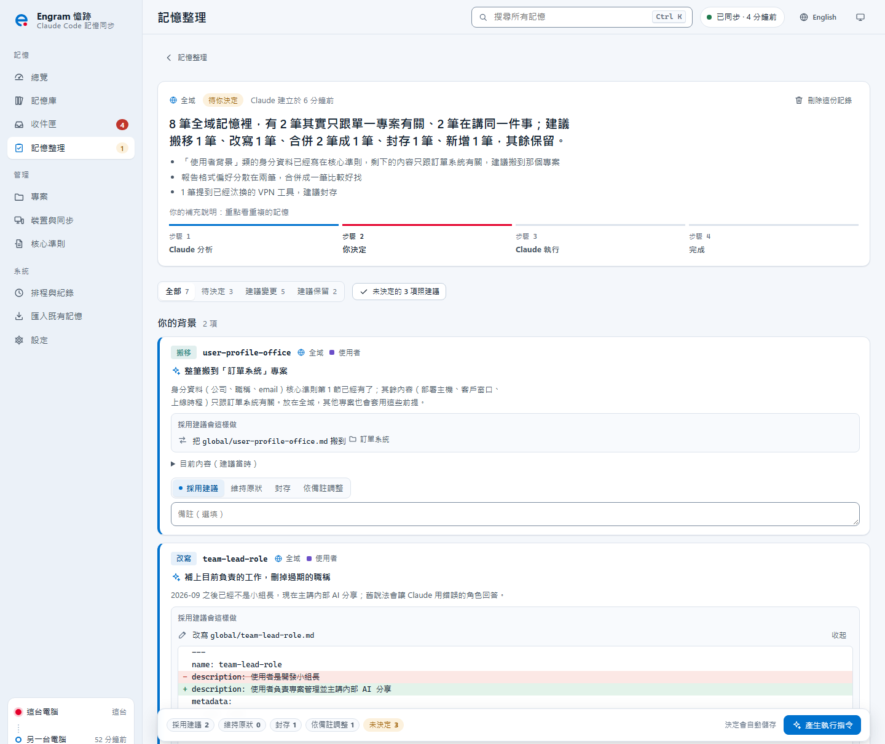
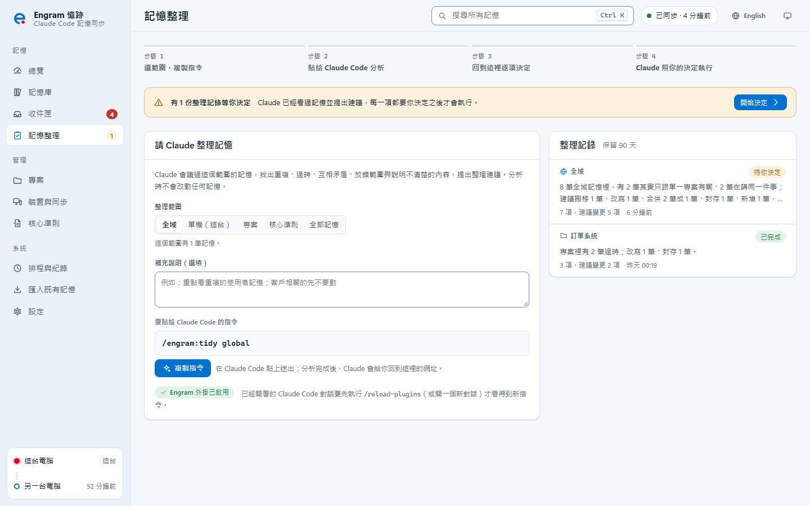

**繁體中文** · [English](en/user-guide.md)

# 使用說明

Engram 安裝好之後幾乎不需要操作。這份說明介紹日常會用到的功能，以及需要你決定時該怎麼做。還沒安裝的話，先看[快速開始](快速開始.md)。

**目錄**：[運作方式](#1-運作方式) · [平常怎麼用](#2-平常怎麼用) · [用 AI 整理](#3-在-claude-code-裡用-ai-整理) · [記憶面板](#4-記憶面板這次對話讀了哪些記憶) · [管理介面](#5-管理介面) · [收件匣](#6-收件匣與健康卡片) · [衝突](#7-衝突怎麼處理) · [資料夾撞名](#8-資料夾撞名) · [核心準則](#9-核心準則) · [暫停、復原與移除](#10-暫停復原與移除) · [更新](#11-更新) · [指令速查](#12-指令速查)

## 1. 運作方式

  

| 概念 | 說明 |
| --- | --- |
| 記憶庫（vault） | 所有記憶集中在 `%USERPROFILE%\.engram\vault`，它是一個 git repo，同步到你 GitHub 上的私人 repo `engram-vault` |
| 三種範圍 | **全域**：所有專案都成立，例如你的偏好。**專案**：只屬於某個專案，例如部署方式。**單機**：只在這台電腦成立，例如安裝路徑、網路設定 |
| 專案 ID | 每個專案有固定的 ID。git 專案用 remote 認，其他資料夾用標記檔認，所以搬家、改名、換電腦都認得 |
| 綁定 | 把專案資料夾接到記憶庫裡對應的位置。git 專案在另一台電腦第一次開 Claude Code 時自動綁定 |

Engram 不修改 Claude Code 本身，只使用官方的記憶資料夾、`CLAUDE.md` 匯入、hooks，以及外掛畫面（記憶面板）。

三種範圍怎麼分？判斷原則只有一句：**換到另一台電腦還成立嗎？** 不成立的放「單機」；成立的話再問**換到別的專案還成立嗎？** 成立的放「全域」，不成立的放「專案」。

  

## 2. 平常怎麼用

什麼都不用做。Claude 照平常記憶事情，Engram 在背景處理其他的事：

| 時機 | Engram 做什麼 |
| --- | --- |
| 對話開始 | 帶入狀態：Claude 知道自己在哪台電腦、哪個專案，也知道全域與單機記憶要寫到哪裡 |
| 對話中 | 專案記憶照官方方式寫；全域與單機記憶由 Claude 用 `engram remember` 寫入，寫完會告訴你 |
| 對話結束 | 整理索引、檢查有沒有疑似金鑰，然後存進記憶庫 |
| 每 10 分鐘（預設） | 和其他電腦交換變更。離線時先存在本機，恢復連線後自動補上。間隔可在設定頁調整 |
| 每天一次（預設 09:30） | 健康檢查，有需要你決定的事就放進收件匣 |

想主動整理時：

- 管理介面的「記憶庫」可以搜尋、編輯，或用「改變範圍」把記憶移到全域、單機或別的專案。重複的記憶會出現在收件匣的「內容相同的記憶」或「可能重複」卡片，在那裡合併。
- 「專案」頁可以看到每個專案的記憶索引（MEMORY.md）離 Claude Code 的載入上限還有多少。
- 「總覽」的「最近一次對話載入了什麼」列出 Claude 實際讀進了哪些檔案、各有多大。想在對話當下看，用 Claude Code 裡的記憶面板（第 4 節）。

## 3. 在 Claude Code 裡用 AI 整理

健康檢查只用規則判斷，只能找出「名稱相同」「檔案太大」這類候選；要不要升級全域、是不是真的重複、還有沒有用，要讀過內容才知道。這些判斷交給你自己的 Claude Code：

| 指令 | 做什麼 | 管理介面的入口 |
| --- | --- | --- |
| `/engram:inbox` | 逐張讀過收件匣的卡片，說明判斷依據與建議，你同意後才執行。加上卡片 id 只處理那一張；加上「自動」會直接處理有把握的項目，同步衝突、疑似金鑰、資料夾綁定與改名、大量刪除、封存與沒把握的項目仍留給你決定 | 收件匣頁首「交給 Claude 整理」、卡片上的「交給 Claude」、衝突卡的「交給 Claude 合併」 |
| `/engram:tidy` | 深度整理全域、單機、一個專案、核心準則、全部範圍或單筆記憶：找出語意重複、過時、互相矛盾、放錯範圍、說明不清楚的記憶，把建議（含修改後的完整內容）存成整理記錄，給你網址到管理介面逐項決定。分析時不改任何記憶（見下方「記憶整理」） | 「記憶整理」頁產生指令；專案頁「請 Claude 整理」、記憶庫「請 Claude 檢查」、核心準則頁「請 Claude 精簡」會帶著範圍開啟這一頁 |
| `/engram:tidy-apply` | 照你在記憶整理頁的決定執行：採用建議的項目照你看過的內容寫入，依備註調整的項目由 Claude 依備註處理，最後回報結果與復原方式 | 記憶整理頁的「產生執行指令」 |
| `/engram:save` | 回顧這次對話，把值得長期記住的事存成記憶：判斷範圍、先查有沒有相近的記憶，有就更新那一筆 | 在對話中使用 |
| `/engram:recall` | 從其他專案、全域與每台電腦的記憶找出相關經驗，整理成可以直接套用的結論並附來源；只讀不寫 | 在對話中使用 |

### 記憶整理：Claude 提建議，你逐項決定

  

1. **選範圍**：在管理介面打開「記憶整理」，選全域、單機（這台）、專案、核心準則或全部記憶，需要的話寫補充說明（例如「重點看重複」「客戶相關的先不要動」），按「複製指令」。
2. **交給 Claude 分析**：在 Claude Code 貼上 `/engram:tidy …`。Claude 讀過記憶，把每一項的建議、理由與修改後的完整內容存成整理記錄，最後給你一個回到管理介面的網址。這一步不改任何記憶。
3. **逐項決定**：每一項可以看 Claude 的建議與理由、「看差異」比對修改前後、展開「目前內容」，然後選：

   | 決定 | 會怎麼做 |
   | --- | --- |
   | 採用建議 | 照你看到的內容執行（改寫、搬移、合併、新增、封存） |
   | 維持原狀 | 不動 |
   | 封存 | 移到歷史，之後可以還原 |
   | 依備註調整 | 在備註寫下要怎麼改，由 Claude 依備註處理 |

   決定會自動儲存，可以分幾次做完。「未決定的照建議」一次把剩下的照 Claude 的建議處理。建議之後記憶被改過（例如另一台電腦同步過來）的項目會標出來；執行時那一項不會寫入（標成失敗），不會覆蓋。
4. **執行**：按「產生執行指令」，把 `/engram:tidy-apply <id>` 貼回 Claude Code。Engram 先把會動到的檔案備份到 `~/.engram/local/backups/`，採用建議的項目照內容執行，依備註調整的交給 Claude；一項失敗不影響其他項。結果回到同一頁，每一項都有「復原這一項」。

  

整理記錄只存在這台電腦（`~/.engram/local/tidy/`），不會同步，90 天後自動清除；在記錄頁可以手動刪除。

安全設計：

- **先提建議、你決定才動手**。`/engram:tidy` 只讀取記憶、建立整理記錄（技能只預先允許這些指令），寫入要等你在記憶整理頁決定、貼上 `/engram:tidy-apply` 之後；收件匣的 `/engram:inbox` 則是先提計畫、你同意才執行。每一筆寫入都附上 `engram undo <版本>`，可以逐項復原。
- **偵測到的金鑰不交給 Claude**。Claude 讀記憶時，疑似金鑰已在這台電腦上換成「‹已遮蔽›」。Engram 也不接受含疑似金鑰的寫入，Claude 會改成只記存放位置。
- **「不是金鑰」由你本人確認**。被誤判的值，請在你自己的終端機執行 `engram not-secret`（在 Claude Code 裡執行會被拒絕）。確認過的值只存雜湊、同步到所有電腦；標錯時用 `engram not-secret --list` 查看、`--remove` 撤銷。
- **讀取之後被改過就不覆蓋**。另一台電腦剛同步過來、或你在介面改過，寫入會被拒絕，Claude 會重新讀取再判斷。

> 剛更新 Engram、已經開著的對話看不到這些指令時，執行 `/reload-plugins` 或開一個新對話。Claude Code 第一次詢問是否允許執行 `engram` 指令時，按允許即可。

## 4. 記憶面板：這次對話讀了哪些記憶

Claude Code 旁邊的面板，即時列出這次對話 Claude 讀進了哪些記憶、讀到多深，讓你知道回答是根據什麼。

  

**開關面板**

| 方式 | 說明 |
| --- | --- |
| 底部的「◆ 憶跡 · 讀取 N」 | 在 Claude Code 底部右側，點一下開關面板。數字是這次對話讀取或搜尋到的記憶數（還沒有時只顯示「◆ 憶跡」）。滑鼠點擊只在全螢幕版面有效（見下方） |
| `/engram-memories` | 在 Claude Code 輸入，任何模式都能用 |
| 自動開啟 | 全螢幕版面、終端機至少 144 欄寬時，新對話會自動開啟。關掉一次之後就不再自動開啟，用上面兩種方式打開即恢復 |

**全螢幕版面**是 Claude Code 預設的畫面（不是把終端機視窗最大化）：面板停靠在對話右側，可以用滑鼠點按鈕與每一列。設了環境變數 `CLAUDE_CODE_NO_FLICKER=0`、或在 tmux 裡執行時，Claude Code 改用一般畫面：面板顯示在輸入框上方，收不到滑鼠點擊，請用指令與鍵盤操作。

**看懂面板**

| 區塊或標記 | 意思 |
| --- | --- |
| 開場載入 | 對話一開始就放進 Claude 腦袋的檔案。`├ └ │` 連接線表示誰用 `@` 匯入了誰，右側是估計的 token 數，標題列右側是合計。送出第一個訊息前這裡是空的；對話被壓縮後標題會變成「壓縮後重新載入（第 N 回合）」 |
| 對話中讀取 | 對話途中 Claude 讀取或搜尋到的記憶，以及 Claude 讀到相關檔案時自動載入的指示檔（例如子資料夾的 CLAUDE.md、符合條件的規則檔）。`#3` 是第 3 回合，● 是這一回合新讀到的，`×2` 是讀了兩次，「子代理」表示由子代理讀取。對話被壓縮後，壓縮前讀取的記憶會調暗，上方標出「內容已整理成摘要」 |
| 全文 | 整份內容在對話裡：CLAUDE.md、CORE.md，以及 Claude 讀取過的記憶 |
| 標題 | 只有標題與一句話說明。開場載入的 INDEX.md、MEMORY.md 都是索引：Claude 知道有這些記憶，但還沒讀內容。「標題 18 則」表示這個索引列了 18 則記憶 |
| 摘要 | `engram search`（或在記憶資料夾裡搜尋）結果裡的說明與一小段內文，沒有讀全文 |
| ⚠ 只看得到前 N 則 | MEMORY.md 超過 Claude Code 的載入上限（前 200 行或 25KB），後面的記憶 Claude 看不到。用收件匣或 `/engram:tidy` 整理 |
| 範圍 | 核心、全域、單機、專案，以及「指示」（CLAUDE.md 與 `.claude/rules`） |

**操作**：點一列看記憶內容，以及它是怎麼、什麼時候進到對話的；`b` 返回、`f` 依範圍篩選、`l` 切換中文與 English（選擇會記住；沒切換過時跟著 Claude Code 的 language 設定，沒設定時是英文）。用鍵盤操作時先按 Ctrl+X Tab 讓面板取得鍵盤，Tab 移動、Enter 選擇，Esc 回到輸入框。

**限制**

- 需要支援外掛畫面（mods）的 Claude Code；實測 2.1.307 至 2.1.309 可用，更早的版本未測試。
- 偵測的是 Read 工具、`cat`／`Get-Content` 這類讀檔指令、`engram search`／`engram memory show`，以及在記憶資料夾裡的搜尋；用其他方式（例如 `grep`、`Select-String` 或寫程式）讀取的不會列出。面板也不判斷回答「實際引用」了哪一則。
- 壓縮的事件被其他外掛略過時，面板改用估計的 token 驟降判斷，可能晚一回合才標出「壓縮後重新載入」，也可能把 `/rewind` 這類大幅縮減對話的操作當成壓縮。
- 面板只在本機讀取，不呼叫 AI，也不送出任何資料。

## 5. 管理介面

在終端機輸入 `engram ui`（在 Claude Code 裡輸入 `! engram ui`），瀏覽器會開啟 `http://127.0.0.1:4777`。介面只在你的電腦上執行，不對外連線。

| 頁面 | 用途 |
| --- | --- |
| 總覽 | 待處理事項、裝置同步軌跡、記憶分布、最近記住的事 |
| 記憶庫 | 依範圍與專案瀏覽、搜尋、編輯、改變範圍、釘選、查看歷史 |
| 收件匣 | 需要你決定的事：衝突、健康檢查卡片；重複的記憶在這裡合併 |
| 記憶整理 | 請 Claude 分析記憶並提出建議，你逐項決定後再交給 Claude 執行；整理記錄與結果（見第 3 節） |
| 專案 | 每個專案的資料夾、綁定方式、記憶數量與索引載入預算；改名、併入另一個專案 |
| 裝置與同步 | 每台電腦的最後同步時間、變更紀錄與復原 |
| 核心準則 | 每次對話都會載入的準則（見第 9 節） |
| 排程與紀錄 | 背景同步、健康檢查、相容性探測的排程與執行紀錄 |
| 匯入既有記憶 | 把 Claude Code 原本的記憶收進記憶庫：產生計畫 → 檢查 → 沙盒演練 → 套用 → 驗證；套用後可選擇同步工作準則（見第 9 節） |
| 設定 | 電腦名稱、同步間隔、自動綁定方式、撞名資料夾處理、健康檢查時間、暫停與移除 |

## 6. 收件匣與健康卡片

Engram 每天檢查一次記憶的狀況，有需要你決定的事就放進收件匣。大多數卡片都有一個主要按鈕可以一鍵處理，也可以選「七天後提醒」或「忽略」。Claude 不會主動提起收件匣，除非你問它。

| 嚴重度 | 卡片 | 意思 | 建議 |
| --- | --- | --- | --- |
| 高 | 索引超過載入上限 | 某專案的記憶索引超過 200 行或 25 KB，後面的不會被 Claude 看到 | 合併或封存舊的記憶 |
| 高 | 疑似含有金鑰 | 這筆記憶不會被同步 | 按「移除金鑰」，再按「遮蔽並恢復同步」：記憶裡的金鑰在本機換成「‹已遮蔽›」後恢復同步；如果不是金鑰，選「這不是金鑰」 |
| 高 | 衝突待處理 | 兩台電腦改了同一筆記憶的同一段 | 見第 7 節 |
| 高 | 偵測到大量刪除 | 一次刪掉某專案一半以上（至少 3 筆）的記憶，Engram 先扣住、沒有同步 | 不是你刻意的，就按「還原」 |
| 高／中 | 記憶連結失效／資料夾撞名 | 某個專案的記憶沒有正確接到記憶庫，或兩個資料夾撞名 | 連結失效：按「重新建立連結」；撞名：見第 8 節 |
| 中 | 內容相同的記憶／可能重複 | 兩筆以上記憶內容相同，或名稱、說明非常像 | 按「合併」，或「並排比對與合併」 |
| 中 | 看起來只適用這台電腦 | 內容提到這台電腦的安裝位置或環境 | 改為單機記憶 |
| 中 | 可能屬於另一個資料夾 | 撞名期間寫錯地方的記憶 | 移到正確的資料夾 |
| 低 | 可能適用所有專案 | 例如你的偏好卻只存在一個專案裡 | 升級為全域 |
| 低 | 可能已過時 | 很久沒更新、專案也很久沒開 | 封存（可以還原） |

需要讀內容才能判斷的卡片有「交給 Claude」按鈕，會給你一個指令，貼到任一個 Claude Code 對話即可。

## 7. 衝突怎麼處理

同一個人很少同時在兩台電腦改同一筆記憶，所以衝突應該很少見。真的發生時：

1. Engram 會自動合併能合併的部分，例如兩邊改了不同段落。
2. 合併不了的，這台電腦保留自己的版本，另一台的版本放進衝突區。兩台電腦都看得到這張衝突卡。
3. 按衝突卡上的「比對並決定」，會並排顯示兩個版本與共同的原始版本。可以選「保留這台的版本」「改用〈另一台〉的版本」「兩者都保留」（另一台的版本另存成 `-2.md`），或直接在左欄編輯後按「儲存左邊的合併結果」。
4. 兩邊各自加了不同的內容、不想自己逐段搬時，按「交給 Claude 合併」，Claude 會說明兩邊各改了什麼，寫出合併版本讓你確認。

Claude 讀到的檔案裡永遠不會出現衝突標記。

## 8. 資料夾撞名

Claude Code 會把資料夾路徑換成一個內部名稱，中文字、空白、底線、點等符號都會變成連字號。所以同一層、字數相同的中文資料夾（例如「甲方專案」和「乙方專案」），或只差在符號的英文資料夾（例如 `my_proj` 和 `my proj`），會共用同一個內部名稱，記憶和對話紀錄就混在一起。這是 Claude Code 本身的限制。

Engram 的處理：

| 做法 | 效果 |
| --- | --- |
| 自動偵測撞名 | 撞名的資料夾不會被錯誤地接在一起 |
| 改用專案設定檔指定記憶位置 | 記憶可以分開；但只在從該資料夾本身啟動 Claude Code 時有效，對話紀錄仍會混在一起 |
| 事後才出現的撞名 | 在對話開頭警告 Claude 不要引用、也不要寫入記憶 |
| **依命名規則改名（根本解法）** | 在原名後面加 4 碼代號，例如「照片優化」改成「照片優化-66ca」。中文名稱照樣看得到，在 Claude Code 裡就不再撞名 |

改名時會一併重新綁定、更新這台電腦寫的記憶裡的舊路徑。為了不影響其他程式，下列資料夾不會自動改名：30 分鐘內有對話或檔案修改、裡面還有其他專案、有 Python 虛擬環境或 git worktree、在 OneDrive 底下，或 Claude Code 為它記了 MCP 伺服器、允許的工具。

在「設定 › 撞名的資料夾」選擇處理方式：

| 選項 | 做法 |
| --- | --- |
| 在收件匣詢問（預設） | 撞名卡片列出建議的新名稱，按「依命名規則改名」才改 |
| 自動改名 | 常駐程式每小時檢查一次，改完發通知 |
| 關閉 | 不改名；記憶仍用設定檔分開，對話紀錄會混在一起 |

想還原：在「裝置與同步」的變更紀錄找到那一筆按「復原」，或執行 `engram collisions undo <id>`（`engram collisions` 會列出最近一次的 id）。

> **改名前要知道**：Claude Code 的對話紀錄也依內部名稱存放。改名後在新資料夾開 Claude Code，`/resume` 清單不會有改名前的對話（它們仍保存在 `~/.claude/projects/` 底下）。記憶不受影響。還想接續的舊對話，請在改名前先完成。

## 9. 核心準則

核心準則（`CORE.md`）是每次對話都會載入的一份文件，所有專案、所有電腦共用。內容包括你的身分與偏好、工作環境清單，以及教 Claude 怎麼把記憶寫到正確範圍的「記憶寫入協定」。

- 在管理介面的「核心準則」頁編輯，或按「請 Claude 精簡」交給 `/engram:tidy` 整理。
- 原本 `~/.claude/CLAUDE.md` 裡的工作準則不會被搬走。希望每台電腦的工作準則一致時：在「匯入既有記憶」頁套用匯入之後，會出現「選用：讓所有電腦共用你的工作準則」，按「同步工作準則」：先預覽搬移後的內容，同意後才搬進記憶庫；之後可以按「改回各台電腦自己的版本」逐位元還原。

## 10. 暫停、復原與移除

| 想做的事 | 怎麼做 |
| --- | --- |
| 暫時停用 | 設定頁的「暫停 Engram」。暫停期間不同步、不自動接上新專案；Claude 照常記憶，恢復後一起處理 |
| 復原某個整理動作 | 動作完成時的通知可以直接按「復原」；記憶整理的項目在整理記錄頁按「復原這一項」；之後也可以到「裝置與同步」的變更紀錄找到那一筆 |
| 還原某次匯入 | 匯入頁的「還原到匯入前」，或 `engram import undo <還原點>`。匯入後才改過或新增的記憶會保留最新版，被取代的舊版另存成 `.pre-rollback` |
| 某個專案不要用 Engram | 在該資料夾執行 `engram unbind`。記憶會複製回 Claude Code 原本的資料夾 |
| 新專案先問我再接上 | 設定頁的「自動綁定專案資料夾」改成「每次都詢問」或「關閉」 |
| 整個移除 | `engram uninstall`：先列出計畫，同意後逐項還原到安裝前。**預設保留記憶庫**，之後重新安裝直接沿用；加上 `--purge` 才會連本機的記憶庫一起刪除（GitHub 上的 repo 不受影響） |

## 11. 更新

1. 取得新版程式：
   - 用 git 安裝的：在 Engram 資料夾執行 `git pull`
   - 用 ZIP 安裝的：下載新版本的 ZIP，解壓縮覆蓋原本的 Engram 資料夾（ZIP 以版本號區分，同一版本重複解壓不會更新）
2. 執行 `engram update`。它會部署新版、重新啟動常駐程式。
3. 已經開著的 Claude Code 對話執行 `/reload-plugins`；新開的對話會直接使用新版。

新版有問題時，`engram update --rollback` 切回上一版。Engram 資料夾搬到別處的話，用 `engram update --from "<新位置>\app"`。

## 12. 指令速查

| 指令 | 做什麼 |
| --- | --- |
| `engram status` | 這台電腦、目前資料夾的綁定與同步狀態 |
| `engram ui` | 開啟管理介面 |
| `engram sync` | 立即同步 |
| `engram doctor` | 逐項檢查環境；加上 `--probe` 另外確認這一版 Claude Code 的行為與 Engram 的假設一致（會使用你的 Claude 額度） |
| `engram search <關鍵字>` | 搜尋所有範圍的記憶 |
| `engram projects` | 列出所有專案 |
| `engram bind` ／ `engram unbind` | 把目前資料夾綁定到專案／解除綁定 |
| `engram import plan` | 產生匯入計畫（`apply --yes` 套用、`undo <還原點>` 還原） |
| `engram collisions` | 列出撞名的資料夾與建議的新名稱（`apply` 改名、`undo <id>` 整批還原） |
| `engram undo <版本>` | 復原一次寫入、移動、封存、合併或衝突處理 |
| `engram tidy list` | 列出記憶整理的記錄（`show <id>` 看內容；`create`、`apply`、`done` 由 `/engram:tidy` 與 `/engram:tidy-apply` 使用） |
| `engram not-secret` | 把被誤判為金鑰的值記入「不是金鑰」清單（只能在你自己的終端機執行） |
| `engram update` | 部署新版本（`--rollback` 切回上一版） |
| `engram uninstall` | 依安裝紀錄還原到安裝前（`--dry-run` 只列計畫、`--purge` 連本機記憶庫一起刪除） |
| `engram help <指令>` | 查看某個指令的完整用法 |

Claude Code 裡的 `/engram:inbox`、`/engram:tidy`、`/engram:tidy-apply`、`/engram:save`、`/engram:recall` 見第 3 節，記憶面板的 `/engram-memories` 見第 4 節。
